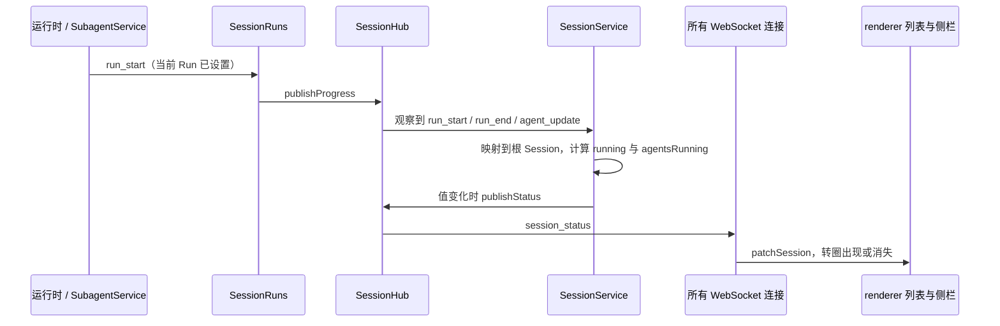

# 会话运行状态广播

## 问题与范围

本设计服务 [spec](spec.md) 的 RUN-01 与 RUN-05：侧栏要为所有根 Session 实时显示“执行中”，包括当前窗口从未打开过的 Session，以及父 Run 结束后后台 Subagent 或 Teammate 仍在运行的 Session。

现在运行状态只通过 entry 和 progress 推给订阅了该 Session 的连接。列表快照只在启动、重连、添加 Workspace、首次发送和交接完成时刷新。

本设计只解决三件事：状态怎么计算、怎么广播、renderer 怎么写入列表。状态栏、标题栏和侧栏的界面细节见 spec。现有的 `activity` 推导和按 Session 订阅的协议不变。

## 来源与约束

**已确认的产品决定**

- spec RUN-01 定义“执行中”，Background Job 不算。
- spec RUN-05 要求实时、面向所有连接、重连后不残留，应用重启后没有“执行中”。

**代码事实**（基线 `560148db`）

- `SessionHub` 把 entry 和 progress 按 Session 发给订阅者。只有 `session_title` 经单独的监听集合发给所有连接，每个 WebSocket 连接建立时登记一次。
- renderer 用 `ServerMessage` 严格校验收到的消息，不认识的类型直接丢弃。
- Session DTO 的 `running` 取自运行时的 `isRunning`。运行时先设置当前 Run，再同步发出 `run_start` 进度。结束时在 finally 中先清除当前 Run，再发出 `run_end` 进度。`run_end` 条目在清除当前 Run 之前提交，所以如果按 `run_end` 条目重算，看到的仍是运行中。
- 运行时的进度经脱敏后，由 SessionRuns 同步调用 `publishProgress`。
- Subagent 状态变化发布到根 Session，形式是 `agent_update`。
  - 派发时，live 状态先登记为 running，然后才开始子 Session 的 Run。
  - 继续对话（rearm）时同样先设为 running，再开始子 Session 的 Run。
  - 结束时先更新状态，再发布 `agent_update`。
- `runningChildren(rootId)` 返回根 Session 下 status 为 running 的 live Subagent 与 Teammate；空闲等待消息的 Teammate 不在其中。
- 子 Session 到根 Session 的映射由现有的权限作用域（`rootSessionId`）提供。
- Background Job 的状态在 Job 服务中，不参与本设计的计算。

**假设**

- 广播的频率受限于 Run 的开始与结束和 Subagent 的状态变化，远低于流式增量，不需要另外节流。
- 桌面端与 Sidecar 同版本发布，不需要支持新旧版本混用。旧 renderer 收到新消息类型时会丢弃，不需要额外处理。

**未决问题**：无。

## 模块责任与依赖

| 模块或进程 | 负责什么 | 不负责什么 | 依赖与消费者 |
| --- | --- | --- | --- |
| protocol | 定义 `session_status` 消息和 Session DTO 的可选字段 `agentsRunning` | 计算或缓存状态 | server 与 renderer 共用 |
| SessionHub（server） | 持有全局广播的监听集合，提供进度观察入口 | 判断状态，或了解 Subagent | 由 SessionService 和 WebSocket 连接使用 |
| SessionService（server） | 计算根 Session 的状态；收到观察到的进度后重算、去重并广播；在 DTO 中写入 `agentsRunning` | 界面，或 `activity` 的推导 | 依赖运行时登记表、SessionRuns 的 `runningChildren`、权限作用域的根映射 |
| WebSocket 连接（server） | 从建立到关闭转发全局广播 | 过滤或缓存 | 依赖 SessionHub |
| chat-store（renderer） | 把收到的 `session_status` 交给列表 store | 为未订阅的 Session 推导状态 | 依赖列表 store |
| 列表 store（renderer） | 写入 `running` 与 `agentsRunning`，用与标题相同的修订号记录每条广播，使之后到达的列表快照和接口 DTO 不覆盖较新的值 | 修改已订阅 Session 现有的运行状态推导 | 由 chat-store 写入 |
| 侧栏（renderer） | 以 `running` 或 `agentsRunning` 为真判断“执行中”，渲染转圈 | 订阅 Session 或计算状态 | 依赖列表 store |

## 关键路径与接口

- **未打开的 Session 中开始与结束 Run**（定时任务、Goal Round）：
  - 开始：`run_start` 进度触发重算，结果为 `running: true`，广播出去，侧栏显示转圈。
  - 结束：`run_end` 进度触发重算，此时运行时已清除当前 Run，`running` 为 false。没有 running 的 Subagent 时广播 `{ running: false, agentsRunning: false }`，转圈消失。
- **父 Run 结束、后台 Subagent 仍在运行**：根 Session 在 `run_end` 后重算为 `{ running: false, agentsRunning: true }`，广播的值从 `{ true, true }` 变为 `{ false, true }`。侧栏保留转圈，可访问名称改为“后台运行中”。Subagent 结束时发布 `agent_update`，重算为 `{ false, false }` 后广播。
- **Teammate 开始新的 Run**：rearm 先把它设为 running，然后子 Session 的 `run_start` 映射到根 Session，重算结果为 `agentsRunning: true`。这个 Run 结束时，`agent_update` 和子 Session 的 `run_end` 都会触发重算；第二次的值相同，被去重。

**接口**

- `session_status { sessionId, running, agentsRunning }`：`sessionId` 是根 Session，两个布尔字段都必填。
- Session DTO 的 `agentsRunning?: boolean`：缺省视为 false。
- 计算是同步的内存读取，不访问存储：
  - `running`：根 Session 的运行时 `isRunning`，没有运行时时为 false。
  - `agentsRunning`：`runningChildren(root)` 非空。前台 Subagent 运行时它也为真，但这时父 Run 同样在运行，转圈名称按“运行中”显示。
- 子 Session 的进度映射到根 Session 后重算，不为子 Session 单独广播。

**去重**

- 每个根 Session 记录最近一次广播的值，只保存非空闲的值（两个字段至少一个为真）。回到 `{ false, false }` 时删除记录。
- 没有记录视为 `{ false, false }`。
- Session 删除或被遗忘时同时删除它的记录。

**renderer 写入**（与标题相同的修订号写法）

- 收到 `session_status` 时，列表 store 立即写入，并以递增的修订号记录这条广播，每个 Session 只留最新一条。
- `load()` 开始时记下当前修订号。快照落地时，修订号更大的记录覆盖快照中对应的两个字段；修订号不大于开始值的记录删除。
- 接口返回的 DTO（例如置顶、移动之后返回的 Session）写入列表时，同样以该 Session 最新的记录覆盖这两个字段。Session 被删除时删除它的记录。

每条广播携带完整的值，不是增量，所以某个 Session 最后收到的那条广播，反映的状态至少与快照取得时一样新；快照之后的任何变化都会另有一条广播。因此删除修订号不大于开始值的记录是安全的。

## 状态 持久化与失败

- **只存在于运行时，不持久化。** 重启后运行时和 live Subagent 都不存在，`running` 与 `agentsRunning` 均为 false，符合 spec RUN-05 的“重启后没有执行中”。去重表同样只在内存中，重启后为空。
- **单个连接发送失败不影响其他连接，也不影响已提交的状态。** 做法与现有的 `session_title` 广播相同。
- **断线期间错过的广播，在重连后补齐。** 客户端重连会重新读取列表快照，并按上面的规则写入；快照本身已经带 `agentsRunning`。
- **同一连接内的消息保持顺序。** 对已订阅的 Session，renderer 先收到 `run_end` 进度，再收到 `session_status`，两者写入的值不冲突。
- **兼容。**
  - DTO 字段可选、缺省为 false。renderer 连接旧服务端时，只是看不到后台转圈。
  - 新消息类型需要 renderer 的严格校验接受，这一处在同批修改。
  - headless 与集成测试的使用方只处理 `entry` 和 `progress`，不受影响。

## 备选方案与选择

| 方案 | 结论 | 理由 |
| --- | --- | --- |
| 观察 hub 上的 `run_start`、`run_end`、`agent_update` 进度，去重后广播 | 选择 | 一个观察点覆盖派发、继续对话、正常结束、取消与失败。代价是依赖运行时与 SubagentService 的三处时序，用集成测试锁住。 |
| 观察每条已提交的 entry | 放弃 | `run_end` 条目在运行时清除当前 Run 之前提交，会重算出过期的“运行中”。 |
| 在各生命周期点显式调用广播 | 放弃 | 调用点分散在派发、继续、结束、解散和 Run 的开始与结束，以后容易漏掉。 |
| renderer 定时轮询列表 | 放弃 | 有延迟又浪费请求，未打开的 Session 仍然滞后。 |
| 广播完整的 `activity` | 放弃 | 侧栏不需要它。审批、恢复等 `activity` 变化走别的路径，要广播它就得增加更多触发点。已订阅的 Session 仍由现有逻辑推导。 |
| renderer 用待补放表，在快照落地后重放 | 放弃 | 列表 store 已有标题的修订号写法，能挡住较旧的快照和 DTO，不需要另建一套机制。 |

## 验证与实施顺序

| 规格场景 | 测试接口或真实入口 | 观察结果 | 依赖与文档影响 |
| --- | --- | --- | --- |
| RUN-05 | 真实 Sidecar 集成测试：一个没有订阅的连接，faux Run | 收到 `session_status` 为 running true，随后为 false | 新的集成测试文件 |
| RUN-01、05 | 同上：后台 Subagent | 父 Run 结束后为 `{ false, true }`，Subagent 结束后为 `{ false, false }` | 同上 |
| RUN-01 | 同上：Teammate 的 Run 结束后进入空闲 | `agentsRunning` 变为 false | 同上 |
| RUN-01 | 同上：只有 Background Job 在运行 | 不因它发出“执行中” | 同上 |
| RUN-05 | 同上：列表快照 | `agentsRunning` 与广播一致 | 同上 |
| RUN-05 | server 单元测试：hub 广播与 SessionService 去重 | 相同的值不重复广播；遗忘 Session 后去重表被清除；DTO 带该字段 | SessionService 的测试 |
| RUN-05 | renderer store 测试：列表加载与广播交错 | 快照落地后，最终状态等于最后一条广播 | chat-store 的测试 |
| RUN-01、05 | E2E：未打开的 Session 中运行后台 Subagent | 侧栏该行出现转圈，Subagent 结束后消失 | WebSocket 消息与 DTO 字段写入所属子系统说明 |

最小端到端切片依次是：protocol 的消息与字段 → hub 的广播与观察入口 → SessionService 的计算与去重 → 集成测试 → renderer 的写入 → 侧栏界面。本设计由实施票 02 实现。撤回前按本设计写的草稿见 [session-status-broadcast.patch](reference/session-status-broadcast.patch)，只通过了类型检查，没有测试。

## 待决问题与确认

无待决问题。

产品语义来自 spec 的 RUN-01 与 RUN-05，用户已两轮确认。2026-11-04，用户确认拆成 9 张实施票：本设计由 02 实现，renderer 改用修订号写法。本文的触发事件、去重、DTO 可选字段和 renderer 的修订号写入，都是这一确认范围内可逆的实现选择，因此本设计在确认时为 `approved`，当前交付状态见下节。

## 交付记录

2026-11-04 已本地交付本设计，实施与检查见 [02](issues/02-session-status-broadcast.md)，最终组合复核见 [09](issues/09-integrated-acceptance.md) 与 [spec 的联合验收记录](spec.md#联合验收与交付记录)。真实 Sidecar 验证未订阅连接、根 Run、后台子代理等待审批与取消、Teammate idle/rearm、Background Job 排除及重启；renderer 验证广播与快照/DTO 交错，最终 Electron 与静默 CDP 验证未打开会话的侧栏指示。不把本地实现表述为已推送、主分支合并或发布。
