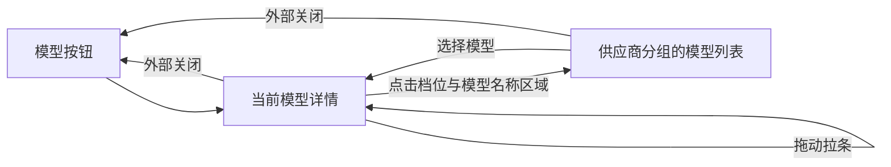

# 对话列表与新对话界面 PRD

Status: ready-for-agent

本文是本功能唯一维护的需求正文，汇总用户截至 2026-11-02 在本会话中提出的要求及其后续修订。UI、样式和各状态的视觉以 [双栏布局.pen](../../docs/ui/双栏布局.pen) 为依据，组件约束沿用 [界面约定](../../docs/tech-stack/ui.md) 与 [设计系统规格](../../docs/tech-stack/ui-design-system.md)。

本文维护已批准的产品行为；当前本地实施与验证状态见 16.2 和 20.2。用户已明确提出的交互写入功能要求；2026-11-02 需求澄清中确认的规则已写入对应章节，汇总见 16.1。用户于 2026-11-02 确认了全部待决项，本文因此为 `approved`。批准只表示需求已确定，不表示已交付；批准与实施分别记录；后续状态见 16.2。2026-11-03 按 to-spec 补齐了完整的用户故事（3.1）、实施决定（第 17 节）、测试决定（第 18 节）与非目标（第 19 节），分拣状态为 ready-for-agent，同日按 to-tickets 拆为同目录 `issues/` 下的 01 至 23 号实施票；行为以第 4 至 15 节为准。

## 1. 背景、目标与范围

### 1.1 用户问题

用户需要在一个稳定的桌面工作台中管理独立对话和项目内对话，快速定位、置顶和组织已有会话，并在发送第一条消息前明确本次对话的项目归属、模型、推理档位、权限模式、分支与工作树配置。

现有讨论反复修订了分类标题、列表密度、展开收起、悬浮菜单、输入区与浮层位置。本 PRD 将最终要求合并，避免实现时继续混用早期截图或已撤回的方案。

### 1.2 本轮目标

- 提供“左侧导航与列表 + 右侧内容”的双栏工作台。
- 统一置顶、对话、项目分类及各层级列表项的展示和交互。
- 支持项目创建、编辑、排序、展开、置顶及项目内新对话。
- 支持会话详情预览、置顶、更多操作及长标题滚动。
- 提供完整的新对话欢迎页和主输入区，发送前配置会话归属、权限、模型与推理档位。
- 支持项目分支选择、创建并检出分支，以及新建工作树配置。
- 全部界面遵守项目设计系统；示例数据脱敏；界面与 Tooltip 均不展示快捷键。

### 1.3 范围边界

| 范围 | 本文覆盖 | 本文不扩展 |
| --- | --- | --- |
| 工作台 | 双栏外壳、启动 Loading、窗口控制区、侧栏收起、前进后退入口、底部设置入口 | 各平台窗口管理的完整实现方案 |
| 侧栏 | 三类列表、对话标题搜索、分类拖拽、列表展开收起、项目和会话操作、归档 | 插件页、定时任务页的业务内容 |
| 新对话 | 欢迎内容、输入区、归属栏、权限、模型与推理档位、发送前配置、上下文统计的分类口径（CTX-03）；已有对话的输入区复用同一主输入框（NEW-09） | 已有对话消息流、工具卡、diff、审批卡、Goal、Plan 审阅页的重新设计 |
| 项目 | 名称、多个源文件夹、详情、编辑、置顶、排序、项目下会话；与 Workspace 的映射见 [ADR 0020](../../docs/adr/0020-projects-organize-workspaces.md) | 自动导入真实项目、修改或删除源文件夹内的文件 |
| 模型 | 消费已配置供应商及模型目录、会话内模型和档位选择 | 创建供应商、凭据管理和获取模型；这些由 [模型服务 PRD](../model-service-settings/spec.md) 负责 |
| 权限与 Git | 用户可见选择与反馈、边界衔接 | 重新定义审批流水线、沙箱和 Git 执行架构 |

## 2. 依据与最终修订

### 2.1 依据优先级

1. 本会话中用户后续的明确修订覆盖此前相反要求。
2. 当前 [双栏布局.pen](../../docs/ui/双栏布局.pen) 的实际画面与规则说明用于确定 UI；旧截图中的真实名称、路径、模型和人名只是参考素材。
3. 本文明确的交互要求用于验收；未定义行为按现有有效技术约束执行，涉及新产品语义时按第 16 节确认。
4. 画布中的早期注释不能覆盖实际几何及较新的画布规则：列表项浮层间距为 2px，输入框高度为 120px。
5. 原型用于体验核对，不构成生产实现或后端行为的证明。

### 2.2 必须采用的最终版本

| 主题 | 最终要求 |
| --- | --- |
| 新建入口 | “新建任务”改为“新对话” |
| 顶部侧栏菜单 | 仅保留新对话、插件、定时任务；移除专家、远程控制、更多 |
| 分类标题 | 与列表处于同一内容左边缘；字号与列表标题一致，不使用辅助小字档位 |
| 分类右侧操作 | 只展示明确要求的按钮；置顶分类无右端操作，对话分类提供拖拽与创建新对话，项目分类提供四个指定按钮 |
| 置顶分类 | 标题参考最新截图的灰色与左对齐；会话有聊天图标，项目有文件夹图标 |
| 图标 | 聊天统一使用圆形气泡；置顶统一使用斜图钉，针尖朝左下 |
| 列表项、顶部三个菜单 | H32；分类列表项 R8 圆弧；hover 背景覆盖整行 |
| 展开、折叠 | 使用小型纯文字操作，左对齐，依照画布，不使用大字号或自行增加箭头图标 |
| 项目、会话浮层 | 详情卡片和点击更多打开的菜单在对应行右侧，顶部对齐，表面间距 2px；右键打开的会话菜单改用鼠标坐标定位 |
| 新对话输入区 | 会话归属栏在顶部；工具栏在主输入框底部。“工具栏整体移到顶部”的方案已撤回 |
| 主输入框 | 高度 120px；工具栏图标与文本在同一水平线上，垂直居中 |
| 删除的入口 | 不展示四个场景快捷按钮、语音输入按钮和右上角帮助图标 |
| 权限菜单 | 直接展示三个选项，不展示顶部说明文案 |
| 二级菜单 | 父菜单保留时，子菜单在更高层叠加并与父菜单重叠 |
| 移到项目二级菜单 | 紧贴“移到项目”触发项右侧，间距 0px、顶部对齐；触发项右端保留向右箭头 |
| 会话行状态 | 只展示视觉稿中的内容：不显示运行中、待审批等状态点和分支 chip，列表不按状态上浮；排序按 LIST-12 |
| worktree 管理 | 不保留侧栏的 worktree 列表与移除入口；“在新 worktree 中新建会话”由归属栏的“新建工作树”开关取代 |

## 3. 用户故事与对象

### 3.1 用户故事

按主题分组，编号连续，供实施票引用；括号内为对应的规则。

**工作台与导航**

1. 作为用户，我希望左侧是导航与列表、右侧是当前内容，以便边看列表边工作。（NAV-01）
2. 作为用户，我希望用后退、前进在去过的会话、新对话、插件和定时任务之间切换，以便回到刚才的位置。（NAV-02）
3. 作为用户，我希望能收起侧栏，以便在窄窗口里留出内容空间。（NAV-02）
4. 作为用户，我希望侧栏顶部只有新对话、插件、定时任务三个入口，以便不被用不到的入口干扰。（NAV-03、NAV-07）
5. 作为用户，我希望设置入口固定在侧栏底部，以便列表再长也能找到设置。（NAV-04、NAV-05）

**分类与列表**

6. 作为用户，我希望对话分为置顶、对话、项目三类，以便分清常用、独立和项目内的工作。（4.2）
7. 作为用户，我希望折叠和展开分类，以便只看当前关心的部分。（LIST-02、LIST-05）
8. 作为用户，我希望拖动分类调换“对话”和“项目”的顺序，以便按习惯排列。（LIST-04）
9. 作为用户，我希望列表默认显示 5 条、每次展开多显示 5 条、可以折叠回去，以便长列表不挤占侧栏。（LIST-08）
10. 作为用户，我希望对话按最后活动时间排序，以便最近的工作在最上面。（LIST-12）
11. 作为用户，我希望点击项目行就在下方展开它的对话，并能一次收起或展开所有项目，以便快速浏览项目。（LIST-06、LIST-07）
12. 作为用户，我希望项目可以按创建时间或最近使用排序，以便按需要找到项目。（PROJ-01）
13. 作为用户，我希望 hover 对话时看到完整标题、相对时间和所属项目，以便进入前确认是哪一个。（CHAT-02、CHAT-03）
14. 作为用户，我希望长标题可以横向滚动并有渐隐提示，以便读完标题又不误触行尾按钮。（CHAT-04、CHAT-05）
15. 作为用户，我希望重启后分类顺序、展开状态、项目排序和上次打开的对话都恢复，以便接着之前的状态工作。（STATE-01）

**置顶**

16. 作为用户，我希望置顶单个对话或整个项目，以便常用的内容一直在最上面。（CHAT-06、CHAT-07）
17. 作为用户，我希望置顶的对象只出现一次并保留原来的项目归属，以便取消置顶后回到原位。（4.2、CHAT-08、LIST-11）

**项目**

18. 作为用户，我希望用一个名称和多个源文件夹创建项目，以便把分散在几个目录里的代码放在一起处理。（PROJ-02 至 PROJ-06）
19. 作为用户，我希望指定并更换项目的主要文件夹，以便新对话在正确的目录中运行。（PROJ-16、PROJ-18）
20. 作为用户，我希望选择的主要文件夹已属于另一个项目时直接打开那个项目，以便不会出现两个指向同一目录的项目。（PROJ-15）
21. 作为用户，我希望 hover 项目时看到对话数、全部源文件夹路径和编辑入口，以便不打开设置就了解项目。（PROJ-08 至 PROJ-10）
22. 作为用户，我希望编辑项目时看到已保存的名称、文件夹和主要标记，放弃未保存的修改前先确认，以便不误丢修改。（PROJ-07、PROJ-12、PROJ-13）
23. 作为用户，我希望在行内直接重命名项目和对话，以便不打开额外的弹窗。（CHAT-17）
24. 作为用户，我希望在项目下新建对话时自动归入该项目，以便少一步选择。（PROJ-14）
25. 作为用户，我希望在 Finder 中打开项目的主要文件夹，以便用其他工具查看文件。（PROJ-18）
26. 作为用户，我希望项目内的对话读取项目的其他源文件夹不需要审批，以便 Agent 能跨目录理解代码。（PROJ-17）
27. 作为用户，我希望删除项目前知道运行中的对话会被停止、记录和文件都会保留，以便放心整理项目。（PROJ-19）
28. 作为用户，我希望同名项目在菜单中附带主要文件夹的目录名，以便分清它们。（PROJ-20）

**会话管理**

29. 作为用户，我希望点“更多”和右键打开同一套菜单，右键时菜单出现在鼠标处，以便顺手操作。（CHAT-10、CHAT-12）
30. 作为用户，我希望把对话移入、移出项目，或从选择的文件夹新建项目并移入，同时工作目录不变，以便整理归属而不打断进行中的工作。（CHAT-11、CHAT-19、CHAT-20）
31. 作为用户，我希望归档不再使用的对话，并在设置里打开、恢复或删除它们，以便列表保持整洁又不丢记录。（CHAT-16）
32. 作为用户，我希望删除对话前得到确认，并知道子智能体对话会一起被永久删除，以便不误删。（CHAT-13、CHAT-14）
33. 作为用户，我希望对话有进行中的工作时，归档或删除被拒绝并说明原因，以便不中断正在运行的任务。（CHAT-15、CHAT-16）
34. 作为用户，我希望新对话首次发送后自动得到一个概括意图的短标题，手动改过的标题不被覆盖，以便列表一眼可读。（CHAT-18）

**搜索**

35. 作为用户，我希望打开搜索就看到最近 10 个对话，以便快速回到最近的工作。（SEARCH-02、SEARCH-09）
36. 作为用户，我希望输入标题片段就能找到对话，以便不必记住完整名称。（SEARCH-03）
37. 作为用户，我希望结果显示所属项目和相对时间，且每个对话只出现一次，以便分清相似的对话。（SEARCH-04、SEARCH-05）
38. 作为用户，我希望用方向键、Enter 和 Escape 操作搜索，中文输入法组合期间不误确认，以便全程不离开键盘。（SEARCH-07、SEARCH-08）

**新对话**

39. 作为用户，我希望新对话只有一份草稿，切走或重启后文字、附件和配置都还在，以便随时回来继续写。（NEW-01、MODEL-12）
40. 作为用户，我希望发送前选择独立对话或某个项目，以便对话从一开始就在正确的位置。（DEST-01 至 DEST-04）
41. 作为用户，我希望新的独立对话有自己的专属目录，以便它产生的文件不与其他对话混在一起。（3.2）
42. 作为用户，我希望打开欢迎页或修改配置不产生对话，首次发送才创建，以便列表里没有空对话。（NEW-08）
43. 作为用户，我希望首次发送失败时草稿和配置都保留，重试只产生一个对话，以便放心重试。（NEW-08）
44. 作为用户，我希望通过选择、粘贴或拖入添加附件，模型不支持图片时被明确拒绝，以便知道附件如何交给 Agent。（NEW-07）
45. 作为用户，我希望已有对话使用同一个输入区，运行中可以停止，以便两处的操作方式一致。（NEW-09）

**权限**

46. 作为用户，我希望直接从三种权限模式中选择并看到每种的说明，以便清楚 Agent 能做什么。（PERM-01 至 PERM-03、PERM-05）
47. 作为用户，我希望按钮如实显示 read-only 或计划模式，计划模式可以一键退出并回到之前的模式，以便按钮不误导我。（PERM-04、PLAN-01 至 PLAN-04）

**模型与推理档位**

48. 作为用户，我希望先看到当前模型和档位的详情，再从按供应商分组的列表中切换模型，以便确认正在用什么。（MODEL-03 至 MODEL-06）
49. 作为用户，我希望拖动拉条选择推理档位，并从粒子的数量和流速感知强度，以便直观地调整。（MODEL-07 至 MODEL-10）
50. 作为用户，我希望只能选当前模型支持的档位，模型失效或没有模型时得到明确提示和配置入口，以便不向不存在的模型发请求。（MODEL-11）
51. 作为用户，我希望新对话默认用第一个模型、档位关闭，以便不做任何设置也能开始。（MODEL-12）

**上下文**

52. 作为用户，我希望在输入框看到上下文用量环，并能展开按系统、提示词、助手、思考、工具五类划分的明细，以便知道上下文花在哪里。（CTX-01 至 CTX-03）
53. 作为用户，我希望用量接近预警线和压缩阈值时环的颜色变化，以便预见自动压缩。（CTX-04）

**分支与工作树**

54. 作为用户，我希望为新对话选择分支，不新建工作树时直接切换主要文件夹的分支，以便在想要的分支上工作。（GIT-01 至 GIT-03）
55. 作为用户，我希望有未提交的改动或忙碌的会话时，切换分支被拒绝并说明原因，以便不打断其他工作或丢失改动。（GIT-03）
56. 作为用户，我希望开启“新建工作树”后，对话在从所选基础分支创建的 worktree 中进行，且首次发送时才创建，以便实验不影响主检出。（DEST-07、GIT-03）
57. 作为用户，我希望创建并检出新分支时校验名称，并能保存全局的分支名前缀，以便符合团队的命名习惯。（GIT-04 至 GIT-07）

**可访问性与外观**

58. 作为用户，我希望所有图标按钮、菜单和弹窗都能用键盘操作并有可访问名称，以便不依赖鼠标。（13.2）
59. 作为用户，我希望界面与 Tooltip 不显示快捷键，以便界面保持简洁。（1.2、13.2）
60. 作为用户，我希望浅色和深色主题都清楚可读，并遵从减少动态效果的系统设置，以便长时间使用舒适。（13.2、MODEL-10）

**升级与安全**

61. 作为用户，我希望升级后每个原有的 Workspace 成为单文件夹项目，原有对话都在其中，以便不必重新整理。（ADR 0020）
62. 作为用户，我希望附加文件夹仍受拒绝规则和受保护路径约束，以便添加文件夹不会绕过已有的安全规则。（PROJ-17）
63. 作为用户，我希望自动生成标题的请求不带出已登记的 Secret，日志也不记录标题与消息原文，以便自动标题不成为新的泄露途径。（CHAT-18）

### 3.2 页面对象与含义

沿用 [术语表](../../GLOSSARY.md) 中的 Session、Standalone Session、Workspace、Project、Provider、Model Catalog、Thinking Level 与 Worktree。下表只说明本页面用词。

| 页面用词 | 含义与边界 |
| --- | --- |
| 对话 / 会话 | 界面称“对话”，业务对象沿用 Session；不另建一套与 Session 平行的聊天对象 |
| 独立对话 | 即 Standalone Session：没有项目归属；新建的独立对话在 Coko 于首次发送时创建的专属目录中工作（[ADR 0020](../../docs/adr/0020-projects-organize-workspaces.md)） |
| 项目 | 即 Project：侧栏的组织与创建入口，有名称和多个源文件夹；主要文件夹对应一个 Workspace，项目内的新会话在其中运行（ADR 0020） |
| 源文件夹 | 用户显式添加到项目的本机目录；其中一个显示“主要”标记，主要文件夹在所有项目中唯一。附加文件夹的权限见 PROJ-17，主要文件夹的指定与更换见 PROJ-16、PROJ-18 |
| 分类 | 置顶、对话、项目三个导航分组；分类折叠不改变对象或项目归属 |
| 置顶 | 改变对象在导航中的展示位置，不复制对象、不清除会话的原项目关联 |
| 新对话草稿 | 首次发送前的输入与配置状态；不将打开欢迎页直接等同于已经创建 Session |
| 推理档位 | Thinking Level 的界面名称；顺序为关闭、最低、低、中、高、极高、最大 |
| 会话归属栏 | 主输入框顶部用于选择独立对话 / 项目，并进入分支与工作树设置的一行控件 |

### 3.3 需要一致维护的状态

分类展开状态、列表“显示更多”状态、单个项目展开状态、当前会话、项目归属、置顶状态、排序方式、输入草稿、权限模式、模型与档位、分支和工作树开关相互区分。例：收起分类不能取消项目置顶；置顶会话不能丢失项目关联；只打开菜单不能改变当前选择。

持久化范围和跨重启恢复规则见 5.4。第 17 节的实施决定只写到模块、数据归属与接口语义，不指定数据库表、字段名或 API 路径。

## 4. 工作台与侧栏导航

### 4.1 双栏外壳

**BOOT-01**：应用启动时先展示 Loading 界面，参考用户提供的启动图：浅色共享背景、应用窗口四角 R28、左上保留 macOS 三色按钮；页面中央使用现有 `brand/rukie-avatar.png` 角色图，250 × 250px、保持比例并作圆形裁剪，在整个窗口中水平和垂直居中；直接展示原图，不带欢迎页的底部渐隐层或渐变蒙版。不展示工作台侧栏、其他顶栏按钮、输入框、加载文案、额外图标或虚构进度。

**BOOT-02**：工作台初始化及必要资源就绪后切入正常双栏工作台，保留窗口按钮的位置，不在未就绪时允许操作工作台；为辅助技术提供“应用正在启动”的状态。真实产品不增加人为最短等待。当前交互原型模拟等待 1.2 秒，底部原型控制区提供“预览启动 / 进入工作台”以重放或提前结束，不改变已有草稿与列表数据；这些按钮不进入产品 UI。`?startup=hold` 可固定查看启动样式。此原型不证明 Electron 的真实启动流程已接入。

**NAV-01**：左侧为导航与列表，右侧为当前内容。左侧栏采用 deepseek-harness 的半透明磨砂玻璃背景与淡蓝紫渐变，具体材质和降级按设计系统的侧栏磨砂玻璃规则；文字和图标不参与模糊，右侧内容区保持不透明。新对话时右侧展示欢迎与输入区；选择已有会话时右侧进入该会话。整个窗口四角均有圆角，包括右上和右下；不能用矩形内容层覆盖右侧圆角。

**NAV-02**：侧栏固定展开时，左上从 macOS 三色窗口控制按钮之后依次排列后退、前进、收起侧栏。侧栏收起后，顶部顺序按最新参考改为三色窗口控制按钮、展开侧栏、后退、前进、新对话；各图标按钮与窗口控制按钮垂直居中，处于同一水平线上，顶部栏不绘制底部边框。新增的新对话按钮使用编辑形状图标，点击进入独立新对话并清除项目、分支和工作树选择，沿用单份草稿规则。保留窗口控制按钮位置，按两种状态的画布设置间距、图标大小和线宽，不因重新排版而改变各状态的顺序。没有可前进的历史时展示禁用态。前进后退只记录右侧内容区去过的位置：会话、新对话、插件和定时任务。历史只保存在内存中，重启后不保留，也不包括设置页；已删除或已归档的会话在历史中跳过。

**NAV-03**：侧栏顶部保留“新对话”“插件”“定时任务”三个菜单项，三项高度与列表项相同。“插件”的前导图标统一使用 Lucide `at-sign`，沿用 14px 尺寸、1.1 线宽与原有对齐。新对话行右侧提供搜索会话图标；新对话默认与其他导航项同为透明背景，不因当前处于新对话页面而常驻高亮。hover 新对话名称、前导图标或行内空白时，整行使用共享 accent 背景，包括右侧搜索按钮区域，搜索按钮自身不叠加第二层背景；hover 搜索按钮时，仅搜索按钮使用 accent 背景，整行恢复透明。两种 hover 状态互斥，切换不改变布局，搜索与新对话各自响应点击。不增加专家、远程控制或更多菜单。

**NAV-04**：底部设置区域固定于侧栏底部，上方有细分隔线。展示左侧设置图标和紧随其后的“设置”文本，不展示头像、用户名或右侧独立按钮。整行可点击，图标与文字垂直居中；默认背景透明，仅 hover 显示共享 accent 背景，状态切换保持几何稳定；间距与圆角按照画布。列表内容在中间区域滚动，不挤压底部设置区。

**NAV-05**：设置入口跳转方式沿用 [模型服务 PRD 的整页设置约定](../model-service-settings/spec.md#21-设置布局)，返回应用应保留会话草稿与列表状态，不重新引入旧的设置 modal 方案。

**NAV-06**：点击“新对话”右侧的搜索图标，打开第 4.3 节的对话搜索浮层。该入口不触发创建新对话。

**NAV-07**：“插件”“定时任务”在右侧内容区打开，侧栏保持可见；内容先复用现有设置分区。两个页面的业务设计由各自的功能维护。

**NAV-08**：侧栏收起时，鼠标 hover 顶部“展开侧栏”按钮后显示完整侧栏悬浮卡片；卡片覆盖在内容区前方，不挤压或重排右侧内容，不将侧栏自动固定展开。卡片采用白色共享浮层材质、R28 外框与 prominent elevation，宽度沿用 280px，最多占满窗口可用高度；内部列表滚动、底部设置区固定。复用现有导航、分类、搜索、项目与对话操作，项目名称、会话标题均使用脱敏示例。指针从触发按钮移入卡片时保持打开，移出触发器、卡片及其关联浮层后关闭；菜单打开期间保持卡片，外部点击或 Escape 可关闭。点击侧栏按钮才恢复固定双栏；从浮卡选择内容后保持侧栏收起。Tooltip 只显示“展开侧栏”，不展示快捷键，也不恢复参考图中的额外导航或闪电按钮。

### 4.2 三类列表

| 分类 | 内容 | 行首表达 |
| --- | --- | --- |
| 置顶 | 已置顶的项目与会话；各对象只出现一次 | 会话用聊天气泡；项目用文件夹；展开项目继续显示其所属会话 |
| 对话 | 未置顶的独立对话 | 标题直接左对齐，不预留前导图标空槽 |
| 项目 | 未置顶项目，项目展开后展示未单独置顶的所属会话 | 项目用文件夹；所属会话保留空图标槽，文字与项目名对齐 |

置顶区的项目和会话混排，按置顶时间排列，最近置顶的在最上面，之后不随活动重排。没有置顶项时，整个置顶分类连同标题都不显示；“对话”与“项目”分类为空时仍显示标题，保留创建入口。不会因为置顶而创建新的 Session 或项目记录。

### 4.3 对话搜索浮层

2026-11-02 补充确认：按用户提供的两张搜索参考图增加搜索浮层，移除 Tabs；默认只显示最近对话，输入关键词后按对话标题模糊匹配。参考图中的“建议”操作与操作搜索不属于本次对话搜索范围。

**SEARCH-01**：点击新对话行右侧搜索图标后，在当前工作台前方打开共享模态浮层，保留可识别的背景并使用共享遮罩。输入框获得焦点，placeholder 为“搜索对话…”，不使用“搜索操作或对话”。

**SEARCH-02**：每次打开时关键词为空，只展示“最近对话”分组及最近会话列表；不显示常用搜索 / 资产搜索 Tabs，不显示建议、新建任务、打开文件夹或设置等操作，不显示快捷键。

**SEARCH-03**：输入非空关键词后，列表即时切换为“对话”匹配结果。模糊匹配基线为标题包含关键词，不要求输入完整标题；忽略首尾空白和英文大小写。只匹配会话标题，不匹配消息正文、项目名称、操作名称或附件内容。

**SEARCH-04**：搜索范围包含独立对话、项目内对话和已置顶会话；同一 Session 按身份去重，不能因为置顶和项目关联出现多行。已归档的对话不参与搜索，只能从设置的“已归档对话”中找到（CHAT-16）。

**SEARCH-05**：结果行左侧为统一聊天气泡图标，随后为标题；右侧展示所属项目标签（仅项目内会话）及相对时间。独立对话不伪造项目标签。关键词命中部分使用共享语义色高亮，hover / 键盘当前行采用共享背景；不展示正文摘要、Tabs 或额外操作列。长标题截断时保留可读取完整标题的可访问名称。

**SEARCH-06**：清空关键词后恢复最近对话。无匹配时保留输入，显示“未找到匹配的对话”和“试试其他关键词”；没有最近会话时展示“暂无最近对话”，不能用建议操作填充。

**SEARCH-07**：点击结果或键盘确认后关闭浮层，在右侧打开对应的已有会话；保留其项目关联和置顶状态，不创建副本、不触发新对话。关闭而未选择时保持原内容，并恢复搜索按钮焦点。

**SEARCH-08**：支持方向键移动当前结果、Enter 确认、Escape 关闭，以及外部点击关闭；这些按键不印在界面中。中文输入法组合期间不触发确认，组合结束后更新匹配结果。

**SEARCH-09**：最近列表与匹配结果都按会话的最后记录时间降序排列（LIST-12）。关键词为空时显示最近的 10 个对话，没有“加载更多”；输入关键词后列出全部标题匹配的对话。结果超过浮层可用高度时只滚动结果列表，输入框保持可见。

**SEARCH-10**：基准浮层宽 640px、高 432px，外框 R28、白色共享浮层材质，内边距 12px；搜索框 H40/R12，结果行 H32/R8 圆弧，正文 13/20，分组标题和项目 / 时间为 12/18。窗口不足时按共享浮层规则收敛可用宽高，不按参考图的双倍像素尺寸直接放大控件。

**SEARCH-11**：搜索浮层的设计示例标题统一使用“示例对话 · A01”“示例对话 · B02”等中性占位名称；脱敏同时覆盖画布图层名称、交互示例和标题匹配展示。运行时用户搜索自己的会话仍展示其真实标题，不把示例脱敏误实现为产品对真实标题的隐藏。

## 5. 分类、展开收起与列表密度

### 5.1 分类标题状态

**LIST-01**：置顶、对话、项目三个分类的标题栏统一使用上外边距 8px、下外边距 8px；分类之间不额外叠加原有分组间距，首个分类也遵循同一规则，折叠与展开时保持标题栏外边距。分类标题与下方列表的内容左边缘对齐；标题使用与会话名称、项目名称相同的 `text-ui-body` 字号与行高。置顶标题采用画布中的弱化颜色，不据此降为 small / caption。

**LIST-02**：分类展开时，向下箭头仅在标题栏 hover / focus 时出现在名称后；分类折叠时，向右箭头常驻。点击置顶、对话、项目任一分类的整行标题栏（包含名称、箭头与空白区域）均切换展开状态，分类内容随之隐藏或恢复；右侧操作按钮和拖拽手柄保持独立，不触发分类切换。

**LIST-03**：分类右端按钮仅在该标题栏 hover / focus 时显示；点击图标按钮不能连带触发分类折叠。

| 分类 | 名称旁的箭头 | 标题栏右端操作 |
| --- | --- | --- |
| 置顶 | 展开 hover 向下；折叠向右常驻 | 无拖拽、新建、更多等按钮；不能依据早期参考图中的省略号增加操作 |
| 对话 | 同上 | 拖拽手柄、创建新对话（编辑形状图标，不使用加号） |
| 项目 | 同上 | 展开 / 收起所有项目、拖拽手柄、项目排序（省略号图标）、创建项目（加号），共四项 |

**LIST-04**：鼠标在拖拽手柄按住左键不松，上下拖动分类，释放后完成顺序调整。按住时立即展示跟随鼠标右下方的悬浮小卡片，包含六点拖拽图标与当前分类名称（“对话”或“项目”）；卡片使用白色共享浮层材质，H32/R12、左右内边距 12px、图标 14px、图文间距 8px，正文 13/20；图标与名称容器垂直居中，名称用 H28、下内边距 2px 的文字容器完成字面上移 1px 的光学校正。卡片相对指针偏移 12px，靠近窗口边缘时避让，且不拦截鼠标；移动时跟手更新位置。原分类保持已有拖拽弱化，合法插入位置显示主题 ring 蓝色的横向指示线和左端空心圆点；线高 2px、两端圆弧，圆点直径 8px、描边 1.5px、白色中心，与线垂直居中。指示线按指针落点切换至目标分类之前或之后，位于分类间的留白中，保持可见且不改变布局；小卡片叠加在线条之上，悬浮卡片不显示分类右侧的其他操作。松开后移除卡片并完成排序；未发生有效移动时不改变顺序，取消、失去指针捕获、Escape 或窗口失焦时移除卡片并保留原顺序。拖拽手柄不是菜单。置顶没有拖拽入口，固定在最上方；拖拽只能调换“对话”与“项目”两个分类的顺序。

### 5.2 三种不同的展开动作

**LIST-05**：分类折叠只隐藏整个分类内容，不改变项目自身展开状态，也不改变“显示更多”的范围。

**LIST-06**：点击项目行，在该行下方展开该项目的会话列表；文件夹图标切换为打开状态。再次点击收起。不能打开为项目详情页或另一个项目列表；点击行内更多、新对话按钮不会触发该切换。

**LIST-07**：项目分类标题栏的“收起所有项目”收起各项目的会话。全部收起后按钮切换为“展开所有项目”；展开全部时恢复各项目会话层级。它不等同于折叠“项目”分类，也不等同于底部“展开更多项目”。按钮只作用于项目分类内的项目，不影响置顶区的项目；只要有一个项目展开，就显示“收起所有项目”，全部收起后才显示“展开所有项目”。

**LIST-08**：列表底部的“展开”“折叠”控制可见列表项数量，使用截图中的纯文字样式，位于列表左侧，不使用大按钮、胶囊或自行添加的图标。会话列表、项目列表和项目内会话列表的显示更多状态分别管理；画布中同时呈现“展开”“折叠”时保持同一行并左对齐。三个列表各自默认显示 5 条，每点一次“展开”多显示 5 条，“折叠”回到 5 条；还有未显示的项时才出现“展开”，显示超过 5 条时才出现“折叠”。置顶分类始终全部显示。

### 5.3 行与 hover

**LIST-09**：各分类下的项目、会话和所属会话，以及顶部三个菜单项统一高 32px。列表行间距 2px，R8 圆弧，normal 透明；hover 使用共享 `accent` 表面，覆盖整行。selected 独立保持，hover 不覆盖已有选择语义。

**LIST-10**：对话分类中的独立会话直接左对齐，不预留前导图标槽；仅项目展开后的会话保留空图标位，使标题与父项目名称对齐。背景左右边界一致。置顶会话左侧显示聊天图标；所有使用聊天语义的图标统一采用画布中的圆形聊天气泡。

**LIST-11**：单独的项目会话被置顶后，从项目展开的会话列表移出并在置顶分类显示。项目对话数不计已归档的会话；单独置顶的会话仍计入原项目；置顶本身不应让同一会话被重复计数。

**LIST-12**：“对话”分类与各项目的会话列表都按会话的最后记录时间降序排列，时间相同时按 id 排；不按运行中、待审批等状态上浮。会话每追加一条记录（消息、工具结果、模式切换等），最后记录时间就刷新。详情卡与搜索中的相对时间取同一时间：1 分钟内显示“刚刚”，之后依次显示分钟、小时、天，超过 7 天显示日期。

### 5.4 状态持久化与重启恢复

**STATE-01**：分类顺序、分类与项目的展开状态、项目排序方式在重启后恢复；“展开”后多显示的条数、打开着的菜单与浮层不保存。重启后打开上次打开的会话；它已被删除或归档时，打开新对话。新对话草稿按 NEW-01 与 MODEL-12 保留。

**LIST-ALIGN**：所有侧栏选项共用行背景左右边界：280px 侧栏下，行左右外留白 8px、内边距 8px。首个可见元素从侧栏左侧 16px 起，有图标时对齐图标槽左缘，无图标的分类标题、独立对话与普通展开 / 折叠入口直接对齐文字左缘。仅项目展开后的会话项预留 16px 空图标槽及 8px 间距，文字从侧栏左侧 40px 起，与父项目名称对齐；项目内空状态与展开 / 折叠入口复用该子项文字轴。行尾按钮 24px，右边缘距行右侧 8px；滚动条槽位不改变背景宽度及操作列，固定与悬浮侧栏一致。

**LIST-EMPTY**：已展开的项目分类中没有项目时显示“暂无项目”，已展开的对话分类中没有会话时显示“暂无对话”；这两种分类级空状态直接左对齐，不显示图标也不保留空图标位。项目展开后没有会话时显示“暂无对话”，左侧保留 16px 图标空槽与 8px 间距，与父项目名称及项目内会话文字起点一致。空状态 H32、13/20、normal、muted 色、透明背景、垂直居中，不增加点击或 hover 行为；折叠时隐藏，新增首项后以列表项替换，不显示空列表的展开 / 折叠数量控制。

## 6. 项目管理

### 6.1 项目排序与创建入口

**PROJ-01**：点击项目分类的排序按钮，在菜单中提供“按创建时间”“按最近使用”两个单选项，当前项显示勾选。选择后重新排序并关闭菜单。默认“按最近使用”：取项目内会话的最后记录时间，项目里没有会话时取创建时间；“按创建时间”时新建的在前。两种排序都按时间降序，时间相同时依次按创建时间和 id 排。

**PROJ-02**：点击创建项目加号打开“创建项目”模态弹窗。弹窗包含标题、关闭按钮、项目名称、源文件夹区域，以及取消、创建项目操作；不展示参考截图中的个人目录和真实项目名称。

### 6.2 创建项目表单

**PROJ-03**：项目名称字段带文件夹图标，首次进入时聚焦。源文件夹为空时展示虚线添加区域和说明“添加可读取和编辑的文件夹”；触发后由宿主进行目录选择。

**PROJ-04**：支持添加多个源文件夹。添加后以列表显示文件夹名称和路径，并保留“添加文件夹”入口；路径保持单行，超出可用宽度时尾部省略，不挤压主要标记、设为主要和移除操作。悬停整个文件夹列表项时，按共享 Tooltip 的延迟与边缘避让展示完整地址；长地址允许在 Tooltip 内换行，创建与编辑复用该规则。每行提供移除按钮，其中主要文件夹带“主要”标记。非主要文件夹行 hover / focus 时按 PROJ-16 显示“设为主要”按钮。目录选择取消时表单保持原样。

**PROJ-05**：名称或必要文件夹信息不满足要求时，主按钮禁用。画布基线为非空名称且至少一个源文件夹。项目名称可以重复；主要文件夹在项目之间不能重复，处理见 PROJ-15。在同一个项目里重复添加同一文件夹时提示“已添加”，不新增一行；无法访问的目录不能添加，并说明原因。表单中的主要文件夹选择交互见 PROJ-16；主要文件夹的缺省、移除与运行时限制见 PROJ-18。

**PROJ-06**：创建提交期间防止重复提交；失败时保留表单，给出可理解的错误。成功后关闭弹窗并在项目列表出现同一项目。新项目没有会话时，展开后显示“暂无对话”，文字起点与项目内会话及项目名称一致；创建首个会话后以会话列表替换空状态。

**PROJ-07**：取消和右上关闭按钮关闭弹窗，不保存草稿为项目、不删除用户选择的本机文件夹。表单有未保存的修改时，取消、关闭或 Escape 先提示“放弃更改？”，确认后丢弃，取消则保持表单；没有修改时直接关闭。创建与编辑弹窗相同。

### 6.3 项目 hover 与详情卡片

**PROJ-08**：项目行 hover 时，整行出现背景，右侧显示“更多项目操作”和“在此项目下新建对话”图标按钮，同时在该行右侧显示项目详情卡片。

**PROJ-NAME**：长项目名称复用会话标题的单行横向滚动与左右渐隐规则。未 hover 时隐藏操作按钮并释放其宽度，名称及右渐变延伸至行右内边距；hover、焦点进入或菜单打开时显示右侧按钮，滚动视口和遮罩同步缩短，图标和按钮固定。起点只显示右渐隐，中段两侧，终点只显示左渐隐，没有溢出时不添加渐变。触控板、滚轮、拖动和键盘滚动不能误触项目展开 / 收起；按钮显隐、宽度变化后重算滚动范围与遮罩并保留有效位置。折叠、展开及置顶的项目行一致，详情卡片仍完整折行显示名称。

**PROJ-09**：详情卡片基准宽 320px，高度随内容增长；标题使用 13px/20px、500 字重。项目名称与全部源文件夹地址必须完整展示，长内容自然换行，连续长路径也可折行，不省略、不限制行数。详情卡片与项目行顶部对齐，卡片左边缘距该行右边缘 **2px**。卡片包含：文件夹与项目名称、右上角置顶 / 取消置顶按钮、当前项目对话数、全部引用源文件夹路径、底部“编辑项目”菜单项。

**PROJ-10**：指针从项目行移入卡片或焦点进入卡片时保持打开，不因穿过 2px 间距立即消失。移出行与卡片后按共享 HoverCard 行为关闭。详情路径完整折行展示，不做省略或水平裁剪；超出窗口可用高度时在卡片内纵向滚动读取。

### 6.4 项目更多菜单

**PROJ-11**：点击项目行更多按钮，先收起详情卡片，再在该项目行右侧打开菜单。菜单同样顶部对齐、间距 2px，当前行保持可识别状态；不能定位在更多按钮下方。

| 菜单项 | 行为 |
| --- | --- |
| 重命名 | 按 CHAT-17 在行内编辑项目名称；保存后在列表、归属栏、卡片等引用处同步名称 |
| 编辑项目… | 打开编辑项目弹窗 |
| 置顶 / 取消置顶 | 在原项目分类与置顶分类之间移动整个项目树 |
| 在此项目下新建对话 | 右侧进入欢迎页，归属栏预选该项目并聚焦输入框 |
| 在 Finder 中打开 | 通过宿主打开项目的主要文件夹（PROJ-18） |
| 删除项目 | 分隔线下的危险操作，文字和图标使用危险色；确认与关联会话的处理按 PROJ-19 |

### 6.5 编辑与项目内新对话

**PROJ-12**：从卡片“编辑项目”或菜单“编辑项目…”进入同一编辑弹窗，样式与创建一致，回填项目名称、完整源文件夹列表及主要文件夹标记。可添加或移除文件夹。

**PROJ-13**：保存更新原项目，不创建副本；成功后刷新列表、详情卡片和其他引用。取消保留已保存数据。已存在 Session 的工作目录不会因修改项目目录列表而自动变更（ADR 0020）。

**PROJ-14**：项目行的新对话图标、项目更多菜单中的新对话入口行为一致。它们进入新对话界面并带入所选项目，不触发项目展开收起，不直接向 Agent 发送消息。

**PROJ-15**：创建项目时，如果主要文件夹已是另一个项目的主要文件夹，点击“创建项目”不新建项目，而是关闭弹窗、打开那个已有项目，并进入它的新对话界面，归属栏预选该项目。表单中填写的名称和其他文件夹不并入已有项目，用 Toast 告知该文件夹已属于哪个项目。编辑项目时，把主要文件夹改成另一个项目的主要文件夹，保存失败并指出是哪个项目，表单保留。

**PROJ-16**：在创建与编辑项目的源文件夹列表中，鼠标 hover 到非主要文件夹行时，在该行右侧、移除按钮左侧显示“设为主要”文字按钮；键盘焦点进入该行时同样可见。normal 时隐藏按钮并保留操作位置，避免名称、路径与移除按钮横向跳动。按钮 H28/R8，文字 13/20，背景透明，仅按钮自身 hover 使用共享 accent 背景，不另加图标。当前主要行持续显示“主要”标记，不显示“设为主要”。点击后，主要标记转移到所选行，原主要行恢复为可设置项；同一表单草稿中恰好一个主要文件夹。更改随创建或保存项目提交，取消按既有放弃更改流程恢复原数据。跨项目唯一性继续按 PROJ-15 校验，不改写既有 Session 的工作目录。“设为主要”随非主要行 hover / focus 显示时背景透明，只有鼠标悬停该按钮自身时才使用共享 accent 背景；按钮不使用常驻底色或描边，显示、隐藏及 hover 不改变预留的 68px 操作槽和路径可用宽度。

**PROJ-17**：对项目内的会话来说，项目的源文件夹中不是其工作目录的那些都在 Workspace 内（在项目内新建的会话是主要文件夹之外的文件夹；从别处移入的会话还包括主要文件夹）：读取不需要审批，写入按当前权限模式处理，命令沙箱的可写根也包含它们；拒绝规则与受保护路径照常生效。指令文件、项目设置、Hook、MCP 与 Skills 仍只从工作目录读取。每个 Run 开始时读取项目的文件夹列表，修改列表或把会话移入、移出项目都从下一个 Run 开始生效。同一个文件夹可以同时是多个项目的附加文件夹，也可以是另一个项目的主要文件夹（ADR 0020）。

**PROJ-18**：第一个添加的文件夹缺省为主要文件夹，可按 PROJ-16 更改。移除主要文件夹时，由列表中的下一个文件夹接替；接替者已是另一个项目的主要文件夹时，保存失败并指出是哪个项目。更换主要文件夹只影响之后新建的会话。“在 Finder 中打开”打开主要文件夹。主要文件夹不是 Git 仓库或没有安装 Git 时，项目配置菜单中的“新建工作树”与“分支”不可用，并说明原因。

**PROJ-19**：项目更多菜单中的“删除项目”先关闭菜单并打开模态确认弹窗。标题为“删除项目？”，说明为“项目会从列表中移除，正在运行的对话会被停止。对话记录会保留，移到「对话」下；项目文件夹里的文件不会被删除。”。采用参考图 1 的白底圆角布局、右上角关闭、底部中性“取消”和浅红底红字“删除”，不采用参考图 2 的实心红按钮。基准 W480/H208/R28，padding 24px，标题 20/28、说明和按钮 13/20、按钮 H36/R12；取消无描边、文字使用 muted 色。首次焦点落在取消，取消、关闭与 Escape 不改变数据。

确认后先停止项目中正在运行的对话，再移除项目组织关系；保留对话及子智能体记录，清空项目归属，作为独立对话展示；子智能体记录保留原父子关系。不删除源文件夹、工作文件、绑定的 worktree，以及按 Workspace 保存的记忆与批准，不改变既有会话工作目录。会话列表、置顶中的项目引用、搜索结果和会话归属栏同步更新；当前打开的对话继续保留，新对话草稿若选择了该项目则清空选择。停止失败时不移除项目；移除失败时保留对话并反馈原因，已停止的执行不自动重启，提交期间防止重复确认。本轮替代此前级联删除项目会话、运行中直接拒绝删除项目的规则，见 [ADR 0022](../../docs/adr/0022-project-removal-preserves-sessions.md)；单独删除对话仍按 CHAT-15。

**PROJ-20**：项目名称重复时，归属栏的项目菜单和“移到项目”子菜单在项目名后用弱化文字显示主要文件夹的目录名，例如“web · shop-web”“web · admin-web”；名称不重复的项目不显示。这只改变显示，项目搜索的匹配规则不变。

## 7. 会话管理与置顶

### 7.1 会话 hover

**CHAT-01**：独立对话和项目内对话 hover 时，行尾出现置顶 / 取消置顶及查看更多按钮，按钮固定在行右侧。标题滚动时不能带动两个按钮移动。

**CHAT-02**：会话详情卡片基准宽 280px，比项目卡片更窄；标题使用 13px/20px、500 字重，完整展示并自然换行，不省略、不限制行数，卡片高度随内容增长，时间使用 12px/20px 次级样式并保留在标题右上侧。对应行右侧显示会话详情卡片，顶部对齐，表面间距 **2px**。第一行显示完整标题和相对时间；第二行显示归属：独立对话为聊天图标 +“对话”，项目内会话为文件夹 + 项目名称。置顶后仍显示真实原项目，不能一律改为“对话”。相对时间按 LIST-12。

**CHAT-03**：详情卡片允许完整读取长标题。点击查看更多时先关闭卡片，再显示该行的操作菜单，避免两个互斥浮层同时遮挡内容。

### 7.2 长标题

**CHAT-04**：会话标题单行展示，发生溢出时支持触控板、滚轮、拖动及键盘横向滚动。根据实际滚动位置显示两侧透明渐隐：起点只弱化右侧，滚动中两侧弱化，终点只弱化左侧；没有溢出时不添加不必要的遮罩。

**CHAT-05**：未 hover 且按钮隐藏时不预留操作位，标题滚动区和右渐变延伸至行右内边距；按钮因 hover、焦点或菜单打开而展示时，滚动区和渐变遮罩同步缩短，并按实际可用宽度重算溢出。渐隐只作用于标题区域，不覆盖行尾按钮或前导图标。完整标题始终可从详情卡片读取；不能用自动跑马灯代替用户可控滚动。拖动标题不能误触发进入会话或置顶。

### 7.3 置顶与取消置顶

**CHAT-06**：点击会话的斜图钉按钮或菜单“置顶”，将同一个会话移出当前列表并放入置顶分类。独立会话从“对话”移出；项目内会话从对应项目会话列表移出，项目关联保持不变。

**CHAT-07**：点击项目卡片或菜单中的置顶，将整个项目及其展开内容移入置顶分类；原“项目”分类不再重复展示。已单独置顶的会话仍只展示一次，不能随着项目移入而再复制一份。

**CHAT-08**：取消置顶后恢复原分类与项目关系。项目的展开状态、当前会话选择不因导航位置变化而丢失；当前打开会话的内容不因置顶而卸载或重建。

**CHAT-09**：置顶分类标题栏只提供名称旁的展开收起箭头，右端无更多、新建、拖拽等按钮。置顶会话显示聊天图标，置顶项目显示文件夹。图钉方向与所有相关按钮、卡片、菜单保持一致。

### 7.4 会话更多菜单

**CHAT-10**：点击查看更多，在对应会话行右侧打开菜单，顶部对齐，间距 2px；不能锚定到按钮下方。独立、项目内和已置顶会话复用相同菜单结构，置顶状态决定菜单文案。右键触发同一菜单时按 CHAT-12 改用鼠标位置，不套用行右侧 2px 规则。

| 菜单项 | 行为要求 |
| --- | --- |
| 重命名 | 按 CHAT-17 在行内编辑并保存会话标题；取消不修改 |
| 置顶 / 取消置顶 | 按 CHAT-06 至 CHAT-09 执行 |
| 归档 | 按 CHAT-16 执行 |
| 移到项目 | 打开项目选择二级菜单，选择后更新界面项目归属；不能静默改变既有 Session 工作目录，见 CHAT-11 |
| 删除对话 | 分隔线下危险操作；先打开 CHAT-13 的确认弹窗，不立即删除；运行中任务的约束见 CHAT-15 |

不展示“导出为 MD”“在飞书中继续”“小窗打开”，不展示参考图中的快捷键。

**CHAT-11**：移到项目的二级菜单保留上级会话菜单，以更高层级展示在“移到项目”触发项右侧：子菜单左边缘紧贴该项右边缘，水平间距 0px，顶部与该项顶部对齐；该项右端始终保留向右箭头。不能把子菜单放在父菜单上方或覆盖到父项文字。父菜单自身 4px 的右内边距使两个菜单表面仍有窄幅重叠，保留可识别的父级上下文；窗口右侧空间不足时才按共享避让规则翻转或调整。菜单展示项目搜索、已有项目列表与当前项目勾选，底部在分隔线后展示“选择文件夹…”；仅当前对话已有项目归属时再展示“移出项目”。选择后关闭相关菜单并更新归属；关闭二级菜单时先返回父级触发项，不连带关闭父菜单。移动只改变归属，不改变工作目录与 worktree 绑定（ADR 0020），保留置顶状态。同名项目按 PROJ-20 区分；创建与移出流程见 CHAT-19、CHAT-20。

### 7.5 右键菜单与删除确认

2026-11-02 补充确认：右键对话项复用查看更多菜单，位置以鼠标为准；点击“删除对话”必须先出现删除确认。

**CHAT-12**：独立对话、项目内对话、置顶对话及搜索结果中的对话项均可右键唤出同一套查看更多菜单。阻止系统或浏览器原生菜单，先关闭会话详情卡片；右键本身不进入会话，也不触发删除、置顶或新建。菜单左上角以鼠标的视口坐标为首选锚点；靠近窗口边缘时按共享规则避让，保证菜单可操作。不能将右键菜单强制移到行尾按钮或整行右侧。

**CHAT-13**：从右键或点击更多菜单进入“删除对话”，先关闭操作菜单，打开模态确认弹窗。标题为“要删除对话吗？”，说明为“此操作将永久删除该对话及其子智能体对话，且无法撤销。”；提供右上角关闭、底部“取消”和“删除”。删除按钮采用源稿中的浅危险色底面与危险色文字，取消为中性按钮。弹窗基准 W480/H184/R28，内边距 24px；标题 20/28，说明与按钮 13/20，按钮 H36/R12。

**CHAT-14**：打开弹窗并不删除任何数据。初始焦点位于取消；取消、右上关闭或 Escape 均保留目标及其子智能体对话，恢复触发上下文。搜索结果触发时保留原搜索关键词和结果上下文，确认弹窗显示在搜索浮层之上。

**CHAT-15**：仅明确点击确认删除后，永久删除目标 Session 及其子智能体 Session；所有入口始终绑定同一个目标身份，不因后续 hover 改变。提交期间防止重复操作；失败保留数据与错误反馈，不能提前显示成功。成功后从普通列表、项目列表、置顶及搜索结果同步移除；如果删除的是当前打开的对话，退出该已删除内容并回到新对话入口。该操作不删除项目源目录或用户工作文件；目标有进行中的 Run、子代理或运行中的后台任务时，点“删除”失败，弹窗说明原因，数据保留。绑定的定时任务一起删除；绑定的 worktree 与独立对话的专属目录保留。

### 7.6 归档、重命名与标题

**CHAT-16**：归档后，会话从置顶、对话、项目列表和搜索中移出，同时取消置顶；会话的记录、工作目录和绑定的 worktree 都保留，子智能体对话随它一起归档。设置中新增“已归档对话”分区，列出标题、所属项目和归档时间，可以打开、恢复或删除（删除按 CHAT-13）。恢复后会话按项目归属回到原分类，不恢复置顶。打开已归档的会话时只读，输入区换成“恢复后可继续”的提示。会话有进行中的 Run、子代理、运行中的后台任务或启用的定时任务时不能归档，并说明原因。

**CHAT-17**：项目和会话都在行内重命名：标题变成输入框并全选，Enter 或失焦保存，Escape 取消。保存前去掉首尾空白，结果为空时恢复原名、不保存；保存失败时保留输入并用 Toast 提示。项目名最多 50 个字符，会话标题最多 200 个字符，两者都可以重复。

**CHAT-18**：新对话的首次发送被接受时，标题立即设为第一条消息的第一行，去掉首尾空白，最多 20 个字符；只发了附件时为“附件：”加文件名，多个文件名用“、”连接。第一条消息保存后，用会话当前的模型再发一次标题请求：不带工具、关闭思考，把用户消息当作要概括的数据而不是要执行的指令，生成一个概括意图的短标题，语言与用户消息一致，目标约 12 个字、最多 20 个字符。请求 15 秒超时，不随停止 Run 而取消，所以首次发送后被停止的对话也会得到标题。成功时替换第一条消息生成的标题；失败、超时或结果为空时保留它。只有标题仍是第一条消息生成的标题时才写入模型标题，生成期间用户手动改过的标题不会被覆盖。标题请求记为一条用途为 `title` 的 `model_request`，计入会话费用；日志只记耗时、用量与结果，不记标题与消息文本。只有新对话的首次发送会生成标题；交接、分叉与子智能体会话不适用本条。行为参考程小帮的会话标题生成。

### 7.7 从移动菜单创建项目与移出项目

2026-11-02 补充确认：移到项目的二级菜单增加“选择文件夹…”，点击打开创建项目弹窗，创建成功后移动来源对话；“移出项目”仅在项目对话中出现。

**CHAT-19**：点击“选择文件夹…”先关闭操作菜单，打开同一套创建项目弹窗，继续填写名称和源文件夹；不直接创建新的 Session，也不把该操作解释为新对话页的归属选择。弹窗保留来源 Session 的稳定身份及原归属，待项目创建成功后将该对话移入目标项目。置顶的独立对话和置顶的项目对话均保留置顶状态，详情与搜索归属同步回显新项目，并且每个 Session 仍只显示一次。此入口以“移动原对话”为完成动作；若主要文件夹按 PROJ-15 命中已有项目，复用该目标并完成原对话移动，不误走创建新对话分支。取消或创建失败不提前修改来源对话；如果项目已创建而移动失败，保留原归属并明确说明失败，不能把它显示为已移动成功。文件夹表单、主要标记、校验和取消沿用项目创建约定。

**CHAT-20**：“移出项目”按实际项目归属判断是否显示，不按当前所在侧栏分类判断。有项目归属的已置顶对话仍显示此项；没有项目归属的独立对话（含置顶独立对话）不显示。点击后清除项目关联，普通项目对话从项目列表移到独立对话分类；已置顶项目对话仍在置顶分类，详情归属改为聊天图标与“对话”。不改变 Session 身份、消息、工作目录、worktree 或置顶状态；项目附加文件夹等作用域变化沿用 PROJ-17，从下一个 Run 生效。失败时保留原归属并提示。

## 8. 新对话欢迎页与主输入区

### 8.1 新对话入口

| 入口 | 初始归属 | 右侧结果 |
| --- | --- | --- |
| 侧栏“新对话” | 独立对话 | 欢迎页与可编辑输入区 |
| 对话分类标题栏创建新对话图标 | 独立对话；清除此前项目、分支与工作树选择 | 欢迎页；归属栏显示聊天图标 +“对话”+ 下拉箭头 |
| 项目行新对话图标 | 该项目 | 欢迎页；归属栏显示项目名称 |
| 项目更多菜单“在此项目下新建对话” | 该项目 | 与项目行入口一致 |

**NEW-01**：入口打开后聚焦主输入框，不自动发送、不因页面切换直接运行 Agent。新对话只保留一份草稿，从任何入口进入都是这一份，已输入的文字和附件都保留，入口只决定归属；从对话分类入口进入时按上表清除项目、分支与工作树。归属、权限模式、模型、档位、分支和“新建工作树”开关都随草稿保存：切到其他对话再切回、或重启应用后仍然保留，首次发送成功后清空。已有对话的草稿保持现状。

### 8.2 欢迎内容

**NEW-02**：右侧保留充足留白，展示品牌角色、欢迎标题“今天我们来做些什么？”及画布中的欢迎说明。角色使用 [brand](../../brand/) 下当前已确认的形象资产，不重新生成或使用参考产品的人物形象。

**NEW-03**：不展示“飞书协作”“数据研究”“设计创作”“编程开发”四个快捷按钮；不展示右上角帮助图标和输入框语音按钮。

### 8.3 输入区结构

**NEW-04**：输入区由顶部会话归属栏和下方主输入框组成。基准画布中总高 156px：归属栏 36px、主输入框 120px；宽度参考 768px 基准并随可用内容区适配，不将画布高度作为真实窗口的固定滚动高度。

**NEW-05**：主输入框包含编辑区域、提示文案及底部工具栏。工具栏从左至右为添加附件、权限模式、计划状态组（仅计划模式，8.5）、弹性间距、上下文环（8.4）、模型与档位选择、发送。工具栏保持在底部，不能因顶部归属栏迁移而整体上移。主输入框外容器内边距为 0，分区间距为 0；文本输入区内边距为上 12px、左右 12px、下 8px，工具栏内边距为上 0、左右 12px、下 8px。基准总高仍为 120px，工具栏控件行高 32px，加底部留白后工具栏区域高 40px，其余高度由文本输入区填充；两区独立维护内边距，避免外层重复叠加。

**NEW-06**：工具栏内图标、文字和下拉箭头垂直居中，处于同一视觉水平线。权限按钮尤其需要核对真实字形与图标的光学中心；不能仅使外框中心相等却让文字下沉。hover / open 不改变布局。

**NEW-07**：添加附件按钮保留并提供 Tooltip，支持系统选择、粘贴和拖入。只有当前模型的输入类型包含“图片”时才能添加图片；不支持时，选择或粘贴图片会被拒绝并说明原因。其他文件不复制内容：Workspace 内的文件作为 File Reference 插入，效果与 @ 相同；Workspace 外的文件以绝对路径插入，Agent 读取时按现有的“读取 Workspace 之外须审批”规则处理。附件随草稿保存。编辑区能力沿用 [界面约定](../../docs/tech-stack/ui.md) 与现有文件引用、命令契约，不通过本稿加入未讨论的快捷按钮或新菜单。

**NEW-08**：既没有文字也没有附件时发送按钮禁用；只有附件也可以发送。打开欢迎页和修改配置都不写任何记录。第一次发送被接受时，依次创建独立对话的专属目录或 worktree（如果开启了）、Session 和第一条消息；任一步失败都不留下 Session，刚创建的专属目录和未改动的 worktree 一并清除（[ADR 0021](../../docs/adr/0021-new-chat-worktree-base-branch.md)）。提交进行中再次点击发送不起作用；失败时保留草稿与配置并明确反馈，重试只产生一个会话。成功后进入该 Session 的对话内容，并在对应分类出现同一会话。

**NEW-09**：已有对话的输入区使用同一个主输入框和工具栏，不显示归属栏。Run 进行中，发送按钮变为停止。输入框上方的 Todo、Goal、Queue dock 与审批卡、确认卡接管输入区的方式不变。用户于 2026-11-02 后续要求参考 rukie.pen 加入上下文环与详情浮层，其 UI 按 8.4，替代此前“暂不放上下文环”的安排。用户随后要求增加权限模式右侧的“计划”胶囊，按 8.5 展示开启、hover 与关闭状态，替代此前暂缓 Plan chip 的安排。`/plan` 进入、`/plan off` 或胶囊关闭按钮退出并回到进入前的模式，选择三个权限选项之一也会退出（PERM-04）。自动压缩与 `/compact` 照常工作，压缩失败和自动压缩暂停仍用 Toast 提示。

### 8.4 上下文环与详情浮层

**CTX-01**：参考 `/Users/chenzheng/Desktop/UI/rukie.pen` 的 C04 主输入框与 C08 上下文详情，在底部工具栏的模型按钮左侧增加上下文环。入口 24 × 24px，环 12 × 12px，内半径比例 0.7，从顶部顺时针按用量填充；与模型、发送按钮垂直居中，间距 8px。沿用源稿仅展示环的紧凑形式，百分比出现在 Tooltip 和详情中。hover / open 使用 R8 的 accent 背景，入口不因状态改变几何；仅图标入口提供“上下文用量”可访问名称与 Tooltip，界面不展示快捷键。

**CTX-02**：点击或键盘激活打开详情，单纯 hover 只显示 Tooltip；详情优先显示在上下文环上方，右侧对齐、间距 8px。浮层基准 320 × 320px、R16、横向内边距 12px；通过收紧分区和明细行距保持紧凑，不缩小既定字号，采用共享白色菜单表面与 elevation，脱离输入区裁剪。指针进入详情后保持可阅读，指针离开入口与浮层、外部点击或 Escape 关闭；键盘关闭后焦点回到入口。窗口边缘按可用空间避让，不遮挡必要操作。

**CTX-03**：视觉结构沿用 Rukie：标题“上下文用量”、当前模型和窗口、已用比例与 Token 计数、分段容量条、分类明细及底部压缩点。分类明细按画布的五类展示，每项比例以已用 Token 为分母，容量条以模型窗口为分母。容量条高 6px、两端 R3 圆弧，所有进度分段必须置于轨道的圆角裁剪容器内；空、部分和满进度均保持外轮廓圆角，不能让填充作为轨道外的平级图层覆盖左端圆角。分段之间保持连续拼接，不各自增加圆角。详情浮层不展示指令文件、诊断和“含估算”标记。

为此，统计接口的分项从现有的六项（见 [上下文管理](../../docs/subsystems/context.md#估算)）改为五类，内容按所在消息的角色归类：

- **系统**：发给模型的整个系统提示，包括基础提示和指令文件、Skills 索引、Memory、Goal、计划模式、待办等全部章节。
- **提示词**：用户消息，包括其中附上的文件引用内容、图片估算和压缩摘要。
- **助手**：助手正文，以及工具调用的名称与参数。
- **思考**：助手的思考内容块。
- **工具**：工具声明（内置、MCP 与各贡献）和工具结果。

每类先按现有方法以 chars/4 估算，图片仍按 4800 字符计。有真实的模型 usage 时，把已用 Token 按五类估算值的比例分配，取整后五类合计正好等于已用 Token；没有 usage 时，已用 Token 就是五类估算之和。已用 Token、窗口、阈值、预警线与压缩触发都不变，只改分项口径，接口的其余字段也不变。画布中的 5K、35K、100K、60K、40K 是脱敏示例；压缩点按 Coko 当前预算，1M 窗口示例为 930K（93%）。画布注释中“不替换现有后端统计接口”的说法以本条为准。

**CTX-04**：画布提供常态、hover、展开、预警、达到阈值及不可用状态。正常使用共享 link 色，达到预警线使用 warning-text，达到压缩阈值使用 destructive；无有效窗口或读取失败时仅展示轨道，不显示虚假的 0%。浮层正文使用 13/20，辅助与数值 12/18，统计说明 11/14，字重不超过 500；数值列使用共享等宽字体并右对齐；底部“压缩点”数值与五类明细共用右侧基准线，不居中或跟随标签排列。明细行高 34px，每行保留分类、数值与范围说明。运行时已接入五类分项；当前代码与验证见 16.2。

### 8.5 计划模式开启状态胶囊

**PLAN-01**：计划模式开启时，在权限模式按钮右侧、工具栏弹性间距之前显示状态组。组内由 0.5px × 16px 的中性分隔线与“计划”胶囊组成，组内水平间距 4px，与权限按钮、上下文环、模型和发送按钮垂直居中。胶囊 H28、基准宽 72px、R14 圆弧，左内边距 4px、右内边距至少 12px；实现时按内容撑开，不以过窄固定宽度挤占内边距，图标按钮 24px、图标 14px、图文间距 4px，标签使用 13/20、muted 色。常态显示灯泡图标和“计划”，背景透明；未开启时整个状态组不占空间。

**PLAN-02**：hover 胶囊或键盘聚焦关闭按钮时，胶囊使用 accent 浅灰底，灯泡替换为圆形关闭图标；圆形底面直径 14px、muted-foreground 色，内部 8px 的 × 使用背景色。hover 前后外框、图标槽与文字位置不变，不在标签右侧追加一个图标。浅灰背景覆盖整个胶囊，右侧保持完整圆弧，文字右侧的有效内边距不得少于 12px，不能被固定宽度、收缩或裁剪吃掉。关闭按钮提供“关闭计划模式”可访问名称及 Tooltip，提示中不展示快捷键；低精度或无 hover 设备仍需保留可触达的关闭入口。

**PLAN-03**：点击关闭图标或键盘激活关闭按钮，退出计划模式并恢复进入前的权限模式（prior，缺失时按现有 default 规则），移除计划胶囊及分隔线。不弹出确认、不提交消息、不清空输入草稿，也不改变附件、项目归属、模型、推理档位和上下文环。关闭后将焦点回到编辑区；退出失败时保留开启状态并反馈原因，不提前虚报成功。

**PLAN-04**：胶囊表达当前计划模式是否开启，发送消息后不能仅因输入区清空而移除。退出或批准计划按既有计划模式契约处理；本轮只调整新输入框中的状态呈现，不改变计划审阅与执行权限。画布包含开启、hover 和关闭后三态及两张完整场景；[计划模式交互预览](../../docs/ui/composer-plan-preview.html) 可验证悬停关闭和草稿保留，仅修改预览内状态。

## 9. 权限模式

**PERM-01**：权限按钮只显示状态图标和当前模式名称，所有模式均不展示右侧箭头，也不保留箭头的空白占位；点击按钮仍打开既有权限菜单。按钮 H32、图标 14px、文字 13/20、图文间距 6px；左右内边距分别为 8px 和 12px；常态、hover、pressed 与菜单展开态保持相同内边距和外框，文字右侧有效留白不少于 12px，背景完整覆盖控件且保留右端圆弧。按钮与计划状态组保留工具栏 8px 间距，权限文字右缘至分隔线 20px；分隔线至计划图标约 13.5px，两个控件垂直居中。完全访问权限沿用既有警示色与浅暖色 hover；普通模式按 PERM-05 使用中性灰色。

**PERM-02**：点击打开三个单选项；每项包含图标、名称、说明，当前项显示勾选。菜单顶部不展示“应如何批准操作”“了解更多”等说明区。

| 界面名称（按当前画布） | 模式映射 | 说明要求 |
| --- | --- | --- |
| 请求批准 | `default` | 编辑文件和执行命令通常需要批准 |
| 帮我批准 | `accept-edits` | 自动批准工作区内编辑，其他操作按规则询问 |
| 完全访问权限 | `full-access` | 可访问外部文件并执行命令，仍遵循拒绝规则、询问规则与受保护路径等约束 |

**PERM-03**：选择请求批准或帮我批准后更新按钮、关闭菜单并将焦点返回触发按钮；选择完全访问权限时先按 PERM-06 确认风险，确认前不更新模式。只打开或外部关闭菜单不改变选择。新 Session 默认值沿用设置及 [ADR 0005](../../docs/adr/0005-permission-mode-and-sandbox.md)，不能把示例画面的“完全访问权限”当作默认产品授权。

**PERM-04**：三个快捷选项不删除运行时已有的 `read-only`、`plan` 模式。会话处于 read-only 时按钮显示该模式的名称和图标；处于 plan 时，按照本轮截图在权限按钮右侧显示“计划”胶囊，权限按钮以进入计划前的 prior 展示，实际执行模式仍为 plan。菜单里三项都不勾选；选择请求批准或帮我批准时直接切换，从 plan 切出不经计划审阅；选择完全访问权限时先展示 PERM-06 风险确认，确认后再切出 plan，取消保持原模式与计划状态。read-only 的原有进入路径、`/plan` 的进入能力及计划模式的执行限制保持不变；界面不展示快捷键。full-access 的原有危险色与警示保留，示例权限名称不代表计划模式期间已获得该权限。权限文案不能承诺绝对无审批、无限网络能力或绕过规则。

**PERM-05**：新增两种普通权限按钮的常态与 hover 样式。“帮我批准”（`accept-edits`）使用截图中的盾牌与终端符号，基于现有图标库的 shield / terminal 组合；“请求批准”（`default`）使用手掌图标。两者的图标、文字均使用 muted-foreground，常态背景透明，hover / open 使用 accent 浅灰底，保持尺寸和文字起点不变。名称与权限菜单同步；本次名称从“请批准”统一为“请求批准”，不改变模式映射或审批规则。

**PERM-06**：从权限菜单选择“完全访问权限”时，先关闭菜单并打开模态风险提示；每次主动选择该选项均提示，不提供跳过或“了解更多”入口。标题为“要开启完全访问权限吗？”，前置警告图标；正文说明 Coko 可运行命令、使用互联网以及读取和修改本机文件，相关操作可能不再逐项请求批准，但仍受系统权限、项目规则及已连接服务限制。浅灰色能力区按三行列出“文件和文件夹”“终端命令”“互联网和已连接的应用”，分别说明文件读写、命令与系统设置、网站与数据发送及插件使用；下方提示文件误改或删除、敏感数据泄露、提示注入等风险，并说明可切换回其他权限模式。文案不承诺绕过系统或项目约束。

弹窗采用共享白色模态表面、R28 与 prominent elevation，基准宽 560px、内边距 24px、分区间距 16px；高度由内容撑开。标题 20/28、正文与按钮 13/20、能力说明 12/18；能力容器 R16、行高至少 56px，图标与文字垂直居中。底部右对齐中性“取消”与浅危险色底、危险色文字的“确认”（含警告图标），按钮 H36/R12。首次焦点落在取消，Tab 焦点约束于弹窗；取消、Escape 或点击遮罩只关闭弹窗并返回权限按钮，不改变权限、计划状态、文字或附件。确认后才切换为 full-access，退出计划模式、更新按钮并返回焦点。新对话和已有对话复用此流程；原型只模拟状态变化，不改变真实系统授权。

## 10. 模型选择与推理档位

### 10.1 数据与展示

**MODEL-01**：供应商和模型来自用户在模型服务中保存的配置，不硬编码参考截图中的人名、商业账号或示例模型。供应商分组使用 Provider 显示名称；同名模型仍通过 Provider 与模型标识区分。

**MODEL-02**：主输入框的模型按钮展示当前模型名称、档位摘要和下拉箭头，hover 使用画布中的浅灰色背景，保持原几何。

### 10.2 两种互斥菜单

**MODEL-03**：第一次点击模型按钮，先出现“当前模型详情”悬浮菜单。上方为当前推理档位，下方的模型区域展示模型图标、名称及进入列表的指示；底部为推理档位拉条。不展示参考图左上角的闪电按钮和右上角的重置按钮。

**MODEL-04**：鼠标 hover 在档位与模型名称的可点击组合区域时，出现画布中的圆角背景。点击该区域，关闭详情菜单并展示模型列表菜单。

**MODEL-05**：模型列表按供应商分组；供应商分组名称左对齐，与下方模型行的前导图标左缘对齐，标题行左右内边距均为 8px，不额外缩进至模型名称列；分类标题与模型行区分层级。每个模型行左侧展示模型图标，紧接着模型名称，当前选择在行尾显示勾选；hover 改变行背景。不能添加参考图中的倍率、价格或其他未经要求的列。

**MODEL-06**：选择模型后，关闭列表并返回该模型的详情菜单；按钮、图标、名称、可用推理档位一并更新。点击已选模型同样返回详情，不出现两个并存的模型菜单。

### 10.3 推理档位

**MODEL-07**：沿用 [模型服务 PRD](../model-service-settings/spec.md#47-会话中选择推理档位) 的配置规则：新 Session 默认关闭；仅展示当前模型实际配置且允许选择的档位。顺序固定为 `off → minimal → low → medium → high → xhigh → max`，界面分别为“关闭、最低、低、中、高、极高、最大”。推理功能关闭时只有“关闭”。

**MODEL-08**：拖动拉条时跟手更新档位，释放后吸附有效节点；详情菜单保持展开，主按钮摘要同步。被填充覆盖的档位节点隐藏，未覆盖节点继续显示；不能让覆盖区的节点穿透浮层或粒子。

**MODEL-09**：填充轨道有从右向左流动的粒子。推理档位越高，粒子数量、密度和流速逐档提高；不能只有数量变化而流速相同，也不能采用左向右的动画。当前画布和 [动效预览](../../docs/ui/thinking-slider-preview.html) 的基线参数如下。

| 档位 | 粒子数量 | 单轮流动时长 |
| --- | --- | --- |
| 关闭 | 0 | 停止 |
| 最低 | 3 | 4 秒 |
| 低 | 6 | 3 秒 |
| 中 | 10 | 2.2 秒 |
| 高 | 15 | 1.6 秒 |
| 极高 | 21 | 1.1 秒 |
| 最大 | 28 | 0.75 秒 |

**MODEL-10**：切换档位时粒子流动连续，拖动和松开过渡沿用共享约 200ms 的动效。菜单关闭、不可见、档位关闭或用户启用减少动态效果时停止粒子；停止粒子不影响档位选择。

**MODEL-11**：选择必须受当前模型能力约束，不保留一个不可执行的虚假选择；数据约束沿用模型服务规格。没有任何可用模型时，模型按钮显示“选择模型”，发送按钮的位置换成“配置模型”，点击后打开设置的模型服务分区，草稿保留。会话的模型因供应商被删除或模型从目录中移除而被清空时，下次运行前提示重新选择。切换到不支持当前档位的模型时，档位回到“关闭”。认不出品牌的供应商和模型显示通用的模型图标。

**MODEL-12**：新对话先展示模型配置的默认值：模型列表中的第一个模型（第一个供应商目录中的第一个模型），推理档位为关闭。用户的修改只作用于这份草稿，切到其他对话再切回、或重启应用后仍然保留（NEW-01）。这与现有的默认模型取值一致：桌面端没有设置默认模型的入口，缺省就是第一个供应商的第一个模型。

模型详情与模型列表是互斥替换关系，因此不适用“保留父菜单的二级叠加”规则；分支列表和移到项目菜单则适用。

## 11. 会话归属栏

### 11.1 独立对话与项目

**DEST-01**：会话归属栏位于主输入框顶部。左侧独立状态显示统一聊天气泡图标、“对话”和下拉箭头；右侧显示分支与工作树设置图标。左侧按钮 H28，图标 14px、箭头 12px，在同一水平中心线上；名称沿用 13/20，并通过 H28 的光学居中文字容器与图标对齐。Noto Sans SC 基准容器下内边距 2px，使文字可见字面上移 1px；独立对话、项目归属的常态与 hover 均复用，不单独移动聊天图标，也不改变名称起点。

**DEST-02**：点击“对话”或当前项目名称，在归属栏上方打开项目选择菜单，距归属栏 6px。菜单包含项目搜索、项目列表、当前项勾选、“新建项目”及“不在项目中工作”；同名项目按 PROJ-20 区分。它与侧栏项目行浮层的 2px 规则是不同锚点，不能混用。

**DEST-03**：选择项目后关闭列表并在归属栏显示文件夹和项目名称。hover 时，文件夹所在位置切换为关闭按钮；名称起点保持稳定，不能左右跳动。点击项目名称仍可更换项目；点击关闭按钮仅清除归属，不误开菜单。

**DEST-04**：点击关闭按钮或“不在项目中工作”，恢复聊天图标与“对话”，同时清除此前项目的分支、工作树草稿。新建项目入口复用创建项目弹窗，创建成功后自动选中这个新项目。

### 11.2 分支与工作树设置

**DEST-05**：点击右侧设置图标，在归属栏上方打开项目配置菜单。菜单提供“新建工作树”开关和“分支”选择，不展示“环境”“无环境”等选项。

**DEST-06**：独立对话状态也可打开设置菜单，但分支与工作树选项为待选择项目状态，不对不明确的目录执行 Git 操作。已选择项目后启用相应能力；非 Git 项目和 Git 不可用时按 PROJ-18 处理。

**DEST-07**：“新建工作树”开关保存本次新会话配置，在首次发送时应用。选择的分支作为项目工作或新工作树的基础配置，不因为开关变化就立即在后台创建工作树；具体语义见 GIT-03 与 [ADR 0021](../../docs/adr/0021-new-chat-worktree-base-branch.md)。

**DEST-08**：新 Session 工作目录遵守 [ADR 0016](../../docs/adr/0016-session-cwd-fixed-worktrees.md)，创建后固定。本文的归属切换仅描述新 Session 创建前的配置，不授权在已有 Session 中途改变工作目录。

## 12. 分支选择与创建并检出

### 12.1 分支选择菜单

**GIT-01**：点击配置菜单的“分支”项，打开分支选择菜单。菜单包含项目相关的搜索输入、分支列表、当前分支勾选及底部“创建并检出新分支…”入口。分支名称使用脱敏示例，实际运行时展示真实当前项目分支。列表只显示本地分支，当前分支在最前，其余按最近提交时间排序，可以按名称搜索。

**GIT-02**：父配置菜单保持打开；分支菜单位于归属栏上方，以更高层级叠在父菜单前方，并与父菜单几何重叠，保留可识别的父级上下文。不能简单放在父菜单上方且两者完全不相交。

**GIT-03**：选择分支后在父菜单回显；关闭分支子菜单时，焦点回到父菜单的分支触发项。不开“新建工作树”时，选择分支就立即在主要文件夹切换，不强制切换；有未提交的改动，或绑定这个目录的任一会话有进行中的 Run、子代理、运行中的后台任务或启用的定时任务时，拒绝切换并说明原因，原分支不变。开启“新建工作树”时，分支只表示新 worktree 的基础分支，缺省为当前分支；首次发送时从这个分支的最新提交创建 worktree 与 `coko/<name>` 分支，主要文件夹不切换，“创建并检出新分支…”隐藏（ADR 0021）。新 worktree 的名称沿用现有规则自动生成 `wt-<6 位十六进制>`，不需要用户填写。

### 12.2 创建并检出分支弹窗

**GIT-04**：点击“创建并检出新分支…”后关闭相关菜单，打开模态弹窗并聚焦分支名称。弹窗包含标题、右上关闭按钮、“分支名称”字段、“设置前缀”、校验区域，以及“关闭”“创建并检出”按钮。

**GIT-05**：按完整 Git 分支名称规则校验。仅有前缀且以 `/` 结尾时显示“分支名不能以‘/’结尾”，主按钮禁用；输入合法完整名称后清除错误并启用。预留校验区域，避免弹窗和按钮随报错上下跳动。前缀示例不是强制命名规则。

**GIT-06**：提交时防止重复操作；成功后关闭弹窗，父配置显示新分支；失败保留名称和表单并显示原因。不能在创建失败时显示已检出成功。关闭或取消返回原上下文，不提交 Git 创建操作。“创建并检出”从当前 HEAD 创建并立即切换；同名分支已存在时报错，不重置。

**GIT-07**：“设置前缀”入口必须保留：在弹窗内直接编辑，保存为全局设置，默认为空；每次“创建并检出”时预填进分支名称，不影响 worktree 的 `coko/<name>` 分支。弹窗不会自行增加环境、远端推送、自动提交或覆盖现有分支等能力。

## 13. UI 与样式要求

### 13.1 视觉权威与关键尺寸

以 [双栏布局.pen](../../docs/ui/双栏布局.pen) 的最新实际渲染为准；共享数值来自 [设计系统规格](../../docs/tech-stack/ui-design-system.md)。下表用于核对关键几何，不建立与主题样式表独立的第二套 token。

| 元素 | 基准与要求 |
| --- | --- |
| 基准工作台 | 1440 × 1200 画板；左栏 280px；不要求真实窗口固定为画板高度 |
| 窗口四角 | R28，按共享 superellipse 曲线，左右均正确裁剪 |
| 顶部安全区 | 48px；窗口控制区位置严格对照源稿 |
| 分类、会话、项目标题 | 同为 13px / 20px；字重不超过 500；置顶标题使用源稿的 muted 色 |
| 列表行与三个导航菜单 | H32；列表行间距 2px；列表背景 R8 圆弧 |
| 置顶行 | 聊天 / 文件夹前导图标与文本垂直居中，文本起点一致 |
| 项目内会话、空状态 | 通过约 28px 左内边距表达层级，hover 背景仍为整行 |
| 展开、折叠 | 与正文一致的紧凑文字尺度，muted 色，左对齐，不使用更大的标题字号 |
| 行尾图标按钮 | 24px 点击框，通常 14px 图标；细线沿用 1.1，部分前导图标 12px；不临时加粗 |
| 图钉 | 斜向右上、针尖左下；置顶及取消置顶语义在按钮、卡片和菜单同步 |
| 对话菜单图标对齐 | 置顶 / 取消置顶图标使用与其他项一致的 14px 图标槽并居中旋转；图标中心、文字起点与其他菜单项一致，不能因斜图钉旋转产生偏移 |
| 列表项详情 / 更多浮层 | 点击触发时对应行右侧、顶对齐、2px 间距；右键会话菜单以鼠标坐标为锚点，边缘避让 |
| 删除对话确认 | W480/H184/R28，padding 24px，标题 20/28、正文 13/20，取消与危险色删除按钮 H36/R12 |
| 删除项目确认 | W480/H208/R28，padding 24px，标题 20/28、正文 13/20；无描边 muted 取消与浅危险色删除按钮 H36/R12 |
| 上下文环 / 详情 | 模型左侧 24px 入口、12px 环；详情 320 × 320/R16、横向内边距 12px、明细 H34；压缩点与明细数值右对齐；入口上方右对齐、间距 8px |
| 计划模式胶囊 | 权限模式右侧 H28/基准 W72/R14 圆弧，右内边距至少 12px；24px 图标按钮、14px 图标、13/20 标签；hover 切换关闭图标 |
| 标准菜单 | 白色不透明表面，R16、内边距 4px，菜单项通常 H32/R12；共享 0.5px elevation 轮廓与阴影 |
| 对话搜索浮层 | 640 × 432 基准、R28、padding 12px、搜索框 H40/R12、结果行 H32/R8；无 Tabs 与建议操作 |
| 详情卡片 | 项目宽 320px、会话宽 280px；标题 13/20、500 字重；标题与项目源文件夹完整路径可折行，无省略或行数限制；白色共享表面、时间次级、归属清楚 |
| Tooltip | 12px / 18px、R8、300ms 延迟、6px 偏移；无快捷键 |
| 共享滚动条 | 纵向宽 / 横向高 4px，R2 圆弧；透明轨道，无箭头；normal / hover / active 只变色，不加粗；见设计系统的全局滚动条规则 |
| 底部设置入口 | 外高 46px，内行 H36/R8，左右外留白 8px、顶部 4px、底部 6px；行内左右 8px，设置图标 16px，图文间距 8px，文字 13/20；默认透明，hover 为 accent |
| 主输入区 | 基准宽 768px；归属栏 H36 + 主输入框 H120；输入区 R28，输入框采用共享 soft elevation |
| 输入工具栏 | 控件行 H32，区域含底部留白 H40；内边距上 0、左右 12px、下 8px；图标与文本光学居中；附件和发送点击框 32px；不展示语音 |
| 权限、模型 hover | 完全访问权限采用浅暖色，普通权限模式与模型采用浅灰色胶囊；权限按钮无箭头，模型保留箭头，不改变高度和文本起点 |

### 13.2 通用交互与可访问性

- 仅图标按钮均有与操作一致的可访问名称和 Tooltip；装饰图标与选中勾号不额外变为按钮。
- 鼠标 hover 和键盘 focus 都能触达必要操作；selected、expanded 与 focus 状态独立可见。
- 菜单使用共享浮层和 portal，避免侧栏滚动容器裁剪。靠近窗口边缘时按共享规则避让；本轮的 2px / 顶对齐为有空间时的首选定位，不以隐藏重要菜单项保全坐标。
- 父菜单保留时，二级菜单必须在更高层叠加且产生重叠；先关闭最上层，再返回父级焦点。模型两种菜单的互斥替换除外。
- 外部点击关闭适用的非模态浮层；模态弹窗约束焦点并在关闭后恢复。Escape 可用于关闭，但界面和 Tooltip 不印出快捷键。
- hover 背景覆盖同一表面，不能增加中性描边和额外阴影；状态变化不改变列表行几何。
- 文本、背景、危险操作、错误和焦点使用共享语义 token；亮暗主题保持可读，不在页面内新造色板。
- 遵守 reduced-motion；交互可在动画关闭后完整操作。
- 项目名称、个人信息、源路径、分支、供应商名称及示例会话标题在设计与测试材料中脱敏。运行时向用户展示其本人真实数据不属于脱敏示例限制。

## 14. 空、加载、失败与数据一致性

本节为遵循现有界面与生命周期约束所需的验收要求；破坏性操作的语义见第 6、7 节。

| 场景 | 必须可观察的结果 |
| --- | --- |
| 分类无项目 / 无对话 | 项目显示“暂无项目”、对话显示“暂无对话”，直接左对齐，无图标占位 |
| 项目无会话 | 展开后显示“暂无对话”，保留图标空位并与项目名称对齐；有会话后不再展示该空状态 |
| 列表或菜单加载 | 内容区显示共享加载反馈，不用闪烁重排打断当前行与菜单锚点 |
| 搜索无匹配 | 展示有意义的空状态，不把无结果误判为没有项目或分支 |
| 项目创建 / 编辑失败 | 保留名称、文件夹和输入焦点上下文，允许修正或重试 |
| 目录选择取消 | 不新增空目录项，不清空原有列表 |
| 分支加载 / 创建 / 检出失败 | 保持旧选择，展示错误；不得显示虚假成功 |
| 切换分支被拒绝 | 原分支不变；说明原因，区分未提交的改动与忙碌的会话 |
| 归档被拒绝 | 会话保持原样；说明是哪类进行中的工作阻止了归档 |
| 删除项目停止或移除失败 | 保留对话记录；停止失败不移除项目；说明原因并允许重试，已停止的执行不自动重启 |
| 删除对话被拒绝 | 数据保持原样；说明是哪个对话的哪类进行中工作阻止了删除 |
| 标题生成失败或超时 | 保留第一条消息生成的标题，对话本身不受影响 |
| 置顶、移动或排序保存失败 | 不出现原分类和置顶同时重复或两边都消失的最终状态；恢复到已保存状态并说明失败 |
| 模型或供应商不可用 | 明确提示重新选择，不向已不存在的模型提交请求 |
| 首次发送失败 | 保留草稿与配置，不留下多个重复 Session；用户可以重试 |
| 项目、会话重命名 | 列表、详情、归属栏等同步引用同一对象，不能出现新旧名称分叉 |
| 项目引用目录修改 | 不静默改写既有 Session 的固定工作目录 |
| 侧栏滚动 / 收起 | 底部设置区和当前会话仍可恢复；浮层不遗留在与原行脱离的位置 |

## 15. 验收场景

下列为验收要求；逐条本地验证证据见 [收尾记录](evidence/23-closeout.md)。本地测试不表示发布构建或真实外部模型已验收。检查应通过实际 UI、持久化读回与宿主结果确认；画布截图和预览只能验证对应视觉或局部交互。

| ID | 前提与操作 | 可观察结果 |
| --- | --- | --- |
| CW-01 | 打开工作台 | 双栏、四角圆角、顶部三个导航项与固定用户区正确，无专家 / 远程控制 / 更多 / 帮助 |
| CW-02 | 对照窗口控制区 | 固定展开态为后退、前进、收起侧栏；收起态为侧栏、后退、前进、新对话，均与 macOS 三色窗口按钮垂直居中，顶部无底部边框，禁用态可识别；收起后 hover 显示侧栏浮卡且不挤压内容 |
| CW-03 | 比较导航、分类标题、会话、项目与设置入口 | 行背景左右边界一致，分类标题和独立对话直接左对齐；仅项目内会话保留 16px 空图标槽与 8px 间距，和父项目名称对齐；行尾按钮右对齐；标题同为 13/20，展开折叠文字不放大 |
| CW-04 | hover 展开分类，再折叠并移出 | 展开 hover 显示向下箭头；折叠后向右箭头常驻；右端操作只在适用状态显示 |
| CW-05 | hover 置顶标题栏 | 只有标题旁展开收起箭头，没有右端更多、拖拽或新建 |
| CW-06 | 按住分类拖拽手柄移动并释放 | 按约定完成分类排序，不误开菜单；只能调换对话与项目，置顶固定在最上方（LIST-04） |
| CW-07 | 操作分类、项目行和底部展开文字 | 三类展开状态独立，项目行下方展示所属会话 |
| CW-08 | hover 各层级列表和三个导航项 | H32；列表 R8、整行背景，标题与行尾按钮不跳动 |
| CW-09 | 创建无会话项目并展开 | 显示“暂无对话”；首个会话建立后以会话项替换空状态 |
| CW-10 | 点击项目排序并选择另一项 | 两个单选项、勾选、列表顺序和关闭行为正确 |
| CW-11 | 打开创建项目，连续添加多个文件夹 | 目录逐项展示，主要标记、移除和继续添加入口正确 |
| CW-12 | 取消目录选择或项目弹窗 | 不创建空项目，不改变已保存项目和本机源文件 |
| CW-13 | hover 项目行 | 更多、新对话按钮和详情卡片出现；卡片包含数量、完整路径和编辑入口 |
| CW-14 | 测量项目卡片与更多菜单 | 均位于对应行右侧，间距 2px、顶部偏移 0px（有足够空间） |
| CW-15 | 从项目卡片进入编辑 | 名称、完整目录及主要标记回填；保存更新原对象，取消保留原值 |
| CW-16 | 从项目行或菜单创建新对话 | 欢迎页打开、项目预选、输入框聚焦，不切换项目展开状态 |
| CW-17 | hover 独立与项目内会话 | 两种卡片显示完整标题、时间及正确归属；行尾 pin 和更多出现 |
| CW-18 | 测量会话卡片和更多菜单 | 在对应整行右侧、2px、顶对齐；不出现在按钮下方 |
| CW-19 | 将溢出标题从起点滚到中间再到终点 | 右、双侧、左渐隐依次正确；图标按钮固定，全文可读 |
| CW-20 | 置顶独立会话 | 原对话分类移除，置顶显示同一对象且有聊天图标，无重复 |
| CW-21 | 置顶项目内会话，再置顶其项目 | 会话关联保留，项目树迁移，单独置顶的会话不重复 |
| CW-22 | 取消项目与会话置顶 | 恢复原分类与展开 / 选择状态，当前对话内容保留 |
| CW-23 | 打开会话更多菜单 | 仅有重命名、置顶 / 取消置顶、归档、移到项目、删除对话五项，无导出为 MD、在飞书中继续、小窗打开或快捷键 |
| CW-24 | 打开移到项目子菜单，再关闭子层 | 子菜单在触发项右侧紧贴、间距 0px、顶对齐，向右箭头可见，父菜单仍在；关闭后焦点回到移到项目项 |
| CW-25 | 点击独立新对话入口 | 项目、分支和工作树草稿清空；归属显示聊天图标 + 对话 |
| CW-26 | 查看欢迎页和输入区 | 使用 brand 资产；无四个快捷按钮、语音或帮助；归属栏在上，工具栏在输入框底部 |
| CW-96 | 选择完全访问权限，分别取消与确认 | 出现风险弹窗且无“了解更多”；取消或 Escape 保留原权限与计划状态，确认后才切换 full-access；草稿与附件保留 |
| CW-27 | 测量输入区与权限按钮 | 主输入框 120px、外层无内边距；文本区上/左右 12px、下 8px；工具栏上 0、左右 12px、下 8px、控件行 32px；权限图标与文字光学居中，权限按钮没有箭头 |
| CW-28 | 打开权限菜单并选择 | 无顶部说明，三项含描述和勾选，按钮同步并关闭；默认不是示例强制全权限 |
| CW-29 | 点击模型按钮 | 先显示详情，有模型图标、名称、档位、拉条，无两角按钮 |
| CW-30 | 点详情名称区，选另一供应商模型 | 详情关闭、分组列表打开；选择后列表关闭并返回详情，只有一个模型浮层 |
| CW-31 | 拖动当前模型推理拉条 | 仅选择配置的有效档位，松开吸附，详情保持，填充覆盖节点隐藏 |
| CW-32 | 逐档提高推理强度 | 粒子始终右向左，数量和流速递增；最大档明显快于低档 |
| CW-33 | 关闭菜单、切 off 或启用减少动态效果 | 粒子停止，档位选择仍正常 |
| CW-34 | 打开归属项目菜单并搜索选择 | 菜单在归属栏上方 6px，选中勾选正确并回填项目 |
| CW-35 | hover 项目归属并点击关闭 | 图标变关闭按钮，名称不跳动；恢复独立并清除项目 Git 草稿 |
| CW-36 | 独立状态打开设置，再选择项目 | 独立时选项待选择；有项目后按能力启用；无环境选项 |
| CW-37 | 开启新建工作树但不发送 | 仅改变新对话配置，不立即创建工作树 |
| CW-38 | 打开分支子菜单 | 搜索、列表、当前项和创建入口完整；子层高于父层并重叠，归属栏在下方 |
| CW-39 | 点击创建并检出，只保留带尾斜杠前缀 | 出现明确校验，主按钮禁用，弹窗几何不跳动 |
| CW-40 | 填合法分支并提交成功 / 失败 | 成功回显，失败保留名称和旧选择，无重复提交 |
| CW-41 | 空输入、发送失败、再次重试 | 空输入禁用；失败保留草稿；成功只创建一个会话并归入正确分类 |
| CW-42 | 用键盘进入图标、菜单与弹窗 | 名称、Tooltip、焦点、逐层关闭和返回正确，界面无快捷键展示 |
| CW-43 | 在长列表、长名称、窗口边缘与窄窗口操作 | 操作可达、浮层避让、不裁断；主内容宽度验收沿用 UI 约定 |
| CW-44 | 检查浅色 / 深色和减少动态效果 | 共享 token 可读、焦点可见；浅色菜单白色不透明，动效遵从偏好 |
| CW-45 | 检查截图、示例、fixture 与导出示例 | 无参考图个人信息、真实路径或账号；图标、品牌和示例数据来源可追溯 |
| CW-46 | 点击新对话右侧搜索图标 | 搜索浮层打开并聚焦输入，默认只有最近对话，不创建 Session，无 Tabs、建议操作或快捷键 |
| CW-47 | 输入标题中的片段；再只输入项目标签或正文中的词 | 前者按标题匹配并高亮，后者不会仅因标签 / 正文命中而返回 |
| CW-48 | 搜索已置顶和项目内会话 | 每个 Session 只有一行，项目标签与归属正确 |
| CW-49 | 输入无匹配关键词，再清空 | 先展示无匹配状态，清空后恢复最近对话；输入框保持可见 |
| CW-50 | 点击结果或用方向键与 Enter 选择 | 浮层关闭并打开同一个已有会话，项目与置顶关系不变 |
| CW-51 | 中文输入法组合、取消或外部关闭搜索 | 组合期间不误确认；未选择时关闭不改变当前内容，焦点回到搜索按钮 |
| CW-52 | 搜索结果为空或超过浮层高度 | 无最近项时显示专属空状态；长列表内部滚动，无正文摘要、Tabs 或额外操作 |
| CW-53 | 检查搜索设计稿、图层及预览的标题 | 统一中性“示例对话”名称，匹配高亮中不残留参考图会话标题 |
| CW-54 | 在同一对话行的不同位置右键 | 打开相同更多菜单，锚点随鼠标变化；不出现原生菜单、不切换会话；点击更多仍为行右侧 2px |
| CW-55 | 在项目内、置顶及搜索结果对话右键 | 菜单对应正确 Session，当前浮层层级正确且边缘可达 |
| CW-56 | 从任一种菜单触发删除 | 先出现明确永久删除及子智能体影响的确认弹窗，尚未移除数据；无快捷键 |
| CW-57 | 取消、关闭或 Escape 退出确认 | 目标及子会话保持，恢复原触发上下文；搜索关键词与结果保留 |
| CW-58 | 确认删除或模拟失败 | 成功后目标及子会话同步从列表和搜索消失；失败不虚报成功，不删除源目录和工作文件 |
| CW-59 | 以另一项目的主要文件夹创建项目 | 不新增项目；打开已有项目的新对话界面并给出 Toast；表单内容不并入已有项目 |
| CW-60 | 归档一个对话，再从设置中打开并恢复 | 从列表、搜索和置顶中移出；打开时只读；恢复后回到原分类，不恢复置顶 |
| CW-61 | 归档有进行中 Run 或启用定时任务的对话 | 拒绝并说明原因，会话不变 |
| CW-62 | 在新对话中改模型、档位并输入文字，切到其他对话再切回，然后重启 | 修改与草稿都保留；首次发送成功后清空 |
| CW-63 | 只发送一张图片；在不支持图片输入的模型下添加图片 | 前者可以发送；后者被拒绝并说明原因 |
| CW-64 | 不开工作树时，在有未提交改动或会话忙碌时选择其他分支 | 拒绝切换并说明原因，原分支不变 |
| CW-65 | 开启新建工作树，首次发送被 Hook 拒绝 | 不留下会话；未改动的 worktree 与分支被移除 |
| CW-66 | 查看已有对话的输入区与侧栏会话行 | 使用同一主输入框且无归属栏，Run 中可停止；会话行没有状态点和分支 chip |
| CW-67 | hover / focus 非主要文件夹行，再移出 | 右侧移除按钮前显示“设为主要”；normal 时隐藏且不挤动内容，主要行仅显示主要标记 |
| CW-68 | 点击设为主要，再保存或取消 | 草稿中只有一个主要标记并移到目标行；保存采用该选择，取消恢复原数据，跨项目唯一性校验保持有效 |
| CW-69 | 在 default 模式下读写项目的附加文件夹，并用 bash 写入 | 读取不询问；写入按模式询问；批准后 bash 能写入该文件夹；受保护路径照常询问 |
| CW-70 | Run 进行中修改项目的文件夹列表 | 本次 Run 不变，下一个 Run 按新列表生效 |
| CW-71 | 移除主要文件夹；再让接替者与另一项目的主要文件夹冲突 | 下一个文件夹成为主要；冲突时保存失败并指出项目 |
| CW-72 | 删除有对话的项目 | 出现指定标题和说明的确认弹窗；确认后项目移除，对话及子智能体记录保留，归属转为独立对话，源文件夹与 worktree 不变 |
| CW-73 | 分别删除有进行中 Run 的项目、单条对话 | 项目删除先停止运行再移除，停止失败时不移除项目；单条对话删除仍按 CHAT-15 拒绝并说明原因 |
| CW-74 | 打开搜索浮层，再输入关键词 | 默认 10 个最近对话；有关键词时列出全部标题匹配 |
| CW-75 | 新对话首次发送；在模型标题返回前手动改名 | 先显示第一条消息的标题，随后换成模型标题；手动改名后不再被覆盖 |
| CW-76 | 标题请求失败或超过 15 秒 | 保留第一条消息生成的标题，对话照常进行 |
| CW-77 | 设置前缀后创建并检出；打开分支列表 | 名称预填前缀；列表只有本地分支，当前分支在最前 |
| CW-78 | 分别对独立与项目对话打开移到项目菜单 | 都有“选择文件夹…”；仅有实际项目归属时显示“移出项目”，置顶不改变该条件 |
| CW-79 | 从置顶对话的选择文件夹入口创建项目 | 打开创建弹窗，成功后同一对话归属新项目，仍置顶，无副本或额外新 Session |
| CW-80 | 取消创建或创建 / 移动失败 | 不提前改变原归属；已创建项目而移动失败时明确提示，不虚报成功 |
| CW-81 | 对普通项目对话和置顶项目对话执行移出项目 | 前者进入独立对话列表，后者留在置顶分类；均清空项目归属且工作目录、worktree 不变 |
| CW-82 | 从移动入口命中已有主要文件夹 | 不新增重复项目，不进入新对话页；将原对话移入已有目标并保留置顶状态 |
| CW-83 | 比较会话菜单的置顶 / 取消置顶和其他选项 | 所有前导图标槽为 14px、中心对齐，文字起点一致，斜图钉无旋转偏移 |
| CW-84 | 有两个同名项目时，打开归属栏项目菜单与移到项目子菜单 | 两者名称后都用弱化文字显示主要文件夹的目录名；名称不重复的项目不显示 |
| CW-85 | 用“选择文件夹…”把独立对话移入新项目后，读写该项目的主要文件夹 | 读取不询问，写入按模式询问；会话的工作目录仍是原来的专属目录 |
| CW-86 | 在项目删除确认中取消、关闭或 Escape | 项目、会话归属和执行状态不变，焦点返回触发入口 |
| CW-87 | 确认删除当前打开会话所在项目 | 保留当前会话内容，归属显示对话；各列表与搜索同步移除项目引用 |
| CW-88 | 查看处于 plan 模式、或用量接近压缩阈值的已有对话的输入区 | 权限模式右侧显示“计划”胶囊，上下文环按 CTX-01 至 CTX-04 显示；关闭胶囊或 `/plan off` 恢复 prior；自动压缩照常触发 |
| CW-89 | 点击上下文环并关闭详情 | 详情在环上方右对齐、无裁剪；hover 不直接打开，外部点击与 Escape 可关闭并返回入口焦点 |
| CW-90 | 比较上下文用量各状态与示例数据 | 入口几何稳定，预警和阈值颜色清楚；五项示例合计 240K、24%，比例分母正确，不可用时不伪造用量 |
| CW-91 | 开启计划模式并 hover 胶囊 | 胶囊在权限模式右侧，显示“计划”；hover 后灯泡切为圆形关闭按钮，背景变浅灰，尺寸和文字位置不变 |
| CW-92 | 输入草稿后点击关闭计划模式 | 胶囊与分隔线移除，恢复 prior；草稿及其他输入配置不变，焦点回到编辑区 |
| CW-93 | 比较三种权限模式与计划胶囊 | 权限按钮均无箭头，权限文字至分隔线 20px，权限按钮各状态右内边距至少 12px；请求批准使用手掌，帮我批准使用盾牌终端组合，普通模式图文为中性灰色 |
| CW-94 | hover 计划胶囊并比较归属栏图文 | 胶囊右端圆弧完整，文字右侧有效留白至少 12px、内容不溢出；对话图标与文字可见字面垂直居中，hover 不跳动 |
| CW-95 | 打开一个含思考、工具调用、工具结果与图片的已有对话的上下文详情 | 五类按 CTX-03 归类，合计等于已用 Token；不出现指令文件、诊断与“含估算”标记；阈值与压缩触发和改动前一致 |

## 16. 已确认规则与待决项

### 16.1 已确认的规则

用户于 2026-11-02 的多轮需求澄清中逐条确认下列规则；用户自行补充的搜索、右键、删除确认、“设为主要”以及移入、移出项目已写入 4.3、7.5、7.7 与 PROJ-16。

| 原编号 | 确认结果 | 写入位置 |
| --- | --- | --- |
| Q-01、Q-02 | 项目是组织容器，执行边界仍是 Workspace；主要文件夹唯一、名称可重复，重复的主要文件夹打开已有项目；独立对话在首次发送时创建的专属目录中工作 | [ADR 0020](../../docs/adr/0020-projects-organize-workspaces.md)、3.2、PROJ-05、PROJ-15 |
| Q-04 | 权限菜单固定三项，read-only 与 plan 只在按钮上显示 | PERM-04 |
| Q-05 | 新对话展示第一个模型、档位关闭，修改只作用于草稿；无模型和模型失效时提示重选 | MODEL-11、MODEL-12 |
| Q-06 | 归档为隐藏可恢复、只读，有进行中的工作时不能归档；删除按用户补充的确认流程；移除导出为 MD | CHAT-10、CHAT-13 至 CHAT-16 |
| Q-07 | 行内重命名，名称可重复；关闭有改动的表单前确认放弃 | CHAT-17、PROJ-07 |
| Q-08 | 列表默认 5 条、每次展开 5 条；按最后记录时间排序，不按状态上浮；相对时间规则 | LIST-08、LIST-12、PROJ-01 |
| Q-09 | 置顶按置顶时间排列，空置顶区不显示；拖拽只调换对话与项目；新对话只有一份草稿；重启后恢复 | 4.2、LIST-04、LIST-07、NEW-01、STATE-01 |
| Q-10 | 前进后退只在内存中记录内容区位置；插件与定时任务复用设置分区；搜索按 4.3 | NAV-02、NAV-07 |
| Q-11 | 首次发送时才创建 Session，失败不留痕迹；附件分图片与文件引用；已有对话复用主输入框 | NEW-07 至 NEW-09 |
| Q-12 | 有无工作树时的分支语义；首次发送失败时自动移除未改动的 worktree | [ADR 0021](../../docs/adr/0021-new-chat-worktree-base-branch.md)、GIT-03 |
| 侧栏状态 | 不显示状态点与分支 chip，不保留 worktree 列表与移除入口 | 2.2 |
| 主要文件夹选择 | 非主要行 hover / focus 显示“设为主要”，点击后转移唯一主要标记；创建或保存项目时提交 | PROJ-16 |
| Q-03（移动入口） | 移到项目子菜单增加选择文件夹，创建成功后移动原对话；仅有项目归属的对话显示移出项目，移动保留置顶、cwd 与 worktree | CHAT-11、CHAT-19、CHAT-20 |
| Q-01（第二轮） | 附加文件夹在权限上算 Workspace 内部；主要文件夹缺省为第一个、移除时由下一个接替；Finder 打开主要文件夹；无 Git 时禁用相关选项 | ADR 0020、PROJ-17、PROJ-18 |
| Q-06（第二轮，历史） | 当时确认项目级联删除且运行中拒绝，此项目删除部分已由下行修订替代；单独删除对话清理定时任务、保留 worktree 与专属目录，单独置顶的对话仍计入原项目，继续有效 | CHAT-15、LIST-11、ADR 0020 |
| 删除项目弹窗（后续修订） | 先确认并停止运行中的对话，删除项目但保留对话记录并转为独立对话，保留源文件；覆盖 Q-06 第二轮的项目删除部分 | PROJ-19、ADR 0022 |
| Q-08（第二轮） | 搜索浮层默认 10 个最近对话，有关键词时列出全部匹配 | SEARCH-09 |
| Q-11（第二轮） | 标题先取第一条消息，再换成模型概括的标题，手动改名后不覆盖 | CHAT-18 |
| Q-12（第二轮） | 前缀为全局设置，分支列表只显示本地分支，worktree 名称自动生成 | GIT-01、GIT-03、GIT-07 |
| Q-03（同名区分） | 名称重复时，归属栏项目菜单与移到项目子菜单在名称后用弱化文字显示主要文件夹的目录名 | PROJ-20 |
| 上下文环与 Plan chip（修订） | 上下文环与详情、权限右侧的“计划”状态胶囊均按后续明确要求补入新输入框；执行权限、计划审阅与自动压缩保持不变 | NEW-09、CTX-01 至 CTX-04、PLAN-01 至 PLAN-04 |
| 上下文详情的分类 | 按画布的五类展示，不展示指令文件、诊断与“含估算”标记；统计接口的分项由六项改为五类，并按比例分配已用 Token | CTX-03 |

### 16.2 后续事项

没有待确认的规则或待补的视觉。2026-11-03 的本地集成已实施 01 至 23，并完成既定本地收尾验收：Project / Workspace 映射与迁移、侧栏与搜索、项目和会话操作、首次发送、图片与标题、五类上下文分项、计划胶囊、分支与工作树。23 的 [收尾证据](evidence/23-closeout.md) 记录逐条 CW-01～CW-95、当前构建 Electron 跨流程、横切与画布几何、检查和未覆盖范围；最终评审、集成与发布状态单独报告，不由 approved 或实施票 Closed 推断。

## 17. 实施决定

本节说明第 4 至 15 节的行为由哪个模块实现、数据由谁持有；行为仍以前文的规则为准。现状依据 2026-11-03 的代码。

### 17.1 数据与迁移

- **Project 是 packages/session 中新的持久化记录**：名称、创建时间、置顶时间、主要文件夹，以及有序的附加文件夹路径。主要文件夹对应一个 Workspace，跨项目唯一由存储层的唯一约束保证；附加文件夹只是路径，不登记为 Workspace（ADR 0020）。服务端在登记前把目录解析为真实路径，避免经符号链接或不同写法为同一目录建出两个项目。“最近使用”由项目会话的最后记录时间派生，不另存。
- **Session 新增三项属性**：项目归属、置顶时间、归档时间。归属只记在根会话上；子智能体会话按根会话的归属，分叉与交接产生的会话继承来源的归属。最后记录时间只在追加条目时刷新，置顶、归档、改名与移动都不改变它，因此不改变排序（LIST-12）。
- **独立对话的专属目录**在首次发送时创建并登记为 Workspace，不生成项目。侧栏“对话”分类只包含没有项目归属、未置顶、未归档的根会话，与 Workspace 无关。
- **迁移**：新增一个 schema 版本，每个已有 Workspace 成为一个单文件夹项目，沿用其名称与创建时间；其中的根会话（含绑定 worktree 的）归入该项目，置顶与归档均为空。迁移沿用现有的迁移前 VACUUM INTO 备份与失败处理，不另建备份。
- **删除**：删除项目只清空成员会话的归属，不删除会话、条目、批准、记忆与 worktree 记录（ADR 0022）。删除会话按 CHAT-15 删除它与子智能体会话的记录及绑定的定时任务，保留 worktree 记录与专属目录。

### 17.2 服务端（apps/server）

- **项目服务**提供列表、创建、编辑、置顶、删除与文件夹检查。列表项带未归档的对话数（LIST-11）、全部源文件夹、主要标记、置顶时间与最近使用时间。创建时主要文件夹已属于其他项目，返回那个项目而不报错（PROJ-15）；编辑时冲突则拒绝并指出是哪个项目。
- **删除项目**先中止成员会话中进行中的 Run 及其子代理，全部停止后在一个事务中清空归属并删除项目；任一停止失败就不删除（ADR 0022）。后台任务与定时任务随会话保留、不被停止：ADR 0022 所说“正在运行的对话”按字面理解为有进行中 Run 的会话。
- **首次发送**是一个服务端操作，输入为草稿标识、归属、第一条消息与附件、权限模式、模型与档位，以及新建工作树时的基础分支。服务端依次创建专属目录或 worktree、带权限模式与模型的 Session、第一条消息，并启动 Run；任一步失败或 UserPromptSubmit Hook 拒绝时，在返回前删除刚建的 Session、专属目录和未改动的 worktree 及其分支（NEW-08、ADR 0021）。同一草稿标识重复提交时返回已创建的 Session，这样 renderer 没收到响应后重试也只产生一个会话。现有的创建 Session 与提交消息接口保留给其他调用方。
- **会话操作**：移入、移出项目（只改归属）、置顶、归档与恢复、永久删除、改名。删除在有进行中的 Run、子代理或运行中的后台任务时拒绝，归档另外在有启用的定时任务时拒绝；由服务端判断并区分原因。已归档会话拒绝新的 Run，包括定时任务触发的；会话列表默认不含已归档会话，另有已归档列表。
- **标题**：首次发送被接受时写入第一条消息生成的标题，随后在 Run 之外发出标题请求；请求只含第一条消息的文字与附件文件名，不展开文件引用、不带图片。写入以“当前标题仍是生成的标题”为条件，生成期间的手动改名不被覆盖（CHAT-18）。请求记为用途 `title` 的 `model_request`，计入会话费用。
- **权限范围**：每个 Run 开始时计算本次的 Workspace 根集合：工作目录加上项目的各源文件夹，worktree 会话不含主检出。这个集合同时用于判断读取是否需要审批、写入的判定与 Seatbelt 的可写根。于是在项目内新建的会话只多出主要文件夹以外的文件夹，worktree 会话保持 ADR 0016 的隔离，从别处移入的会话包含主要文件夹（PROJ-17）。指令文件、项目设置、Hook、MCP 与 Skills 仍只从工作目录读取。
- **Git**：列出主要文件夹的本地分支（当前分支在前，其余按最近提交时间）、切换分支、从当前 HEAD 创建并检出，以及从指定的基础分支创建 worktree；现有的创建 worktree 接口只能从 HEAD 创建。切换按 GIT-03 在有未提交的改动、或工作目录是主要文件夹的任一会话忙碌时拒绝，并区分两类原因；创建并检出遇到同名分支时失败，不重置（GIT-06）。git 调用使用参数数组、不经过 shell，分支名先按 Git 引用名规则校验。
- **上下文分项**：packages/agent 仍按 chars/4 估算；服务端按 CTX-03 把发给模型的内容归入系统、提示词、助手、思考、工具五类，再按比例分配已用 Token。原先单独统计的指令文件、Skills 与 Memory 并入“系统”；已用 Token、窗口、阈值与压缩触发的计算不变。
- **专属目录根**默认为 Coko 管理的用户可见目录（ADR 0020 的例子是 `~/Coko/chats/<日期>-<短 id>`），可由启动配置覆盖，测试据此指向临时目录。
- **设置**新增全局的分支名前缀，默认为空（GIT-07）；新 Session 的权限模式默认值与模型缺省取值不变（PERM-03、MODEL-12）。

### 17.3 协议（packages/protocol）

- **Project**：DTO 与列表、创建、编辑、置顶、删除、文件夹检查等操作；创建结果区分“已创建”与“已存在”，后者带上已有的项目（PROJ-15）。
- **Session**：DTO 增加项目归属、置顶时间与归档时间；新增移动、置顶、归档、恢复、删除、改名操作与已归档列表。拒绝类错误带可机读的原因（进行中的 Run、子代理、后台任务、定时任务、未提交的改动）和涉及的会话，供界面说明是哪个对话的哪类工作（CHAT-15、第 14 节）。
- **首次发送**：新的请求，字段见 17.2，响应为新的 Session 与 Run。
- **提交消息**可以携带图片，只有图片时文字可以为空（NEW-07、NEW-08）；现有的提交请求只接受非空文字。单张图片的上限沿用 read 工具读取图片的上限。
- **ContextBreakdown** 改为固定的五个键（系统、提示词、助手、思考、工具），同步修改服务端、renderer 与 i18n 的全部使用处，不保留旧的六项。
- **ModelRequestPurpose** 增加 `title`。
- **Git**：本地分支的列表、切换、创建并检出；创建 worktree 的请求增加可选的基础分支。
- 所有新请求都经过现有的 schema 校验；路径、名称与分支名在服务端再校验，不依赖 renderer 的检查。

### 17.4 桌面端（apps/desktop 与 packages/ui）

- **侧栏与输入区按本文重写**：侧栏为三类列表，去掉会话行的状态点、分支 chip、按状态上浮，以及侧栏的 worktree 列表与移除入口；新对话与已有对话共用一个主输入组件，归属栏只在新对话出现（NEW-04、NEW-09）。被移除界面的组件与测试一并删除，不留死代码。
- **通用部件**放在 packages/ui 或复用已有组件：行右侧 2px 顶对齐与鼠标坐标锚点的浮层定位、保留父级的叠加子菜单、可横向滚动的渐隐标题、行内重命名、推理档位拉条、上下文环与计划胶囊。业务组合留在 renderer；几何与颜色使用共享 token，不新建色板（13.1）。
- **界面本地状态**：新对话草稿只有一份，由 renderer 本地保存。文字沿用现有的 EditorState 草稿，归属、权限模式、模型与档位、分支和“新建工作树”开关一同保存；图片因 localStorage 的配额存入 IndexedDB，草稿只记引用；首次发送成功后清空。分类顺序、展开状态、项目排序与上次打开的会话也存在本地（STATE-01），前进后退的历史只在内存中（NAV-02）。置顶、归档与项目归属是 Sidecar 的数据，不写入本地。
- **宿主能力**：添加源文件夹复用现有的目录选择对话框；新增“在 Finder 中打开”，主进程只接受已存在的目录。
- **设置**新增“已归档对话”分区（CHAT-16）；插件与定时任务页复用现有的设置分区（NAV-07）。新增文案都进入 i18n 字典。

## 18. 测试决定

- 好的测试只断言外部事实：协议响应与事件、重新读回的会话与项目、faux requestLog 中实际发给模型的请求、文件系统与 git 的实际状态、Seatbelt 下的写入结果、窗口中实际渲染与交互的结果；不断言内部调用顺序或私有状态（[测试约定](../../docs/tech-stack/testing.md)）。
- 测试接口（由高到低）：
  1. **Sidecar 协议**（主接口，覆盖数据与运行语义）：以 `ELECTRON_RUN_AS_NODE=1` 启动真实 Sidecar，使用临时 `COKO_HOME` 与专属目录根、git 夹具和带 `match` 的 faux 脚本。覆盖：项目的增删改查、主要文件夹唯一与“已存在”结果、真实路径判重；附加文件夹的读取免审批、写入按模式询问与 Seatbelt 可写根（darwin），修改列表与移入、移出从下一个 Run 生效；会话的移动、置顶、归档、恢复、删除及各类拒绝原因，删除项目先停止再移除、停止失败不移除；首次发送的创建顺序、失败与 Hook 拒绝后的清理、同一草稿标识只产生一个会话；分支的列出、切换的两类拒绝、创建并检出的同名失败、从基础分支创建 worktree；标题的占位、替换、手动改名不被覆盖、失败与超时（测试时钟）及费用计入；五类分项之和等于已用 Token；迁移后的列表与归属。
  2. **renderer（Browser Mode）**（覆盖交互与视觉细节）：分类与列表的展开、折叠和“显示更多”；详情卡片与更多菜单的 2px 顶对齐，右键菜单的鼠标锚点与边缘避让；二级菜单的叠加与逐层关闭；标题滚动渐隐；行内重命名；项目弹窗的“设为主要”与放弃更改确认；搜索浮层的标题匹配、键盘操作与中文输入法组合；新输入框的权限按钮、计划胶囊、上下文环与详情、模型详情与列表、推理档位拉条与减少动态效果；草稿的本地保存与恢复；浅色、深色主题与可访问名称。
  3. **Electron E2E**（少量主流程）：创建项目后在其中首次发送，列表、标题与归属随之更新；新建独立对话并确认专属目录；删除项目后对话保留在“对话”下；重启后恢复新对话草稿与上次打开的会话；开启“新建工作树”后首次发送。“在 Finder 中打开”不在 E2E 中真的打开 Finder，改用注入宿主能力的单元测试确认只打开已存在的目录。
  4. **packages/session**：迁移（旧库升级、每个 Workspace 成为单文件夹项目、根会话归属、迁移前备份）、主要文件夹的唯一约束，以及新属性在 SQLite 与内存实现中读写一致。
  5. **上下文分项**：表驱动的单元测试覆盖五类归类与按比例分配，包括没有 usage、有 usage 时取整后合计相等、压缩摘要、图片与思考块。
- **对手用例**：附加文件夹越不过拒绝规则与受保护路径；附加文件夹内指向外部的符号链接不扩大读写范围；会话移出项目后，下一个 Run 收回附加文件夹；worktree 会话得不到主检出；第一条消息中要求改写标题或调用工具的文字不改变标题请求（仍不带工具，仍是概括）；同一目录经符号链接或不同写法不能建出第二个项目；以 `-` 开头或含非法字符的分支名被拒绝，不会被 git 当作选项。
- **秘密总闸**：按 secrets-gate 系列新增标题请求的用例，扫描 faux requestLog 与日志，确认已登记的 Secret 不出现在标题请求中，日志不含标题与消息原文。
- **需要调整的已有测试**：经首次发送创建的会话多一条用途为 `title` 的 `model_request`，断言精确条目序列或费用合计的用例要相应调整；依赖侧栏 worktree 列表、状态点或六项分项的 browser 与 E2E 用例随界面改写。每处改动在实施票的 Comments 中写明原因。
- **先例**：`tests/integration/` 的 sidecar-session、sidecar-worktrees、sidecar-context、sidecar-permissions、sidecar-plan 与 secrets-gate 系列；`apps/desktop/e2e/` 的 desktop-shell、open-session、references-drafts、worktrees、context、plan、permissions；renderer 的 composer、context-ring、worktrees、plan 浏览器测试。
- 等待一律使用可观察条件（就绪事件、协议事件、读回的状态），不用固定 sleep；标题超时用测试时钟。Seatbelt 相关用例只在 darwin 运行，其他平台显式跳过并说明原因。

## 19. 非目标

- 已有对话的消息流、工具卡、diff、审批卡、Goal 与计划审阅页的重新设计；自动压缩与计划模式执行权限的规则。
- 插件页与定时任务页的业务内容。
- 按消息正文、项目名称或附件内容搜索；参考图中的“建议”操作与操作搜索。
- 导出为 MD、在飞书中继续、小窗打开；四个场景快捷按钮、语音输入与帮助图标；在界面与 Tooltip 中展示快捷键。
- 侧栏的状态点、分支 chip、按状态上浮，以及 worktree 列表与移除入口。
- 上下文详情中的指令文件、诊断与“含估算”标记。
- 改变已有会话的工作目录；自动清理专属目录或 worktree；自动导入真实项目，或修改、删除源文件夹中的文件。
- 远端推送、自动提交、覆盖已有分支，以及“环境”类选项。
- 供应商、凭据与模型目录的配置（[模型服务 PRD](../model-service-settings/spec.md)）；桌面端设置默认模型的入口。
- 重新设计审批流水线、沙箱与 Git 执行架构；Windows 与 Linux。

## 20. 设计追溯与关联材料

### 20.1 画布索引

源文件：[双栏布局.pen](../../docs/ui/双栏布局.pen)。节点 ID 用于定位本次阅读时的画面；若之后画布重建节点，应同步索引，画面名称比旧导出 PNG 文件名更易识别。

| 功能 | 画面 / 状态 | 节点 |
| --- | --- | --- |
| 工作台 | 桌面应用 · 双栏工作台 | `Y5Oqw` |
| 分类 / 行 | 对话分类四种交互状态；侧栏列表 normal 与 hover；项目标题栏与排序 | `i3Xq1`、`pAHQ8`、`O19dq` |
| 创建项目 | 空状态；多文件夹 | `WUwav`、`YD00b` |
| 主要文件夹选择 | 非主要行 hover；切换后的草稿 | `C0pa1` |
| Tooltip | 全量对照 | `Y2uwiG` |
| 权限 | 按钮与菜单；新建会话菜单展开；完全访问风险确认 | `aDnEd`、`gi2GW`、`sOUT7` |
| 模型 | 流程与档位；详情；供应商列表；选择后返回 | `P0CB6F`、`c51g4`、`nfVk9`、`O12TU` |
| 归属 / 分支 / 工作树 | 对照板；项目列表；项目 hover；配置；分支列表 | `JfJq2`、`Z453aq`、`m7kQ3`、`zW7J2`、`onWQv` |
| 创建分支 | 校验对照；无效；有效 | `Ktfwu`、`YcofM`、`DDlO5` |
| 空项目 | 展开后暂无对话 | `qlX6w` |
| 项目详情 / 菜单 / 编辑 | 对照板；卡片；更多；编辑；项目新对话 | `OK4uk`、`T9Hln`、`C6698I`、`m4M2d`、`CiaDJ` |
| 独立新对话 | 对话分类入口，无项目 | `WNKBc` |
| 会话与置顶 | 对照板；独立 / 项目卡片；更多；迁移后 | `R5ZW4D`、`v0jOXW`、`bICFZ`、`mXK6y`、`ZRqcd` |
| 移到项目 | 独立 / 项目对话的条件菜单；创建项目与移动结果 | `ZyhEm` |
| 对话搜索 | 状态对照；最近对话；标题匹配；无匹配 | `x8SbY`、`o941m`、`mmt0h`、`LMMX2` |
| 右键与删除确认 | 状态对照；鼠标定位全场景；删除确认全场景 | `sN1N0`、`i3Xto`、`Z0KqK` |
| 删除项目确认 | 对照板；确认全场景；移除后保留对话 | `MCM6X`、`zG8uB`、`o3g7B` |
| 上下文环与详情 | 六种状态与输入区整合对照；详情展开全场景 | `xcdQk`、`B1eglK` |
| 计划模式胶囊 | 开启、hover 与关闭后三态；开启 / hover 全场景 | `ODNQF`、`BwE5O`、`D1TzL0` |
| 权限按钮补充 | 三种按钮样式与紧凑计划间距；帮我批准 / 请求批准全场景 | `T2QIIx`、`XBSa4`、`ATT2t` |

### 20.2 依赖与验证资产

- [界面约定](../../docs/tech-stack/ui.md)、[设计系统规格](../../docs/tech-stack/ui-design-system.md)、[测试约定](../../docs/tech-stack/testing.md)。
- [术语表](../../GLOSSARY.md)、[权限模式与沙箱](../../docs/adr/0005-permission-mode-and-sandbox.md)、[固定 cwd 与工作树](../../docs/adr/0016-session-cwd-fixed-worktrees.md)、[项目是组织容器](../../docs/adr/0020-projects-organize-workspaces.md)、[新对话的 worktree 与分支](../../docs/adr/0021-new-chat-worktree-base-branch.md)。
- [删除项目保留会话](../../docs/adr/0022-project-removal-preserves-sessions.md)：本轮修订项目删除的数据保留与停止执行语义，局部替代 ADR 0020。
- [模型服务 PRD](../model-service-settings/spec.md)：供应商、模型目录和推理参数配置的唯一所属正文；本稿补充新对话中的选择流程。
- [桌面应用地图](../desktop-app/map.md)、[早期信息架构决策票](../desktop-app/issues/08-grill-desktop-information-architecture.md)：历史规划和后续规格的继续入口；旧三栏几何不覆盖本次双栏画布。
- 分类拖拽视觉场景：画布 `pilDz`，分别展示“对话”与“项目”的鼠标跟随小卡片及原分类弱化状态，交互按 LIST-04。
- 长名称滚动：会话对照位于 `R5ZW4D` 的 `txwLJ`，项目对照为 `C6OtF5`；未 hover 全宽、hover 收缩及起点 / 中段 / 终点渐隐按 CHAT-04、CHAT-05、PROJ-NAME 核对。
- 详情卡片紧凑布局：画布 `ZWOgp`，项目卡片 `ggo02` 宽 320px、会话卡片 `yE2uC` 宽 280px；完整长标题与源文件夹地址自然折行，按 PROJ-09、CHAT-02 核对。
- 应用启动 Loading：画布 `X89zNh`，复用应用角色图居中展示；原型首页和“预览启动”入口按 BOOT-01、BOOT-02 核对，真实 Electron 启动接入尚未由本原型证明。
- 侧栏空状态：画布 `I0jaly` 对照三种空状态，`KKM8g` 展示对话与项目分类均为空的完整工作台；按 LIST-EMPTY 核对文案、主 / 子项左轴及折叠隐藏。
- 源文件夹地址与主要操作状态：画布 `Kssxg`；路径单行省略、整行 Tooltip、透明按钮常态与按钮独立 hover 按 PROJ-04、PROJ-16 核对。
- 完全访问权限风险确认：画布 `sOUT7`，弹窗 `E0pez5`；风险文案、三类能力、取消 / 确认及无“了解更多”按 PERM-06 核对。
- 侧栏收起视觉场景：画布 `CmuJL`（新对话顶部）、`K1LCB0`（hover 侧栏浮卡）；顶部顺序、无底部分隔线与浮卡状态按 NAV-02、NAV-08 核对。
- [双栏工作台交互原型](../../docs/ui/workbench-prototype.html)：按最新画布串联完整侧栏、搜索、分类拖拽与分批展开、项目与会话管理、归属与分支菜单及新对话输入区；可直接打开，无需启动服务。品牌图像内嵌，数据已脱敏，仅保存在本次页面内存中；文件夹、Git、Finder 与模型回复为交互模拟，不证明生产或宿主行为已实现。页面底部提供体验指引与重置入口。
- [列表交互预览](../../docs/ui/session-sidebar-preview.html)：脱敏的 hover、标题滚动、置顶和会话菜单局部预览。
- [推理档位动效预览](../../docs/ui/thinking-slider-preview.html)：七档拖动与粒子方向、密度、流速的体验核对。

2026-11-02 的需求澄清记录了已确认规则，新增 ADR 0020 至 ADR 0022，更新了术语表，并于同日批准本文。2026-11-03 本地集成实现了这些决定；[收尾验证资产](evidence/23-closeout.md) 提供 95 条场景的测试与观测位置。ADR 0020～0022 的 accepted 与 implementation 分别维护；真实模型、CI、合并与发布不由本地通过推断。2026-11-03 按 to-spec 补齐第 17 至 19 节并标记为 ready-for-agent，同日按 to-tickets 拆为 `issues/` 下的 01 至 23 号实施票；行为仍以本文为准。

### 20.3 风险与注意事项

- **权限范围扩大。** 附加文件夹是本规格唯一放宽免审批范围的地方，同时涉及读取判定、写入判定与 Seatbelt 可写根；实施票须带第 18 节的对手用例，并逐条对照 ADR 0005、ADR 0016 与 ADR 0020。
- **迁移。** 迁移改变每个已有会话的组织方式，失败或归属错误会让用户找不到原有对话。数据模型与迁移应最先交付，并带升级用例与备份读回。
- **首次发送的原子性。** 专属目录、worktree、Session、第一条消息与 Hook 拒绝之间有多个失败点；清理集中在服务端的一次操作里，不由 renderer 补偿。
- **界面改动面大。** 侧栏与输入区基本重写，并删除状态点、分支 chip 与 worktree 列表。建议先交付数据模型、迁移与协议，再按侧栏列表、项目管理、会话操作与搜索、新对话与输入区、分支与工作树切片，每片对应第 15 节的验收场景。
- **worktree 会累积。** 侧栏不再提供 worktree 的移除入口（2.2），worktree 会随使用累积；清理入口不在本规格范围内，需要时另立需求。
- **画布与正文的分工。** 画布确定视觉与几何，正文确定行为；两者冲突时按 2.1 的优先级处理并回写正文，不在实施中自行取舍。

2026-11-03 补充：全应用滚动容器采用 [4px 圆角滚动条](../../docs/tech-stack/ui-design-system.md#全局滚动条)，纵横方向一致；[滚动条预览](../../docs/ui/scrollbar-preview.html) 用于核对透明轨道、主题状态和实际滚动。
