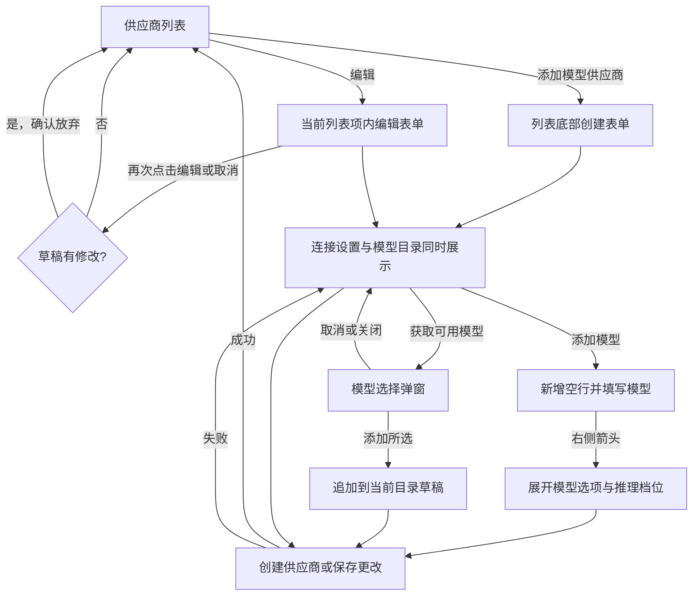

# 模型服务 PRD

本文描述桌面设置中“模型服务”的目标功能与交互，作为本功能唯一维护的需求正文。原第 8 节的待确认规则已于 2026-10-29 经用户逐题确认（见第 8 节），结论已写入各节。同日用户采纳拆票方案时批准本文为实施基线（`approved`）；批准不代表功能已实现。

## 1. 背景与目标（Problem Statement）

用户需要接入自定义模型 API，维护连接信息和可用模型，并为模型配置输入能力、容量及推理档位。配置过程中需要保留供应商列表上下文，避免在供应商、连接设置和模型目录之间来回跳转。

本轮目标：

- 在供应商列表内完成新建、编辑与删除。
- 将连接信息、API Key 和模型目录放入同一表单，一次提交、一次存储。
- 支持手动添加模型，以及获取供应商模型后多选导入。
- 为模型配置推理档位，并在会话的模型选择器中选择档位。
- 使用紧凑的列表、表单与统一的设计系统控件。

适用范围为桌面应用设置页及会话模型选择器中的档位选择；不扩展其他设置分类的具体功能，不重新设计会话模型切换流程。

## 2. 方案与信息架构（Solution）

### 2.1 设置布局

设置是占满窗口的整页（2026-10-30 修订，原为浮层弹窗）：左侧为 240px 设置导航（48px 窗口控制安全区、“返回应用”、“搜索设置…”与分类菜单），右侧为居中、最宽 800px 的当前设置详情。左侧分类与顺序如下。

| 分类 | 菜单项 |
| --- | --- |
| 个人 | 常规、外观、记忆 |
| 环境 | 权限 |
| 插件 | 插件、技能、MCP、Hook |
| 模型 | 模型服务 |
| （无分类，菜单最底部） | 关于 |

“外观”“插件”“Hook”尚无功能，交付前不在菜单中显示，沿用设置分区“未交付不出现在导航中”的现有约定；分类内没有可显示的菜单项时，不显示该分类标题。

整页设置的行为：

- 打开设置时会话侧栏与聊天区隐藏但不卸载：返回后草稿、滚动位置保持，进行中的 Run 不受影响。
- “返回应用”、Escape 与再次按 ⌘, 回到应用；当前分区有未保存修改时先提示“放弃更改？”。设置内有弹窗或菜单打开时，Escape 只关闭该弹窗或菜单。
- “搜索设置…”只按菜单项名称过滤左侧导航，匹配当前语言与英文名称，不区分大小写；无匹配时显示空状态。不搜索分区内的设置项。
- 菜单项按本节规则（未交付的不显示，权限在“环境”下）；几何、颜色与位置按 Pencil 源稿画面 01。

进入模型服务后，右侧展示标题、说明、已配置供应商列表，以及列表下方的“添加模型供应商”入口。

长表单由右侧详情区域滚动，左侧菜单保持稳定。创建、保存和取消操作应始终可通过滚动到达；不要求按视觉稿长截图的高度创建真实窗口。

### 2.2 对象与用词

沿用项目 [术语表](../../GLOSSARY.md)：Provider、Credential、Model Catalog、Thinking Level。产品界面分别使用“供应商”“API Key”“模型目录”“推理档位”。

| 对象 | 本页面含义 |
| --- | --- |
| 供应商 | 一组连接信息（协议、地址、API Key）及其模型目录，由 Provider ID 唯一标识 |
| 模型目录 | 当前供应商下可在会话中选用的模型配置集合 |
| 模型 ID | 向供应商请求时使用的模型标识 |
| 显示名称 | 供应商或模型在界面中展示的名称，与请求标识区分 |
| 推理档位 | off、minimal、low、medium、high、xhigh、max 之一，及其对应的 API 参数值 |
| 表单草稿 | 当前尚未通过“创建供应商”或“保存更改”提交的配置 |

“推理等级”只作为模型选项中开关的界面标签，不用作档位的同义词。

示例供应商统一使用“自定义供应商一 / 二 / 三”，模型统一使用 `custom-model-1` 和“自定义模型一”等中性名称，不沿用参考图中的品牌或人名。

## 3. 用户故事（User Stories）

1. 作为用户，我希望集中查看已配置供应商，并能编辑或删除任一项，以便维护模型接入点。
2. 作为用户，我希望直接在列表底部创建供应商，以便配置时保留已有列表上下文。
3. 作为用户，我希望直接在对应列表项内编辑，再次点击“编辑”即可收起，以便快速查看和修改。
4. 作为用户，我希望选择 API 协议并填写地址与密钥，以便连接兼容的自定义模型服务。
5. 作为用户，我希望编辑时不必重新输入原有密钥，也不看到伪造的密文占位，以便明确是否正在替换密钥。
6. 作为用户，我希望在配置供应商时一起添加模型及其能力信息，并一次保存，以便一次完成接入且不留下半成品。
7. 作为用户，我希望从供应商获取可用模型并多选导入，以便减少手动填写模型 ID。
8. 作为用户，我希望为模型配置推理档位和参数值，以便适配不同模型的请求要求。
9. 作为用户，我希望在会话中为当前模型选择推理档位，默认关闭，以便按任务决定推理强度。

## 4. 功能与交互（Implementation Decisions）

本节记录产品交互决定。存储与密钥路径的架构决定见 [ADR 0010](../../docs/adr/0010-provider-one-shot-save.md)；本节不规定接口路径或组件内部结构。

### 4.1 供应商列表

| 操作或状态 | 行为 |
| --- | --- |
| 默认列表 | 展示已配置供应商；各项均提供“编辑”和“删除” |
| 点击“添加模型供应商” | 在现有列表底部展示创建表单，保留已有供应商列表 |
| 点击某项“编辑” | 在该供应商列表项内部展开编辑表单，保留其他列表项上下文 |
| 同时展开 | 同一时间只展开一个表单；新建与编辑互斥 |
| 关闭或切换表单 | 再次点击同项“编辑”、点击“取消”、展开其他项或新建、离开模型服务页面时：草稿无修改则直接关闭；有未保存修改则提示“放弃更改？”，确认后丢弃草稿，取消则保持当前表单 |
| 编辑展开时的按钮 | 按钮继续显示，文案始终为“编辑”，不改成“编辑中” |
| 创建成功 | 新供应商进入列表，具备与其他供应商相同的编辑和删除入口 |
| 点击“删除” | 二次确认，确认框写明引用该供应商的 Session 数量；见下文 |
| 状态点 | 只表示“已配置 Key / 未配置 Key”，并配文字说明；不检测连通性，不显示检测时间 |

删除供应商确认后：同时删除其 Credential；清空引用它的 Session 的模型字段，这些 Session 下次运行前提示用户重新选择模型；默认模型指向它时回退为第一个可用模型。删除后即使以相同 Provider ID 重新创建，旧 Session 也不会自动接到新供应商上。

添加与编辑均在当前列表完成，不打开独立的二级页面、抽屉或供应商配置弹窗。“获取可用模型”的选择弹窗、“放弃更改？”与删除确认属于此规则的明确例外。

### 4.2 新建供应商

创建表单只展示“自定义模型 API”，不提供第三方模型供应商标签、品牌预设或供应商目录。

| 字段 | 交互要求 |
| --- | --- |
| Provider ID | 必填；格式 `^[a-z][a-z0-9-]{0,63}$`（小写字母开头，后接小写字母、数字或连字符，总长 1–64）；在全部供应商中唯一，重复时字段旁提示“ID 已被使用”；创建后不可修改 |
| 显示名称 | 必填；供应商在界面中的名称 |
| API 地址 | 必填；须为 http 或 https URL；占位示例可用 `https://gateway.example/v1` |
| API 协议 | 必填单选下拉，选项见下表，默认 OpenAI Chat Completions |
| API Key | 新建时必填；未输入时显示输入提示；输入后使用紧凑、连续的密码圆点，不人为增加字符间距 |
| 模型目录 | 在连接字段下方直接展示；至少包含一个模型 |

API 协议选项固定为：

| 顺序 | 选项文案 |
| --- | --- |
| 1 | OpenAI Chat Completions |
| 2 | OpenAI Responses |
| 3 | Anthropic Messages |

切换协议或修改地址时，已填写的模型目录、能力与推理档位全部保留；弹窗中已获取的候选模型作废，下次打开需重新获取。

表单底部统一提供“取消”和“创建供应商”。连接设置不可折叠，模型目录不是独立提交的第二步。创建提交包括连接信息、API Key 和当前模型目录；成功后新供应商进入列表。

### 4.3 编辑供应商

编辑表单顶部并排展示供应商显示名称与 Provider ID，例如：**自定义供应商二** `custom-provider-2`。

- Provider ID 使用静态文本，不展示输入框、禁用输入框或其他表单控件，也不允许在编辑中修改。
- 身份信息中保留“显示名称”的可编辑字段；API 地址、API 协议、API Key 和模型目录仍可修改，校验规则同新建。
- API Key 输入框初始为空，placeholder 固定为“留空则保留现有 Key”，不以密码圆点模拟已保存密钥。
- 保持 API Key 为空并保存时，保留原有 Credential；输入新值表示替换密钥。
- 连接设置始终展开，包括模型展开和添加全部推理档位的状态，不能退化成可折叠的连接摘要。
- 底部统一提供“取消”和“保存更改”，一次提交连接设置、模型目录和可选的新 Key。

不能通过清空编辑框来推断用户要删除原有密钥；本轮不新增“清除密钥”操作。

### 4.4 模型目录与手动添加

新建和编辑供应商使用相同的模型目录功能。

| 操作或状态 | 行为 |
| --- | --- |
| 空目录 | 展示无模型状态，提供“添加模型”和“获取可用模型”；空目录不能提交 |
| 点击“添加模型” | 在当前目录末尾新增一行空栏，包含模型 ID、显示名称、展开箭头和删除入口；新增后聚焦模型 ID |
| 填写模型 | 模型 ID 必填，同一供应商内不能重复；显示名称可留空，留空时使用模型 ID |
| 点击右箭头 | 在该行内向下展开模型选项，箭头改为向下 |
| 收起模型选项 | 恢复紧凑行；收起是显示状态变化，不等同于提交配置 |
| 点击模型删除入口 | 从当前表单的目录草稿中移除该模型，不额外确认；已保存模型的最终变更随供应商保存提交 |
| 获取可用模型 | 打开模型选择弹窗，见 4.6 |

存在模型 ID 为空或重复的行时阻止提交，并在对应行标出错误。

目录不展示“恢复默认模型”按钮。

### 4.5 模型选项与推理档位

展开某个模型后，展示以下配置：

| 配置 | 控件与含义 |
| --- | --- |
| 上下文窗口 | 容量输入，视觉稿示例为 `1M` |
| 最大输出 token 数 | 容量输入，视觉稿示例为 `128K` |
| 输入类型 | “文本”“图片”复选项 |
| 推理等级 | 开关，控制该模型是否使用推理档位配置 |
| 档位 | 预设档位选择项 |
| API 参数值 | 当前档位对应的参数输入；各档位有独立删除入口 |

容量规则：

- 以 token 整数保存；输入接受纯数字或 `K`/`M` 后缀，按 1000 进制换算（`1M` = 1,000,000），展示时换算回带后缀形式。
- 必须为正整数，最大输出 token 数不能超过上下文窗口。
- 未填写时使用默认值：上下文窗口 128K，最大输出 16K。视觉稿中的数值只是示例。

七种预设档位的内部添加顺序固定为：

| 顺序 | 档位 | API 参数展示 |
| --- | --- | --- |
| 1 | off | 禁用参数输入并显示“关闭思考” |
| 2 | minimal | 默认 `minimal`，可编辑 |
| 3 | low | 默认 `low`，可编辑 |
| 4 | medium | 默认 `medium`，可编辑 |
| 5 | high | 默认 `high`，可编辑 |
| 6 | xhigh | 默认 `xhigh`，可编辑 |
| 7 | max | 默认 `max`，可编辑 |

点击“添加档位”每次添加一个档位：选择顺序中最早一个尚未配置的预设，不重复；删除某档后，再次添加时补齐最早缺失档位。

七个档位全部添加后，“添加档位”置灰且不可点击，文案仍固定为“添加档位”。界面不展示预设顺序、下一个档位或按钮右侧提示，也不改成“已添加全部档位”。

档位规则：

- 同一模型的档位不能重复；修改某行的档位时，选择项只提供尚未配置的预设。
- 未配置的档位视为该模型不支持，不出现在会话的档位选择中。
- `off` 行的参数不可自定义；“关闭思考”是显示说明，不作为 API 字面参数发送。
- 推理等级开关关闭时，已填写的档位仍随草稿保存，但请求不使用这些档位，会话选择器只显示“关闭”。

### 4.6 获取可用模型

在当前供应商表单点击“获取可用模型”，使用该表单的协议、地址与 API Key 获取候选模型，并展示“选择要添加的模型”弹窗。新建与编辑共用此流程，不要求用户先保存供应商。

- 新建时使用表单中填写的 Key 发请求，该 Key 只用于这次请求，不保存。
- 编辑时 Key 留空则使用已保存的 Credential；填写了新值则使用新值，同样不在获取时保存。
- 新建表单的地址或 Key 未填写时，“获取可用模型”不可点击。

弹窗包含：标题、说明、右上角关闭按钮、“搜索模型”输入框、全选/取消全选、模型多选列表、选择数量，以及底部“取消”和“添加所选”。长列表在弹窗列表区域滚动。

| 状态或操作 | 可观察行为 |
| --- | --- |
| 候选模型 | 每行只显示供应商返回的模型 ID，保持返回顺序 |
| 搜索 | 按模型 ID 模糊匹配：不区分大小写，输入的字符按顺序出现在模型 ID 中即匹配（例如 `gpt4o` 匹配 `gpt-4o-mini`）；结果保持返回顺序，不按匹配度重排 |
| 已在目录 | 显示“已在目录”，呈禁用勾选态，不允许重复添加，不计入本次新增数量 |
| 默认选择 | 初次打开时不选中任何模型 |
| 全选 | 只作用于当前搜索结果中可新增的模型；这些模型全部选中时批量操作文案为“取消全选” |
| 修改搜索 | 已勾选的模型保持勾选，即使不在当前结果中 |
| 部分选择 | 显示本次已选数量，批量操作文案为“全选” |
| 未选择 | 数量为 0，“添加所选”置灰不可点击 |
| 添加所选 | 关闭弹窗，保留目录原有模型，将所选模型按返回顺序追加到当前表单目录草稿 |
| 取消或关闭 | 关闭弹窗并取消进行中的请求，不修改当前模型目录 |

导入的模型：显示名称等于模型 ID，容量取 4.5 的默认值，输入类型为文本，推理等级开关关闭。

加载与失败：

| 状态 | 行为 |
| --- | --- |
| 加载中 | 弹窗显示加载状态；“获取可用模型”不可再次点击 |
| 超时 | 15 秒未返回视为失败 |
| 失败 | 弹窗内显示脱敏后的错误说明和“重试” |
| 空结果 | 显示空状态说明 |

回填后仍需点击“创建供应商”或“保存更改”。“添加所选”不直接保存供应商，也不替换原有目录。

示例：目录已有 `custom-model-1`，候选共 10 个，其中 1 个标记为“已在目录”。初次打开计数为 0；全选后计数为 9；只选择 `custom-model-2` 和 `custom-model-3` 时计数为 2。点击“添加所选”后，目录包含原模型和这两个新增模型。

### 4.7 会话中选择推理档位

- 会话的模型选择器为支持推理的模型提供档位选择：始终包含“关闭”，推理等级开关打开时再列出该模型已配置的非 off 档位。
- 新建 Session 的档位为“关闭”。推理档位与模型一起按 Session 保存，变化与模型切换一样写入会话记录。
- 切换到不支持当前档位的模型时，档位回到“关闭”。
- 选择“关闭”时按所选协议的默认关闭方式请求（例如 OpenAI Responses 发送 `effort: "none"`）；选择其他档位时发送该档位配置的 API 参数值。
- 本轮不改变模型选择器的其他交互。

### 4.8 提交边界与安全约束

连接字段、API Key、手动添加的模型、导入模型和推理档位共同组成供应商表单草稿。添加模型、收起选项和弹窗回填都不是独立保存操作。

| 入口 | 提交内容 | 成功结果 |
| --- | --- | --- |
| 创建供应商 | 连接信息、API Key 及模型目录 | 一次存储完成，新项出现在列表 |
| 保存更改 | 当前供应商可编辑信息、模型目录及可选的新 API Key | 列表与再次打开的表单反映已保存配置 |

- 一次提交在一个事务中存储，不会出现供应商已保存而 Key 未保存的状态（[ADR 0010](../../docs/adr/0010-provider-one-shot-save.md)）。
- 加密不可用时拒绝整次提交，什么都不写，并提示原因。
- 提交期间“创建供应商”或“保存更改”不可点击；失败时在表单底部显示错误并保留草稿。
- 不做多窗口并发冲突控制，以最后一次写入为准。

凭据处理继承 [ADR 0004](../../docs/adr/0004-model-credentials-safe-storage.md)：界面不读取或回填已保存的密钥明文；不得将其写入普通配置、日志或错误提示；加密不可用时拒绝保存，不退回明文存储。设置持久化边界继承 [ADR 0003](../../docs/adr/0003-settings-and-sessions-in-sqlite.md)。

### 4.9 已有数据

不兼容旧数据。升级时删除已有供应商与 Credential，清空默认模型设置与 Session 中对它们的引用；这些 Session 下次运行前提示重新选择模型。旧的品牌预设与按品牌区分的供应商类型一并移除。

## 5. 主要流程

## 6. 视觉与可访问性要求

视觉规则以 [界面约定](../../docs/tech-stack/ui.md) 和 [设计系统规格](../../docs/tech-stack/ui-design-system.md) 为准。本表是本页面需要重点验收的应用方式，不另建 token。

| 元素 | 本页面应用 |
| --- | --- |
| 供应商紧凑行 | 收起行 H40、R12，列表间距 4px；展开后高度随内容增长 |
| 输入与选择器 | 标准输入 H32/R12；选择器 H36/R12 |
| 按钮 | 小按钮 H28/R8；标准按钮 H36/R12；禁用与普通态保持几何一致 |
| 成组表单 | 列表内嵌编辑区 R16，独立设置卡 R20 |
| 下拉菜单 | 使用共享菜单表面，外 R16、内边距 4px、菜单项 R12，当前稿项高 32px |
| 模型选择弹窗 | 主容器 R28；共享遮罩与浮层阴影，不模糊父页面 |
| 字体 | 正文与操作标签以 13/20 为主，字重不超过 500；技术标识使用相应等宽字体角色 |
| 密钥输入 | 紧凑圆点，正常字符间距；编辑空值提示与其他 placeholder 一致 |
| 材质 | 使用语义 token；中性平面边线 0.5px；抬升表面按共享阴影处理 |

实施验收应覆盖明暗主题、焦点可见、键盘操作、展开状态语义、图标按钮的可访问名称、弹窗焦点管理和长内容滚动。状态点与字段错误不能只通过颜色表达。现有稿为浅色静态流程稿，不视为这些运行时要求已通过；加载、失败、空结果、确认框与字段错误尚无视觉稿。

## 7. 验收场景（Testing Decisions）

以下是后续实现的验收标准，不是已执行的测试结果。

| 编号 | 前提与操作 | 预期结果 |
| --- | --- | --- |
| MS-01 | 打开设置 | 菜单按 2.1 分组；权限在“环境”下，关于在最底部；外观、插件、Hook 不显示 |
| MS-02 | 查看任意供应商 | 均有编辑、删除；状态点以文字区分已配置 / 未配置 Key；示例不使用参考图品牌或人名 |
| MS-03 | 点击添加模型供应商 | 现有列表下方出现自定义模型 API 表单，无第三方标签或二级页面 |
| MS-04 | 点击 API 协议 | 仅展示三种约定协议，默认 OpenAI Chat Completions，可选中并回显 |
| MS-05 | 新建表单输入 API Key | 显示紧凑密码圆点，无过大的点间距 |
| MS-06 | 新建时输入不合格或重复的 Provider ID、非 http(s) 地址、空 Key 或空目录后提交 | 阻止提交，对应字段显示错误；重复 ID 提示“ID 已被使用” |
| MS-07 | 打开编辑表单 | 名称与 Provider ID 静态并排显示；ID 没有表单控件；显示名称仍可编辑 |
| MS-08 | 编辑时不填写 API Key 并保存 | 提示为“留空则保留现有 Key”；原密钥保持有效，不回填原密钥或伪密码 |
| MS-09 | 编辑表单无修改时再次点击同项编辑 | 表单直接关闭；按钮始终为“编辑” |
| MS-10 | 表单有修改时点击取消、再次点击编辑、展开其他项或离开页面 | 提示“放弃更改？”；确认后丢弃，取消后保持表单与草稿 |
| MS-11 | 一个表单展开时展开另一项或点击添加 | 同一时间只有一个表单展开 |
| MS-12 | 新建或编辑中连续添加模型 | 每次新增一个空行并聚焦模型 ID，支持填写 ID 和名称、展开选项及删除 |
| MS-13 | 目录中存在空模型 ID 或重复 ID 后提交 | 阻止提交并标出出错的行；显示名称留空的模型保存后显示为模型 ID |
| MS-14 | 在容量中输入 `1M`、`128K`、`0`，或最大输出大于上下文窗口 | `1M` 存为 1,000,000，`128K` 存为 128,000；0 或超出上下文窗口时显示错误并阻止提交 |
| MS-15 | 展开模型并添加推理档位 | 连接字段仍完整展开，与目录共用创建或保存操作 |
| MS-16 | 从无档位开始连续添加七次 | 顺序为 off、minimal、low、medium、high、xhigh、max；第七次后按钮禁用且仍为“添加档位” |
| MS-17 | 查看档位添加区域与目录操作 | 没有预设顺序、按钮右侧提示、“已添加全部档位”或“恢复默认模型” |
| MS-18 | 删除一个已有档位后再次添加；修改某行档位 | 补齐最早缺失档位；修改时只能选尚未配置的档位 |
| MS-19 | 新建表单填写地址与 Key 后点击获取可用模型 | 用表单中的 Key 获取候选；关闭表单后库与日志中没有该 Key |
| MS-20 | 编辑表单 Key 留空点击获取可用模型 | 使用已保存的 Credential 获取候选 |
| MS-21 | 打开模型选择弹窗 | 每行只显示模型 ID；初次打开计数为 0，“添加所选”禁用 |
| MS-22 | 输入 `gpt4o` 搜索 | 匹配 `gpt-4o-mini` 等按序包含这些字符的 ID，不区分大小写，保持返回顺序 |
| MS-23 | 搜索后全选，再修改搜索 | 全选只选中当前结果中可新增的模型；修改搜索后已选项保持 |
| MS-24 | 候选有已在目录的模型 | 已有模型标记且不可重复新增；本次新增数量不包含它 |
| MS-25 | 原目录有一个模型，勾选两个新模型并添加 | 弹窗关闭，目录保留原模型并追加两个新模型；新模型名称为 ID、容量为默认值、推理关闭；供应商尚未自动保存 |
| MS-26 | 修改弹窗选择后取消或关闭 | 目录保持弹窗打开前的状态；进行中的请求被取消 |
| MS-27 | 获取超时、失败或返回空列表 | 15 秒后显示失败；失败显示脱敏错误与重试；空结果显示空状态 |
| MS-28 | 切换协议或地址后再次打开弹窗 | 模型目录不变；之前的候选不再显示，需要重新获取 |
| MS-29 | 创建或保存连接、Key 与模型目录 | 一次提交；成功后再次读取配置，连接、Key 与模型配置均生效；编辑空 Key 不覆盖原 Credential |
| MS-30 | 加密不可用时创建供应商 | 整次提交被拒绝，库中没有该供应商，表单保留草稿并提示原因 |
| MS-31 | 保存失败或提交中再次点击 | 提交中按钮不可点；失败时表单底部显示错误并保留草稿 |
| MS-32 | 删除被 Session 引用的供应商 | 确认框显示引用数量；确认后 Credential 被删除，引用它的 Session 下次运行前提示重新选择模型，默认模型回退为第一个可用模型 |
| MS-33 | 删除后用相同 Provider ID 重新创建 | 原引用它的 Session 不会自动使用新供应商 |
| MS-34 | 新建 Session 并打开模型选择器 | 档位为“关闭”；推理开关打开的模型列出“关闭”和已配置档位，未配置档位不出现 |
| MS-35 | 选择 high 后发送消息；再切换到未配置 high 的模型 | 请求带 high 配置的参数值；切换后档位回到“关闭”；档位变化写入会话记录并在重启后读回 |
| MS-36 | 推理等级开关关闭的模型 | 会话中只有“关闭”；已填档位在再次打开表单时仍在 |
| MS-37 | 从旧版本升级 | 旧供应商、Credential 与默认模型被清除；旧 Session 下次运行前提示重新选择模型 |
| MS-38 | 切换主题、使用键盘并操作长表单 | 共享几何和主题正确，焦点可见，菜单、确认框与弹窗可操作，提交入口可达 |

验证优先经真实界面操作并重新读取持久化配置；凭据保存与获取模型的密钥路径按 ADR 0010 验证，获取模型可使用受控兼容服务。真实模型验证与静态稿检查分别报告，不以静态画面代替接口或持久化证据。

## 8. 已确认规则

原待确认问题于 2026-10-29 由用户逐题确认，结论已写入上文：

| 原问题 | 结论所在 |
| --- | --- |
| 草稿生命周期、展开互斥 | 4.1 |
| 删除确认、Session 与默认模型引用、关联凭据 | 4.1、4.9 |
| 必填项、ID 格式与唯一性、地址校验、空白行与空目录、无 Key 服务（不支持，Key 必填） | 4.2–4.4 |
| 容量单位与范围、推理开关、档位重复、off 映射 | 4.5、4.7 |
| 切换协议或地址的影响 | 4.2 |
| 搜索、全选范围、默认选择、导入顺序与显示名称 | 4.6 |
| 加载、超时、失败、空结果、重复点击、并发与保存失败 | 4.6、4.8 |
| 状态点含义 | 4.1 |

同时确认的范围变化：推理档位在会话中由用户选择（4.7）；Provider ID 由用户输入并作为主键，不兼容旧数据（4.2、4.9）；连接信息、Key 与目录一次提交、一次存储（4.8）。

## 9. 非目标（Out of Scope）

- 第三方供应商品牌预设、订阅管理、模型市场与供应商排行榜。
- 独立模型管理页、分步保存连接与模型目录，以及恢复默认模型能力。
- 重新设计会话模型切换流程（4.7 的档位选择除外）、模型调用策略、费用统计和使用量监控。
- 连通性检测、清除密钥操作、无 Key 服务、旧供应商数据迁移。
- “外观”“插件”“Hook”分区的具体功能。
- 本轮直接实施代码、数据库迁移或证明真实供应商连接成功。

## 10. 来源、变更与视觉稿索引（Further Notes）

### 10.1 依据与状态

- **用户明确要求**：截至 2026-10-29 的设置与模型服务反馈，包括分类、紧凑列表、统一圆角、自定义 API、三协议、七档、列表内表单、Key 展示、编辑按钮切换、选择模型回填及被移除的操作/提示。后续明确修订覆盖此前相反要求，例如最终保留“编辑”按钮。
- **2026-10-29 规则确认**：第 8 节所列问题，以及档位的会话内选择、用户输入主键、一次存储与不兼容旧数据。架构部分记录为 [ADR 0010](../../docs/adr/0010-provider-one-shot-save.md)，术语记录在 [术语表](../../GLOSSARY.md)。
- **视觉稿补充、已被确认采纳**：自动聚焦模型 ID、档位缺失补齐、off 参数展示、目录去重、选择数量及零选禁用。视觉稿中“全部可新增模型默认选中”被确认改为默认不选中。
- **约束输入**：项目 UI 规范、术语表及 ADR 0003/0004/0010。
- **2026-10-30 修订**：用户要求设置改为整页，按 Pencil 源稿画面 01 的外壳实现，并采纳搜索、返回与冲突处理的推荐方案（2.1）；实施票为 `issues/10-full-page-settings.md`。
- **批准与实施状态**：2026-10-29 用户采纳拆票方案时批准本文（`approved`），并指定视觉以下文 Pencil 源稿为准。实施票见同目录 `issues/`；尚未依据应用代码或真实服务验证这些交互。

早期 [模型提供方决策票](../desktop-app/issues/07-grill-model-providers-credentials.md) 的四类品牌预设与按品牌区分的供应商类型属于历史规划，已由 ADR 0010 移除；其凭据加密与存储决定继续生效。旧里程碑的已交付状态不表示本文交互已经交付。

### 10.2 当前视觉稿

本机 Pencil 源稿：`/Users/chenzheng/Desktop/UI/设置-模型服务.pen`，是视觉的权威来源（用户 2026-10-29 指定）。交互规则以本文为准：两者冲突时（例如 07 画面的默认全选），行为按本文、视觉按源稿。异机读取不依赖此绝对路径。

| 画面 | 说明 |
| --- | --- |
| 01 | 供应商列表 |
| 02、03 | 列表内创建、API Key 输入及协议选择 |
| 02A、02B、02C | 创建中添加模型空行、展开选项、七档齐全 |
| 02D | 创建成功后进入列表 |
| 04、05、06 | 列表内编辑、展开模型、七档齐全；连接设置始终可见 |
| 07、07A、07B | 获取模型弹窗：全选、部分选择、零选择（初次打开应为零选择） |
| 08 | 添加所选后回填模型目录 |

源稿未覆盖的状态：放弃更改与删除确认、字段错误、获取模型的加载 / 失败 / 空结果、会话模型选择器中的档位选择。这些状态沿用源稿的视觉语言与设计系统已有组件实现，不另行定稿。补充视觉状态或修订规则时，原地更新本文。
