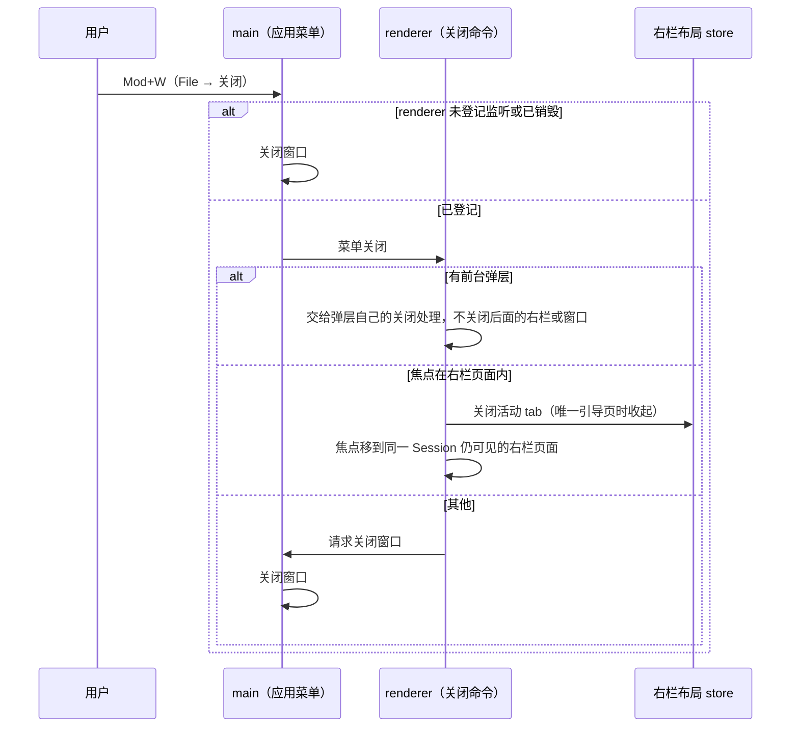

# 右栏与会话数据诊断

## 问题与范围

本设计服务 [spec](spec.md) 中跨模块、跨进程，或者带持久化的部分：

- 右栏的按 Session 布局与保存（RP-02、RP-14）；
- 三栏几何与全屏（RP-10—RP-13）；
- Mod+W 的关闭（RP-15）；
- 开发者开关（DEV-01、02）；
- 诊断页的数据来源、与主时间线共用身份、定位与瞄准（INS-09—INS-16）；
- 第三方声明（LIC-01）。

界面的几何、文案和逐项交互由 spec 规定，这里不重复。本设计不改协议消息和服务端，也不改现有六个页面的内容与数据来源。

## 来源与约束

**已确认的产品决定**：spec 的 Q1—Q21，尤其是 Q10（单格，不分栏）、Q12（照搬列宽与全屏规则）、Q13（按 Session 存入 localStorage，Mod+W）、Q15—Q17（诊断的数据范围与脱敏）、Q18（移植与声明）。

**代码事实**（Coko 基线 `25d4228e`）

- 右栏的 tab 是静态数组，有六个。选中项存在整个窗口共用的内存 store 中。开关是 App 中的 `rightOpen` 状态。标题栏按钮和工具卡经 `openTab` 先选中 tab，再打开右栏。
- 三栏几何在 `computeFrameLayout` 中。空间不够时依次：右栏缩到最小，侧栏收起，右栏改为覆盖中栏。`rightWidth` 参数存在，但 AppFrame 没有接线，右栏不能拖宽。
- chat-store 已经有 `onProgress(listener)`：在本 store 处理完每一帧之后，转发已打开会话的全部 progress，其中包括不属于 Run 的进度。`subscribeSession` 用于不切换会话地订阅子 Session。
- progress 不带时间戳，但带有 runId。`assistant_delta` 有 `kind`（text / thinking / toolcall）、`contentIndex`、`delta` 和可选的 `offset`；`tool_*` 有 toolCallId。`DETACHED_PROGRESS` 标出不属于 Run 的六类进度。
- 时间线行由 conversation-pane 中 `buildTimeline` 的 memo 产生。显示身份来自 timeline-view 中的 `useMessageIdentities`，它带有视图内的状态。过程分组由 ProcessTimeline 用上一次的分组（ref）计算，id 依赖上一次的结果。
- main 没有设置应用菜单，所以使用 Electron 的默认菜单：Mod+W 关闭窗口。main 与 renderer 之间的 IPC 常量在共享的 bridge 定义中，preload 以 `window.coko` 暴露有限的方法，已有 main→renderer 的监听（例如 `onOpenSession`）。
- theme、locale 两个设置键由 renderer 经现有设置接口保存，Sidecar 不读取它们。列表 store 已经把显示状态保存在 localStorage 中。
- 窗口的最小宽度为 520px。Forge 用 `extraResource` 打包 sidecar 与 ripgrep。
- 技术栈选定的 `@tanstack/react-virtual@3.14.14` 依赖 `@tanstack/virtual-core@3.18.0`。按 unpkg 上发布的类型声明，后者的 `VirtualizerOptions` 中有 `anchorTo?: 'start' | 'end'` 和 `scrollEndThreshold?: number`，DeepSeek Harness 的诊断表格用的就是这两个选项。

**参考事实**（DeepSeek Harness 基线 `8bd07339`）

- 右栏的布局按 Session 存入 localStorage，读回时校验结构，无效时只清除该 Session 的键。空间不够且没有全屏时，把该 Session 设为收起。窄于 768px 时，展示为全屏。
- 列宽算法中，左侧栏不让位：右栏放不下最小宽度时取消。
- 桌面端设置了自定义应用菜单。File 菜单的“关闭页面”项带关闭快捷键，点击后把关闭命令交给 renderer；renderer 在没有弹窗、焦点也不在右栏页面时，才请求关闭窗口。

**假设**（实施时核对）

- 同一个 WebSocket 上，服务端先发出 Run 的 progress，再发出对应的条目。增量转交给条目的规则依赖这个顺序。
- 现有的过程分组展开状态可以从时间线外部请求展开。定位接口通过它展开折叠层，不改 DOM。

## 模块责任与依赖

| 模块或进程 | 负责什么 | 不负责什么 | 依赖与消费者 |
| --- | --- | --- | --- |
| 右栏布局 store（renderer） | 按 Session 保存 tab 列表（以页面种类为身份）、选中项、展开状态、形态；集中执行单例去重、引导页与唯一 tab 规则；读写 localStorage；删除 Session 时清理 | 页面内容、宽度、全屏的自动判定 | 页面登记表的可用条件；消费者为右栏组装、全部入口和关闭命令 |
| 页面登记表 | 页面种类、标题字典键、图标、正文组件、可用条件 | 布局 | 诊断页的可用条件读开发者设置；消费者为引导页、tab 条和布局 store |
| 右栏组装（现在的 right-panel 目录） | 把 tab 条、活动页面的正文和引导页组装在一起；普通形态与全屏共用同一棵内容树 | 保存状态 | 布局 store、共享 UI 组件 |
| 三栏几何（`packages/ui` 的 frame layout 与 AppFrame） | 列宽算法、右栏分隔条、全屏形态、窄于 768px 的自动全屏、放不下时报告“无法显示” | Session 状态 | App 传入宽度偏好与展开状态；无法显示时由布局 store 收起 |
| 共享 tab 条与引导卡片（`packages/ui`） | 胶囊、关闭按钮、溢出滚动与渐隐、截断与 Tooltip、右键菜单、拖拽与键盘排序、卡片 | 业务状态与文案来源 | 只接收已经本地化的文案与回调 |
| 应用菜单（main） | 自定义应用菜单：保留默认的应用、编辑、视图、窗口菜单，File 菜单中的“关闭”带 Mod+W，点击后把关闭命令发给 renderer；renderer 请求时关闭窗口；renderer 没有登记监听时直接关闭窗口 | 决定关闭什么 | bridge 新增“菜单关闭”监听与“请求关闭窗口”两个方法 |
| 关闭命令（renderer） | 按前台弹层与焦点决定：交给弹层、关闭右栏页面，或者请求关闭窗口 | 菜单的构造 | 布局 store、DOM 焦点 |
| 投影发布点（renderer） | 按 Session 保存主时间线最近一次提交的投影：时间线行、显示身份、过程分组和 Run | 计算投影 | 写入方是主时间线；读取方是诊断页 |
| 时间线定位接口 | DOM 上的身份属性；“展开到某个身份”的请求；body 层的覆盖层，用于高亮和瞄准 | 移动或渲染时间线项 | 现有的过程分组展开状态；消费者为诊断页 |
| 诊断功能模块（renderer） | 表格模型、吸顶与跟随、筛选、详情、对象树与 JSON 树；原始数据模型（条目加上实时子行）；对话分组模型（订阅投影发布点） | 取数、保存与脱敏 | chat-store 的条目与 `onProgress`、投影发布点、定位接口 |
| 开发者设置 | `developer` 键的 schema 与缺省值（放在协议包），renderer 中的读写 | 服务端读取 | 设置 → 通用的开发者卡片；页面登记表 |
| 第三方声明 | 仓库根目录的 `THIRD_PARTY_NOTICES.md`，经 Forge `extraResource` 进入安装包的 Resources | 为全部 npm 依赖生成许可清单 | 打包配置 |

## 关键路径与接口

**打开或聚焦页面。** 入口调用布局 store 的 `openPage(sessionId, kind)`，内部步骤如下：

1. 种类不可用（例如开关关闭时的诊断页）时，返回 false，什么也不做。
2. 已经有这一种 tab 时选中它。如果它本来就是展开状态下的选中项，就让它所在的格发光。
3. 没有这一种 tab 时，在 tab 列表末尾加入并选中。从引导页打开时，原位替换引导页。
4. 展开右栏，并写入 localStorage。

随后三栏几何按新状态计算。放不下时，几何报告“无法显示”，布局 store 把该 Session 设为收起（RP-12）。没有 Session 时，入口直接返回。引导页的“+”调用同一个动作，只是种类为引导页，并且只在本格还没有引导页时可用。

**恢复。** 布局 store 第一次读取某个 Session 时，同步读取它的 localStorage 键：

1. 校验失败时，删除该键，从初始状态开始。
2. 去掉未知的种类和当前不可用的种类。
3. 选中项被去掉时，选第一个 tab；列表变空时，回到初始状态。

工作台在设置进入 ready 或 error 之后才渲染，所以恢复时诊断页的可用条件已经确定。设置读取失败时，诊断页按不可用处理：内存中去掉它，但不重写该键，直到用户下一次改动这个 Session 的布局。关闭开关时，内存中已经采用的布局立即去掉诊断页；没有采用的布局在恢复时去掉。不逐个重写所有键。

**Mod+W。**



窗口的红绿灯关闭按钮不经过菜单，行为不变。

**诊断页的实时增量。** 诊断模型按 Session 登记，生命周期是“该 Session 的诊断 tab 存在，并且该 Session 是主区当前的 Session”。切换 Session 或关闭诊断 tab 时，模型被释放，实时子行随之清空；同一 Session 内切换 tab 时保留。

模型订阅 chat-store 的 `onProgress`，只接收本 Session 的进度，并排除 `DETACHED_PROGRESS` 中的种类。分组与转交规则如下：

- `assistant_delta` 按 (runId, contentIndex) 组成块，归入该 Run 的“实时进度”行。该 Run 的下一条 assistant message 提交时，自上一条 assistant message（或 run_start）以来的块转到这条条目下，并收起。
- `tool_start`、`tool_update`、`tool_end` 按 (runId, toolCallId) 分组。对应的 toolResult 条目提交后，转到它下面。
- 压缩相关进度在 compaction 条目提交后转到它下面；`run_start` / `run_end` 进度在同名条目提交后转到它下面。
- 其余进度（重试、上下文用量等）和没有匹配的增量，留在“实时进度”行下。

**对话分组与定位。**

- **发布投影。** 主时间线每次提交后，在 layout effect 中把本次投影写入投影发布点：时间线行、显示身份、过程分组和 Run。诊断页用外部 store 订阅读取，得到的就是时间线刚刚画出的那一份。
- **身份属性。** 时间线行、过程分组和工具卡上的身份属性，与发布的身份是同一个值。
- **定位。** 选中表格行时，诊断页把目标身份交给定位接口。定位接口找到元素：如果它在收起的过程分组或详情中，先请求展开，等提交后再平滑滚动，并在 body 层画高亮。找不到时，按 INS-09 的顺序回退。
- **瞄准。** 瞄准蒙层覆盖时间线的滚动区域，用 `elementsFromPoint` 排除自身，取最近的带身份属性的元素，再在当前展示形式的行索引中查找对应的行。

## 状态、持久化与失败

**布局键。** 每个 Session 一个键，名为 `coko.right-panel.v1.<sessionId>`，内容为：

```ts
{ tabs: PageKind[]; active: PageKind; expanded: boolean; mode: 'normal' | 'fullscreen' }
```

`tabs` 不重复，`active` 必须在 `tabs` 中。页面种类本身就是 tab 的身份，不需要像 DeepSeek Harness 那样分配 tab id 和计数。读回时用 typebox 校验：

- JSON 损坏或类型不符时，删除该键。
- 未知种类只被过滤，不使整条记录无效。这样较新版本写入的种类，不会让较旧的版本丢掉整条记录。

以后不兼容的改动改用 `v2` 键，旧键在 Session 被删除时清理。写入失败时，经 renderer 日志记录一次，内存中的布局照常使用。

**其他状态。**

- **宽度偏好。** 只保存在 App 的内存中：重新加载后回到 45%，拖动时夹在上下限内。
- **开发者设置。** 保存方式与 notifications 相同，带修订号；冲突与失败用 Toast 提示，并保留界面上的选择。
- **实时子行。** 只在内存中，不保存。

**失败。**

- 诊断页不取数，所以没有读取失败。
- 序列化失败只显示在详情面板内。
- 定位失败按 INS-09 回退；瞄准没有匹配时给出提示。
- renderer 没有响应时，菜单关闭不会生效；但窗口的关闭按钮仍然可用，不经过菜单。

**删除 Session。** 永久删除返回的全部 sessionId（含子 Session），它们的布局键一并删除。归档不删除布局键。

## 备选方案与选择

| 取舍 | 选择 | 放弃的方案与原因 |
| --- | --- | --- |
| 布局模型 | 按 Session 的有序列表，同一种页面只有一个 tab | 移植 dockkit 的分格树、planner 和操作序列：Q10 不做分栏和浮窗，那些代码大多用不上，还要为它们维护 id 计数与回放 |
| 布局保存位置 | localStorage，沿用列表 store 的先例 | Sidecar 设置库：布局是写入频繁的显示状态，按 Session 增长；放进设置库会带来修订冲突，也会增加对服务端的写入 |
| Mod+W | 自定义应用菜单，File → 关闭交给 renderer，与 DeepSeek Harness 一致 | 在 `before-input-event` 中拦截，并由 renderer 上报焦点：焦点变化与 IPC 之间有竞争，而且只覆盖键盘，不覆盖菜单点击 |
| 对话分组的数据 | 主时间线发布已经算出的投影 | 诊断页自己计算：过程分组 id 和显示身份依赖视图持有的状态，会与时间线对不上。把投影提升为 store：需要重写显示身份和过程分组的状态管理，为一个开发者功能改动核心时间线 |
| 实时增量的来源 | 复用 chat-store 的 `onProgress`，按 Session 过滤 | 在 chat-store 中缓存原始进度：即使没有打开诊断页，也给每个会话增加内存 |
| 虚拟列表 | `@tanstack/react-virtual@3.14.14`，用 `anchorTo` 与 `scrollEndThreshold` | 自己写虚拟化：要重新实现锚定与吸顶范围，而技术栈已经选定这个库 |
| tab 条与卡片的位置 | `packages/ui` 的共享组件 | 写在右栏业务目录：界面约定要求优先复用 `packages/ui` |

## 验证与实施顺序

| 规格场景 | 测试接口或真实入口 | 观察结果 | 依赖与文档影响 |
| --- | --- | --- | --- |
| AC-01—09、AC-15、AC-17 | 真实 App 的 Browser Mode | tab 条、引导页、入口、关闭与排序、快捷键的实际 DOM、焦点与可访问名称 | 布局 store、登记表、共享 tab 条；workbench，以及 plan-mode、jobs、subagents、teams、schedules、tracing 的入口描述 |
| AC-10—13 | AppFrame 浏览器测试与真实 App Browser Mode | 列宽、收起、全屏、分隔条的实际几何与键盘操作 | 三栏几何；workbench 与 ui-design-system 的右栏几何 |
| AC-14、AC-16、AC-18、AC-20 | 真实 Electron E2E（faux 模型、重启） | 重启后恢复；Mod+W 不关闭窗口；开关保持；真实 Sidecar 下出现增量子行 | 布局键、应用菜单与 bridge、开发者设置；delivery 中的菜单说明 |
| AC-19、AC-21—27 | 真实 App Browser Mode，以及移植的纯函数单测 | 行、分组、筛选、跟随、详情、引用、定位与瞄准的外部结果 | 诊断模块、投影发布点、定位接口；新的诊断当前行为说明 |
| AC-28 | 真实 App Browser Mode，使用含 `[REDACTED:secret]` 标记的 fixture | 诊断页与时间线显示相同的内容，没有新的请求 | 无协议变化 |
| AC-29 | Browser Mode 加 agent-browser 静默检查 | 390px、明暗主题、zh/en 下的几何与语义 | ui-design-system |
| AC-30 | 打包产物检查 | Resources 中有声明文件，内容包含版权行和许可文本 | Forge 配置；delivery |

**最小端到端切片。** 布局 store、页面登记表、tab 条与引导页取代现有右栏，全部入口改为 `openPage`，现有六个页面在新容器中可用。

**依赖顺序。** 之后按依赖顺序推进：

1. 三栏几何与全屏；
2. 保存与恢复；
3. 应用菜单与 Mod+W；
4. 文案改名与文档同步；
5. 开发者设置与开关卡片；
6. 诊断表格核心与原始数据；
7. 实时增量子行；
8. 投影发布与对话分组；
9. 定位接口与瞄准；
10. 第三方声明与打包。

具体拆票由 `to-tickets` 决定。整体在“对话状态栏与标题栏”规格交付后开始。

## 待决问题与确认

- **（不阻塞）右栏放不下时是否提示。** spec 的已知后果记录了这一点：窗口接近 1024px 而左侧栏被拉宽时，右栏可能打不开。DeepSeek Harness 在这种情况下静默收起。本设计照搬静默收起，不另加提示；需要提示时作为新需求处理。
- **（不阻塞）是否为“第一次复制第三方源码”写 ADR。** 本次只有一个来源，按单次的工程决定处理，记入 delivery 说明。以后形成长期的引入与声明规则时，再提炼成 ADR。
- **（实施时核对）** 来源与约束中列出的两条假设；以及 DeepSeek Harness tab 条的实际几何（高度、胶囊圆角与间距），实施前从源码读取，并对齐 Coko 的圆角档位。

**批准依据。** 本设计中的选择都是在 spec Q1—Q21 授权范围内做的、可以撤回的工程判断，不改变产品语义、数据归属或对外承诺。涉及用户体验的取舍已经在 spec 的“已知后果”中写明。因此状态为 `approved`。
