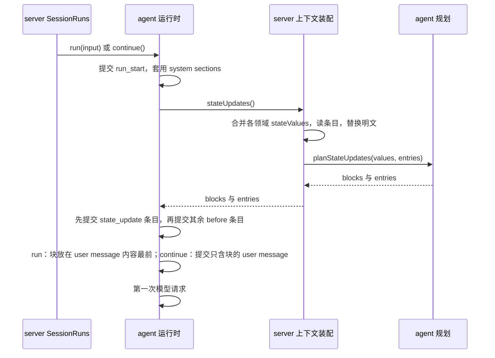

# 系统上下文分层：设计

规格：[spec.md](spec.md)（approved）· 讨论：[grilling.md](grilling.md) · 决定：[ADR 0024](../../docs/adr/0024-session-state-as-state-updates.md)

## 问题与范围

规格要求开头的系统消息在 Run 之间逐字稳定，会变的状态以 State Update 追加到对话末尾（用户故事 1–13），同时补上环境信息（14–17）、基础提示与来源规则（18–23），并在压缩、回退、分叉、retry 与 continue 之后让模型看到当前状态（24–28），覆盖子 Session、上下文用量、导出与 Secret（29–32）。

需要单独设计的原因有三点：送达发生在三个时刻（Run 开始、continue、Run 内压缩之后），其中后两个在运行时内部；一种新条目要被时间线、Goal 授权、分叉、压缩、上下文用量、导出与 headless 共同理解；现有宿主通知按“紧邻”判断来源，不足以支撑 State Update。规格的 Out of Scope 不变。

## 来源与约束

**已确认（用户决定）：** [ADR 0024](../../docs/adr/0024-session-state-as-state-updates.md)；规格中来自三轮讨论的结论；测试接缝只用现有接缝（2026-11-05 `/to-spec` 时确认）。

**事实（2026-11-05 在 main `4c357c55` 核对）：**

- Run 开始的顺序：提交 `run_start` → 套用 system sections → 提交 RunInput 的 `before` 条目 → 执行。run 的执行是 `agent.prompt(userMessage(input))`，user message 在 pi 的 message_end 时提交；continue 直接 `agent.continue()`，没有输入；retry 去掉出错的回复后 `agent.continue()`（[runtime.ts](../../packages/agent/src/engine/runtime.ts)）。
- submit、goal、schedule 由 server 的 `withPending` 把待送达内容并入 RunInput：内容放在最前，`before` 排在输入自身的 `before`（例如 command）之前；subagent 与 handoff 原样传入（[session-runs.ts](../../apps/server/src/application/session-runs.ts)）。子 Session 的 Run（含 teammate 收到消息）都是 trigger subagent。
- 自动压缩在 pi 的 `prepareRequest` 中：请求前检查 → 压缩、提交 compaction 条目、按条目重建 `state.messages` → 再检查 → 把重建的消息作为本次请求的上下文返回。溢出恢复在请求失败后压缩，再 `agent.continue()`（[compaction-driver.ts](../../packages/agent/src/engine/compaction-driver.ts)）。
- 时间线、Goal 的 `runAuthority` 与 Sidecar 的输入标记都按“前一条条目的 kind 属于宿主通知”判断来源。时间线的判定集合遇到其他 kind 的条目即清空，而 Run 开始时 command 条目排在宿主通知条目与 user message 之间。
- 条目 kind 在 agent 的 session-entries 中按领域登记，protocol 镜像各领域的 payload schema；存储的 payload 注册表拒绝未登记的 kind。
- `effectiveEntries`、`modelContext` 是 agent 中被 server 与 renderer 共用的纯函数（[derive.ts](../../packages/agent/src/entries/derive.ts)）。
- headless 的 stream-json 逐行输出根 Session 的每条 entry；分叉只复制 message、permission_mode、permission_rule；摘要请求按文本把 `<file_reference>`、`<instruction_file>` 缩为一行；上下文用量的五类由 server 的用量贡献计算；`ContextScope` 不含当前模型与 Project 的附加文件夹。

**假设：** 在 user message 或工具结果之后再追加一条 user message，三种协议的适配器都能正确发送。依据是 Steering 已在工具结果之后送达 user message；“user 之后再 user”未验证。

**推断（未复现）：** 用户提交 command 时恰有待送达的 agent 或团队通知，command 条目会隔开通知条目与 user message，时间线不会去掉对应的块。这是现有缺口，见待决问题。

## 模块责任与依赖

| 模块或进程 | 负责什么 | 不负责什么 | 依赖与消费者 |
| --- | --- | --- | --- |
| agent：条目派生 | `state_update` 与 user message 的配对；`HOST_INPUT_KINDS`（宿主通知的 kind 加 `state_update`） | 状态的值 | 消费者：规划、运行时、时间线、Goal 授权、压缩计划、上下文用量 |
| agent：State Update 规划 | 按配对找出有效上下文中同名最近一次送达的值，判定送达、清空或不送；按 date → goal → todo_list → team 的顺序渲染块与条目 | 读取存储、领域状态与时钟 | 输入为当前值与条目；被 server 的上下文装配调用 |
| agent：运行时 | 在 Run 开始与 Run 内压缩之后调用 `stateUpdates()`；放置块、按顺序提交条目 | 判定送什么 | 依赖 RuntimeContext |
| agent：条目 schema | 登记 `state_update` payload v1 `{ name, value }` | — | 存储注册表；protocol 镜像 |
| agent：提示与 section 渲染 | 带版本标识的基础提示；goal 与 teams section 只渲染定义部分；todo 不再渲染 section | 取数 | server 的各领域贡献 |
| agent：分叉、压缩计划 | 分叉把配对的 `state_update` 与其 user message 一起复制；摘要请求把配对的块缩为一行 | — | 条目派生 |
| server：上下文装配 | section 顺序（环境在前，todo 移除）；合并各领域的 `stateValues`、替换已登记的明文、调用规划；失败记 warn 不阻止 Run | 块的放置 | 各领域贡献、存储、时钟 |
| server：领域贡献 | goal、todo、teams 给出当前值；新增环境贡献；date 来自 ClockPort（测试中为测试时钟） | — | Goal、Todo、团队服务 |
| server：Run 与运行时登记 | RuntimeContext 增加 `stateUpdates`；`ContextScope` 增加当前模型与附加文件夹；输入标记改用 `HOST_INPUT_KINDS`；`run started` 日志记基础提示版本 | — | 运行时、Session 存储 |
| server：上下文用量 | 配对的块计入 system | — | 条目派生 |
| protocol | `state_update` 的 payload schema；stream-json 中这一 kind 的行 | — | renderer、headless |
| renderer：时间线 | `state_update` 条目不成行；按配对去掉块；只剩块的 user message 不成气泡 | 诊断中的原始条目（照常列出） | 条目派生 |

## 关键路径与接口

**接口：**

- `RuntimeContext.stateUpdates?(): Promise<{ blocks: TextContent[]; entries: RunEntry[] } | undefined>`：返回本次要送达的块与按同一顺序的 `state_update` 条目；没有要送的项时返回 undefined。由 server 实现，运行时只负责调用的时刻与放置。
- `ContextContribution.stateValues?(scope): Promise<Partial<StateValues>>`：各领域给出结构化当前值。键为 date、goal、todo_list、team；null 表示当前没有内容；缺少的键表示该项不适用于这个 Session（例如子 Session 没有 goal）。
- `planStateUpdates(values, entries)`：纯函数。值按规范化 JSON 比较，比较对象是替换已登记明文之后的值，与条目里保存的值口径相同。
- **配对：** 条目派生给出每条 user message 配对的 `state_update` 条目。一条 `state_update` 属于同一 Run 中它之后的第一条 user message，与该消息开头的 `<state_update>` 块按顺序一一对应，名称须相同。没有配对的条目（两次提交之间崩溃，或压缩切点去掉了条目、保留了消息）不算已送达；没有配对的块不算 State Update。

**Run 开始（submit、goal、schedule、subagent、continue）：**

- retry、compact、handoff 不调用钩子。
- run 中块排在 server 并入的待送达内容之前，所以顺序为 State Update → 宿主通知 → 输入。
- continue 有块时，以只含块的 user message 调用 `agent.prompt()`，代替 `agent.continue()`，提交路径与 run 相同；没有块时仍是 `agent.continue()`。

**Run 内压缩之后：**

- 自动压缩成功、在 `prepareRequest` 中重建 `state.messages` 之后，返回本次请求的上下文之前，再调用一次钩子。有块时依次提交 `state_update` 条目与只含块的 user message，并把该消息追加到 `state.messages` 与本次请求的消息末尾。这条消息不经 pi 的事件，所以由运行时自己提交。
- 溢出恢复在压缩成功之后、`agent.continue()` 之前做同样的处理。
- 不经 Steering：在 `prepareRequest` 中排入的追加指令要到下一步才送达，晚于规格要求的“下一次请求之前”。

**消费者：**

- **时间线：** `state_update` 条目不成行；配对的块从用户气泡中去掉；只剩块的 user message 不成气泡。用户输入或工具输出中的同名文本照常显示。
- **Goal 授权：** `runAuthority` 判断“前一条是不是宿主条目”时改用 `HOST_INPUT_KINDS`，只含块的 user message 不算用户的输入。输入标记保证 `state_update` 与它的 user message 之间不插入其他条目。
- **分叉：** 只在配对的 user message 被复制时复制对应的 `state_update`，保持原顺序。
- **压缩计划：** 摘要请求中配对的块替换为 `[state update: <name>]`。
- **上下文用量：** 配对块的字数计入 system。

## 状态 持久化与失败

**提交顺序：**

- Run 开始：`run_start` → `state_update` 条目 → 待送达的宿主通知条目 → 输入自身的 `before` 条目（例如 command）→ user message。
- 压缩之后：compaction → `state_update` 条目 → 只含块的 user message。
- 两种情况下，Sidecar 的输入标记都从第一条 `state_update` 开始，到 user message 提交为止。

**部分提交：**

- `state_update` 已提交、user message 未提交（崩溃或提交失败）：条目没有配对，不算已送达，下一次判定会重发。提交失败按现有 `commitError` 处理，Run 以 commit_failed 结束。
- user message 已提交、请求未发出：消息在有效上下文中，算已送达；重启后 continue 照常接着做。
- 被回退或被压缩去掉的消息，其配对一并失效，下一次判定重发。
- retry 不调用钩子。压缩补发之后的请求失败时，retry 重放的上下文中已包含补发的消息，与原请求一致。

**并发：** 领域状态可能在 Run 中被用户或其他 Session 修改。规划只在上述三个时刻读取，Run 中途的变化留到下一个判定点。

**失败：** 读取领域状态或条目出错时，上下文装配记 warn、本次不送达，Run 照常进行。这与 system section 的失败处理一致，下一次判定会补上。

**兼容：**

- 新 kind 从 v1 开始；旧条目、旧 system section 不需要迁移。
- 升级前的 Session 没有 `state_update`，升级后第一个 Run 会把当前值全部送达一次。
- 存储注册表拒绝未登记的 kind。旧版本应用读取含 `state_update` 的库会怎样，需要在实施时确认，见待决问题。

## 备选方案与选择

- **送达放在哪里：** 选择运行时的单一钩子。另一种做法是像 `withPending` 那样由 server 并入 RunInput，continue 与压缩之后再由运行时补。这会让送达逻辑分成两处、顺序规则写两遍；选定的做法里，运行时在三个时刻调用同一个钩子，server 只决定送什么。
- **压缩之后怎么补发：** 选择直接提交并追加到本次请求。排入 Steering 会晚一步，不满足规格。
- **怎样认定来源：** 选择配对，而不是“紧邻”。紧邻在 Run 开始时会被 command 条目隔开，也表达不了“条目已提交、消息未提交”。配对集中在条目派生中，由五处消费者共用。现有宿主通知继续用紧邻规则，本次不迁移。
- **kind 集合：** 新增 `HOST_INPUT_KINDS`，不把 `state_update` 加进 `HOST_NOTIFICATION_KINDS`。按术语表，后者表示发生过的事，State Update 记录的是值。
- **规划放在哪里：** 作为 agent 的纯函数，而不是 server 的私有逻辑。配对与渲染要被 renderer、压缩计划与运行时共用；纯函数也便于在现有的条目派生测试中覆盖崩溃窗口与压缩切点。
- 长期理由见 ADR 0024。

## 验证与实施顺序

| 规格场景 | 测试接口或真实入口 | 观察结果 | 依赖与文档影响 |
| --- | --- | --- | --- |
| 缓存稳定（1–5） | Sidecar 集成测试的 requestLog；真实 Provider 的追踪接口 | 各 Run 首次请求的 sections 逐字相同；cacheRead 按规格的验收标准 | 上下文管理 |
| 状态准确（6–13） | Sidecar 集成测试，测试时钟 | 变化的项送达，不变不送，清空送一次，跨午夜送新日期 | Todo List、Goal、Agent Teams 文档 |
| 环境信息（14–17） | Sidecar 集成测试 | 环境 section 的各项内容，不含 git status 与日期 | 指令文件之外的上下文说明 |
| 基础提示与来源（18–23） | Eval Case（真实模式）；Sidecar 集成测试；时间线派生测试 | 伪造标签不产生条目、不被隐藏；waiting-input 的 Goal 不被唤醒；替换门槛按规格 | `@coko/agent` README |
| 压缩、回退、分叉、retry、continue（24–28） | Sidecar 集成测试；条目派生测试（配对与崩溃窗口） | 压缩后下一次请求带补发的值；回退与分叉后按当前状态送达；retry 不送；continue 先送块 | 上下文管理 |
| 子 Session、用量、导出、Secret（29–32） | Sidecar 集成测试 | 子 Session 收到各自的值；用量计入 system；导出包含条目；明文为标记 | protocol README、headless |

**最小端到端切片：** `state_update` 条目与配对、运行时在 run 开始调用钩子、server 只给出 todo_list 的值、时间线去掉块。用一个 Sidecar 集成测试确认：模型写 Todo 之后，下一个 Run 的 sections 不变、State Update 出现在 user message 最前。之后依次加上：continue 与压缩之后的送达；goal 与 teams 的拆分；日期与环境 section；分叉、摘要、用量与授权；最后是基础提示 v2 与评测。

## 待决问题与确认

- **规格已获批，已解决。** 2026-11-05 用户答复“规格通过”，规格中补全的几项（子代理与团队消息 Run 的送达方式、送达内的顺序、Secret 替换、State Update 不算用户输入、基础提示版本写日志、替换门槛、缓存验收标准）随之确认。
- **旧版本读取新库，不阻塞，实施时确认。** 存储注册表拒绝未登记的 kind。降级打开含 `state_update` 的库是报错、隔离还是跳过，取决于注册表在读取路径上的行为；结论写入兼容说明。
- **会话诊断的类型筛选，不阻塞。** 确认原始条目的类型筛选是否枚举固定的 kind，新 kind 是否需要加入。
- **“user 之后再 user”，不阻塞。** 在三种协议上的发送须由 Sidecar 集成测试（faux）与真实 Provider 验证；若某个适配器不接受，改为把块并入前一条 user message。
- **现有缺口，不属于本设计。** 推断：command 条目隔开宿主通知条目与 user message 时，时间线不去掉 agent 与团队通知的块；需复现后另开问题，与分叉不复制宿主通知前置条目的缺口一起处理。
- 2026-11-05 用户在 `/to-tickets` 时确认拆票方案，并一并批准本设计（status: approved）；实施票见 [01–10](issues/01-todo-list-state-update.md)。
