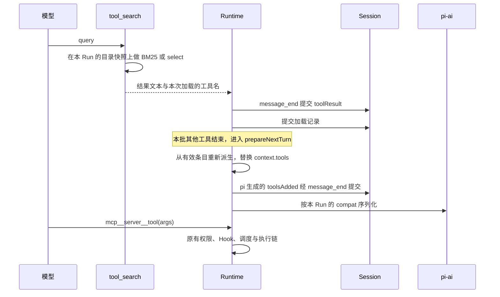

# Coko Tool Search 设计

2026-11-04 起草，2026-11-05 改写。需求以已批准的 [Tool Search 规格](spec.md) 为准（需求 TS-01—TS-27，验收 AC-01—AC-23），本文只说明怎样在 Coko 现有结构中实现。初稿保留在 Git 提交 `3bbc3018`。状态为 draft：规格中的需求已由用户确认，本文的工程选择未单独批准（见第 9 节）。2026-11-05 已按本文拆为 15 张实施票（见 [README](README.md#实施票)）；当时尚未改动产品代码。2026-11-05 用户显式调用 `implement-spec` 后已完成本地实施，当前事实和局限见[联合证据](evidence/acceptance.md)及正式行为文档。本提案保留 draft，不自动升级确认状态。

## 1. 问题与范围

规格要求 MCP 工具按需加载、加载状态随 Session 条目恢复、加载时尽量保留提示词缓存。本文回答三件事：哪些模块承担这些行为；Run 开始与加载时的调用次序；加载状态怎样保存、恢复与失败。范围与不做的内容见规格的 Solution 与 Out of Scope。内置工具不参与按需加载的依据：35 个全部出现时约 6.4K token（按 chars/4 估算）。

## 2. 来源与约束

### 确认依据与研究

- 需求与确认依据：[规格](spec.md) 的“来源、确认与实施状态”。
- 复刻基准：[程小帮研究](research/chengxiaobang.md) 第三节记录 v1.10.1 的工具契约、检索、目录、加载与开关，带源码位置。
- 其他研究：[仓库综合对照](research/repository-comparison.md)（Codex、Rukie 等）、[Anthropic 与 MCP 一手资料](research/anthropic-mcp.md)。研究文档中的“对 Coko 的建议”保留研究时的原意，当前方案以规格与本文为准。

### 仍然适用的决定

- [ADR 0024](../../docs/adr/0024-session-state-as-state-updates.md)：会变的 Session 状态以 State Update 送达，目录公告照此处理。新增一种 State Update，实施时同步该 ADR 的列举与 [上下文管理](../../docs/subsystems/context.md#state-update)。
- [ADR 0008](../../docs/adr/0008-project-files-only-tighten.md)：项目文件只能收紧。全局开关是布尔值，项目只能设为 false。
- [ADR 0003](../../docs/adr/0003-settings-and-sessions-in-sqlite.md)、[ADR 0006](../../docs/adr/0006-file-checkpoints-and-rewind.md)、[ADR 0023](../../docs/adr/0023-assistant-reply-forks.md)：Session 为只追加条目，回退与两种分叉边界都由条目派生，所以已加载集合不能存成单独可改的列。
- [ADR 0014](../../docs/adr/0014-subagents-as-child-sessions.md)：子 Session 有自己的历史。[ADR 0010](../../docs/adr/0010-provider-one-shot-save.md)：Provider 的新字段走原有的一次性保存。

### 本次核实的代码事实

核查对象：Coko HEAD `0e3d42b2`，已安装的 pi-ai 与 pi-agent-core 1.4.0。只读核查，未运行。

| 事实 | 位置 | 本设计如何使用 |
| --- | --- | --- |
| pi-ai 把 system 消息的 `toolsAdded` 与 `toolsRemoved` 翻译成各协议的原生增量写法，由 compat 控制，默认都是 false：Messages 需要 `supportsMidConvoSystemMessages` 与 `supportsMidConvoToolChanges`，Responses 需要 `supportsMidConvoSystemMessages` 与 `supportsAdditionalTools`，Completions 需要 `supportsMidConvoSystemMessages` 与 `supportsMidConvoToolAdditions` | pi-ai `dist/api/anthropic-messages.js`、`openai-responses-shared.js`、`openai-completions.js` | Coko 只按 Run 设置 compat，不自己写序列化 |
| pi-ai 1.4.0 没有程小帮所用 0.85.1 的 `supportsToolReferences` 与 `addedToolNames`；Responses 请求带 `store: false` | 同上，`dist/api/openai-responses.js` | 线上格式与程小帮不同，需要重新验证；中途切换开关只改变同一段历史的写法 |
| `declareToolChanges` 以 transcript 回放为基准比较 `context.tools`，差异经 message_end 提交为 `kind: message` 的 system 条目；带初始工具声明的开头 system 消息不入库，每次构造运行时重建 | pi-agent-core `dist/agent-loop.js`、`dist/agent.js`；[system-message.ts](../../packages/agent/src/engine/system-message.ts) | 只替换 `context.tools`，声明随之生成；声明是相对不入库基线的增量，不用它做已加载集合 |
| 调用不在 `context.tools` 中的工具时，pi 返回 `Tool <name> not found`，不经过 hook；`prepareNextTurn` 可以在下一轮之前替换工具 | pi-agent-core `dist/agent-loop.js` | 乐观加载的接入点 |
| 每个 Run 开始时从 registry 解析模型并 `setModel`；保存 Provider 时 registry 同步更新 | [session-runs.ts](../../apps/server/src/application/session-runs.ts)、[providers.ts](../../apps/server/src/application/providers.ts) | compat 按 Run 计算，两个开关都从下一个 Run 生效 |
| MCP 工具在 Run 开始时取快照，只含已连接的 Server；`tools/list_changed` 不刷新进行中的 Run | [context/mcp.ts](../../apps/server/src/application/context/mcp.ts) | 目录按 Run 取快照 |
| 子代理的工具交集用父级运行时 registry 的工具名（`visibleTools`） | [session-runs.ts](../../apps/server/src/application/session-runs.ts) | registry 保留全部可用工具，只在提供给模型时过滤 |
| MCP 配置拒绝未知键；批准摘要只覆盖启动字段 | [mcp/config.ts](../../packages/agent/src/extensions/mcp/config.ts) | `alwaysLoad` 要改校验器，不进入摘要，不需要重新批准 |
| 用量统计计入全部已连接 MCP 工具，不经过 filterTools | [context/usage.ts](../../apps/server/src/application/context/usage.ts) | 改为只计实际提供给模型的工具 |
| Provider 配置没有 compat 或能力开关字段 | [http.ts](../../packages/protocol/src/http.ts)、[models/registry.ts](../../packages/agent/src/models/registry.ts) | 在协议、表单与 agent 三层新增 `incrementalTools` |

## 3. 需求

用户确认的需求、界面文案与验收场景以 [规格](spec.md) 为准（TS-01—TS-27、AC-01—AC-23），本文不重复；下文涉及行为时引用规格编号。

## 4. 模块责任与依赖

| 模块或进程 | 负责什么 | 不负责什么 | 依赖与消费者 |
| --- | --- | --- | --- |
| `packages/agent/src/tools/tool-search/`（拟新增） | 分词、BM25、查询解析、目录的构造与渲染、`tool_search` 的定义与结果文本 | Session 写入、MCP 连接、权限判定 | 宿主注入目录快照与加载记录的写入接口 |
| `packages/agent/src/entries/` | 从有效条目派生已加载集合；分叉时按边界选取加载记录 | 运行时资源、网络 | server 与 renderer 共用；[fork.ts](../../packages/agent/src/agents/fork.ts) |
| `packages/agent/src/engine/` | 每轮衔接时重新派生并替换 `context.tools`；提交加载记录；乐观加载改写未找到的结果 | 目录取数、Provider 配置 | pi-agent-core 的 `prepareNextTurn` 与 message_end |
| `apps/server` 的 MCP 上下文与 Session 装配 | 按 Run 构造目录快照；alwaysLoad；计算提供给模型的工具；目录 State Update 的值；registry 保留全部可用工具 | BM25、已加载状态的存储 | [context/index.ts](../../apps/server/src/application/context/index.ts)、`context/mcp.ts` |
| `session-runs.ts` 与 `models/registry.ts` | 按 Run 计算 compat（规格 TS-22、TS-23）并 `setModel` | 协议序列化 | pi-ai |
| `context/usage.ts` | 按实际提供给模型的工具统计用量 | 运行时决策 | 上下文环、自动压缩准入 |
| `packages/protocol` | Provider 的 `incrementalTools`、MCP Server 的 `alwaysLoad`、全局配置键、新条目载荷与 State Update 名 | 业务规则 | agent 与 protocol 两份 schema 编译期比对 |
| `apps/desktop` renderer | 三处开关与 zh/en 字典 | 默认值之外的逻辑 | 设置的 MCP 分区、Provider 表单、MCP Server 表单 |
| pi-agent-core 与 pi-ai 1.4.0 | 工具声明的差分与提交、各协议序列化 | Coko 的 Session 所有权与恢复策略 | 锁定版本，不修改 |

不创建可替换的检索框架、通用加载总线或第二个 Agent 循环。

## 5. 关键路径与接口

### Run 开始

1. 从 registry 解析模型；取 MCP 快照（Run 开始时已连接的 Server），排除 alwaysLoad 的 Server 后构造目录。
2. 从有效条目派生已加载集合，计算提供给模型的工具；registry 仍保留全部可用工具，供子代理计算交集。
3. 读取两个开关与 Run 类型，按规格 TS-22 的三个条件与 TS-23 的目录匹配设置 compat，再 `setModel`。现有代码在取工具之后才 `setModel`，顺序不变。
4. 按 ADR 0024 比较目录 State Update，有变化才送达；随后发出第一次请求。

### 加载

乐观加载：模型调用了目录中、但不在 `context.tools` 里的工具时，pi 返回 `Tool <name> not found`。Runtime 在 message_end 提交前把结果文字改为“已加载，请直接重试”，结果提交后写入加载记录；下一轮 `prepareNextTurn` 派生到它。名字不在目录中时保持原结果。

### 目录 State Update

名称暂定 `on_demand_tools`，值为排序后的已公告工具名。正文第一次为完整目录，开头沿用程小帮的 “On-demand tool catalog” 说明；之后为 Added/Removed。送达排在 ADR 0024 现有顺序之后（`team` 之后）。读取或渲染失败时记 warn、本次不发送、Run 继续，与现有 State Update 相同。

### 各协议的线上写法

| 协议 | 开关关闭或条件不满足 | 开关打开且条件满足 | 服务端不支持时 |
| --- | --- | --- | --- |
| anthropic-messages | 每次请求发送完整工具列表，加载工具让缓存失效 | 请求级 tools 固定为初始工具加一个 `defer_loading` 占位符，之后在 `tool_addition` 块中按值声明；带 `inline-tools-2026-09-15` beta | 第一次请求即报错 |
| openai-responses | 同上 | 全部工具在 `additional_tools` item 中声明，第一项在输入开头；移除以文字公告 | 第一次请求即报错 |
| openai-completions | 同上 | 仅 pi 目录命中的模型：顶层取最后一次非追加变化时的状态，追加以带 `tools` 的 system 消息发出；未命中的照常追加到顶层 | 加载时报错或静默忽略；只在 pi 已标注的条目上使用 |

### `tool_search` 的结果

结果字段与提示文字照搬程小帮 v1.10.1（见程小帮研究）。本次加载的工具名只在运行时交给 Runtime，由它在结果提交后写入加载记录，不进入模型可见的文本。

## 6. 状态、持久化与失败

### 加载记录与已加载集合

加载记录是新增的宿主条目（暂定 `tool_load`），载荷为工具名列表、来源（search 或 optimistic）与对应的工具调用 ID，只由 Runtime 在对应的 toolResult 提交之后写入。工具结果的文本与 details 都不算加载记录，其他工具无法伪造。已加载集合等于只处理回退的有效条目中全部加载记录的工具名并集；不经过压缩切点过滤，因为原条目仍在库中。

选择单独的条目、而不是把记录写在 `tool_search` 结果的 details 里，有两个原因：乐观加载的记录不属于 `tool_search` 的结果，单独的条目归属清楚；分叉时按边界选取同一种条目，压缩之后的分叉也不必另写名单。对外行为与规格一致。

| 操作 | 已加载集合 |
| --- | --- |
| 重启、resume、continue、retry | 从条目重新派生 |
| 手动、自动、溢出压缩 | 不丢 |
| 对话 Rewind | 回退区间内的记录失效；纯文件回退不影响 |
| Fork（user-before 与 assistant-inclusive） | 只复制目标边界之前的加载记录，分叉点之后加载的不继承；源会话有压缩时同样适用。不能套用 `permission_mode` 在 assistant-inclusive 下复制全部的规则 |
| Handoff | 不复制 |
| 新的子代理、Teammate | 不做按需加载 |
| Server 断连、工具停用 | 从提供的工具中消失，恢复后回来 |
| 工具 schema 或描述变化 | 使用当前定义 |
| 切换任一开关 | 下一个 Run 生效，切换后第一次请求的前缀缓存失效一次 |

### 失败

- 加载记录提交失败：以 commit_failed 停止 Run，不使用未保存的加载。
- toolResult 已提交、加载记录未提交时崩溃：恢复后没有这次加载，模型再直接调用时由乐观加载补上；不重跑业务工具。
- 原生写法的请求被 400 或 422 拒绝：追加提示，不重试，不回退。
- 目录 State Update 读取失败：按现有 State Update 规则记 warn、不发送。

### 格式影响

新增一种条目与一种 State Update 名称。条目载荷同时扩展 agent 与 protocol 两份 schema，并保持对照测试通过；按 [上下文管理](../../docs/subsystems/context.md#state-update) 的降级规则，旧应用跳过不认识的 kind 并报告 invalid entry。Provider 与 MCP Server 配置各增加一个可选字段。

### 实施时需确认

- `prepareRequest` 内自动压缩后，切点之前的工具差异被丢弃，那一次请求声明的工具可能少于 `context.tools`。需要在压缩后补一次声明，或用测试证明不需要。
- 会话的第一条 message 条目若是 system 工具声明，pi 重建时不插入开头的系统消息，请求会缺少基础提示。[01 号票](issues/01-keep-base-prompt-on-rebuild.md) 已通过 AgentRuntime 的实际模型请求复现并修复：在无正文的工具声明之前补回不提交的基础提示，原声明照常回放。异常条目下的真实 Sidecar 重启未验证。
- 乐观加载在提交前改写结果文字，依赖 message_end 中对象引用可改写；做不到时改为在下一轮衔接时补一条宿主提示。
- 查询 pi 自带目录用哪个导出接口。
- Anthropic 原生模式下，开头的 `toolsAdded` 在运行时重建后变为当时的工具集，重启后第一次请求缓存失效一次；是否在构造时只放常驻工具，实施时比较。

以上第 2 项由 01 号票处理，第 3 项由 08 号票处理，第 4 项由 14 号票处理，第 1、5 项由 12 号票处理。

## 7. 备选方案与选择

| 方案 | 取舍 | 结论 |
| --- | --- | --- |
| 程小帮的 `discovered_tools_json` 独立列 | 查询直观；回退不撤销，分叉复制当前值 | 不采用 |
| 初稿的两阶段方案：system 声明加消费位置标记 | 声明是相对不入库基线的增量，压缩丢切点前的部分，Fork 原样复制位置指针 | 不采用 |
| 加载记录写在 `tool_search` 结果的 details 里 | 乐观加载的记录归属不清，压缩后分叉要另写名单 | 改为单独的加载记录条目 |
| 只用普通 tools 传输 | 所有 provider 都正确，每次加载让缓存失效 | 只在开关关闭或条件不满足时使用 |
| 按模型开关，按模型名算默认值 | 粒度细，但默认值靠猜 | 改为按 Provider 开关，默认开启 |
| Completions 按主机名识别 Kimi | 会把官方接口上的旧模型当作支持 | 改为查 pi 目录标识 |
| Run 中途刷新目录 | 与程小帮一致，但要改 ADR 0024 和所有 MCP 工具的刷新行为 | 不采用 |
| 子代理按需加载 | 省上下文，多一套状态与测试 | 不采用 |
| auto 阈值 | 程小帮没有 | 取消 |
| 分字段加权、NFKC、递归提取参数 | 初稿的改进，用户指定照搬程小帮 | 不采用 |
| 翻译或 embedding | 召回更好，增加依赖 | 首版不做 |

## 8. 验证映射与实施顺序

测试原则、接缝、旧测试的处理与执行范围见规格的 Testing Decisions。下表把实现层面的验证入口对应到规格的验收编号。

| 编号 | 场景 | 入口 | 对应验收 |
| --- | --- | --- | --- |
| D-01 | 首次请求与加载 | 真实 Sidecar + 本地伪造模型服务 + MCP fixture | AC-01、AC-02 |
| D-02 | 检索 | 单元测试 + Sidecar | AC-03、AC-04 |
| D-03 | 目录 | 单元测试 + Sidecar | AC-06、AC-07、AC-08 |
| D-04 | 权限 | Sidecar | AC-05 |
| D-05 | 恢复与派生 | Sidecar（faux） | AC-09、AC-10、AC-11、AC-16 |
| D-06 | 乐观加载 | Sidecar（faux） | AC-12 |
| D-07 | 开关与子代理 | Sidecar（faux） | AC-13、AC-14、AC-15 |
| D-08 | 原生传输 | Sidecar + 本地伪造模型服务（请求体快照） | AC-18、AC-19、AC-20、AC-21 |
| D-09 | 用量 | Sidecar 用量接口 | AC-22 |
| D-10 | 界面 | Browser Mode | AC-17、AC-23 |

另录一段不需要密钥的会话回放。以上检查不通过就不能交付；真实 provider 的验证单独报告，范围见规格。

实施顺序以 [实施票](README.md#实施票) 为准：01、02 为前置重构；03 打通最小闭环，开关暂时默认关闭；04 至 14 多数只依赖 03，其中 11 改为默认打开并迁移现有 MCP 测试；15 联合验收与文档同步。

实施后同步：[MCP](../../docs/subsystems/mcp.md)、[上下文管理](../../docs/subsystems/context.md)、[分层配置](../../docs/subsystems/configuration.md)、[子代理](../../docs/subsystems/subagents.md)、ADR 0024 的 State Update 列举、承载 Provider 设置的当前文档（实施时核实所在页），以及相关包 README 与条目载荷说明。

## 9. 待决问题与确认

- **已确认：** 规格中的需求，用户 2026-11-05 确认，规格为 approved。
- **本文的工程选择（授权范围内，对外行为不变）：** 加载记录用单独条目（调用 `/to-spec` 前已告知用户）；目录 State Update 的名称；模块划分。用户不同意时可以改回把记录写在结果 details 中。
- **已确认的估算：** 目录预算的 token 估算。Coko 没有 tokenizer，沿用 chars/4 时，中文多的目录实际占用会超过预算；改为中日韩字符按 1 token、其余按 chars/4 估算，以贴近程小帮按真实 tokenizer 换算的预算。用户 2026-11-05 确认拆票时采用，由 05 号票实现。
- **ADR：** 设计获批后，再判断“已加载集合从条目派生”与“按 Provider 的原生增量开关”是否提炼为 ADR。

状态保持 draft；用户批准本文后改为 approved。
