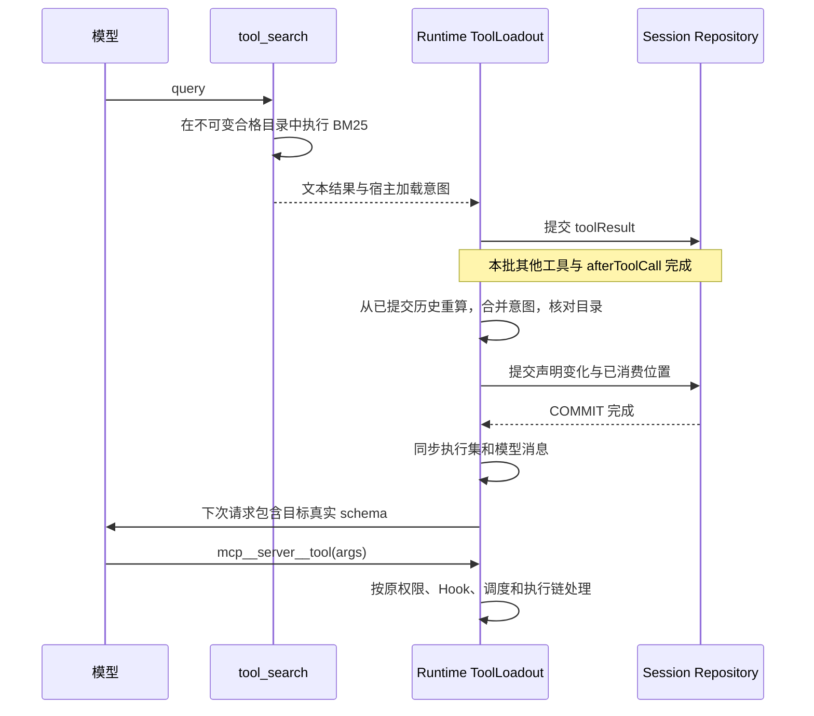

# Coko Tool Search 设计

2026-11-04。用户已指定：加载和恢复参考 Rukie、检索采用 BM25、本次只设计不写代码，文档在主仓库 main 提交。本设计其余范围与参数为可评审提案，未表示功能已实施；不自动创建规格或实施票。

## 1. 问题与范围

当前 Coko 每个 Run 把已连接 MCP Server 的全部工具定义提供给模型。连接多个 Server 时，任务未使用的参数 schema 也占据上下文。目标是让模型先发现相关工具，再按真实工具名执行，并让此过程在重启、压缩和回退后可确定性恢复。

本期建议范围：

- 工具名为 `tool_search`，只发现当前 Session 有资格使用的 MCP 业务工具；常用内置工具、资源入口、认证与恢复入口保持常驻。
- 搜索与加载合并为一次模型工具调用；BM25 在本地运行，命中后呈现目标的完整真实定义。
- 执行仍经过原目标工具的权限、Hook、调度、超时、取消、Secret 与审计链。
- 将加载事实提交为 Session Entry 中的工具声明变化，从有效历史重建；不建立独立 loaded 表或全局发现集合。
- 复用现有 Session、上下文用量、导出和通用工具卡。首版不新增设置界面或专用工具搜索页。

不在本期：通用 `execute_tool` 代理、向量检索或 reranker、provider 托管检索、自动付费能力探测、工具自动淘汰、引入 pi-durable/chord、搜索服务端资源或提示模板内容。原生增量传输作为后续优化，不是本期可用性的前提。

### 设计场景

以下 TS 编号仅用于本设计的验证追踪，不冒充已确认规格验收。

| 场景 | 目标结果 |
| --- | --- |
| TS-01 首次请求与发现 | 初始不含 deferred schema；搜索后下一次请求包含命中定义，业务工具可正常调用 |
| TS-02 检索与定向选择 | 自然语言用 BM25；明确名称可精确选择；结果与注入量受限 |
| TS-03 权限与候选资格 | 搜索不越过 Server 批准、禁用工具或子代理范围；加载不授予执行权限 |
| TS-04 提交与崩溃 | 已提交搜索意图可继续完成加载；未提交结果不能影响恢复；不重跑业务副作用 |
| TS-05 历史与压缩 | resume/continue/retry、压缩和回退均按有效分支恢复工具声明 |
| TS-06 Session 派生 | 普通 Fork 保持既有复制语义；新子 Session 与 Handoff 独立发现 |
| TS-07 目录与配置变化 | 删除、断连、schema 变更、开关切换及并行搜索有明确结果 |
| TS-08 观测与请求预算 | 上下文估算与真实呈现一致，日志、工具卡和导出保留业务目标身份 |

## 2. 来源与现有约束

### 证据与确认

- 已指定的两个方向：Rukie 式加载/恢复、BM25。具体算法参数、配置位置和发布时序为本文提案。
- [仓库综合研究](research/repository-comparison.md)、[Rukie 研究](research/rukie.md)与[公开仓库源码研究](research/public-repositories.md)提供固定版本证据。Rukie 的搜索算法不继承，其 native capability probe 也不自动引入。
- 补充的[程小帮研究](research/chengxiaobang.md)区分当前重写工程与1.9.2解包产物：后者的 BM25/CJK 分词与目录预算可参考，独立发现集存储及分叉复制不作为恢复方案。其8000字符搜索结果预算与本设计8192估算 token 的 schema 加载预算不是同一概念。
- Coko main 基线 `9ce6350823f3a401c3d78cbb214d160d812ed4f3`。本次实际读到的安装包为 pi-agent-core/pi-ai 1.4.0，不套用 Rukie 的 pi-durable 1.0.4 Interface。
- [Agent 执行约定](../../docs/tech-stack/agent-runtime.md)、[ADR 0003](../../docs/adr/0003-settings-and-sessions-in-sqlite.md)、[ADR 0006](../../docs/adr/0006-file-checkpoints-and-rewind.md)、[ADR 0008](../../docs/adr/0008-project-files-only-tighten.md)、[ADR 0014](../../docs/adr/0014-subagents-as-child-sessions.md)继续适用。

### 已存在的接入位置

| 现有位置 | 已核查的事实 | 本设计如何使用 |
| --- | --- | --- |
| [engine/runtime.ts](../../packages/agent/src/engine/runtime.ts) | `message_end` 可等待提交；`prepareNextTurnWithContext` 更新工具；提交失败会停止 Run | 在结果提交完成后的轮次衔接发布加载变化；首轮和恢复也使用同一发布 Interface |
| pi-agent-core `dist/agent-loop.js`（锁定 1.4.0） | `context.tools` 决定执行集，`declareToolChanges` 在请求前形成 system `toolsAdded/toolsRemoved`，消息提交先于请求；之后才调用 `prepareRequest` | 复用其工具声明语义；主动发布完成时同步消息与工具，避免内核重复声明；压缩后必须在请求前再核对 |
| [context/index.ts](../../apps/server/src/application/context/index.ts) | `layeredTools.allow()` 同时过滤 get/list，是当前资格限制 | 继续保留资格限制；不把它直接当已加载集合 |
| [session-runs.ts](../../apps/server/src/application/session-runs.ts) | 每 Run 装配工具，`refreshTools()` 允许本 Run 中更新 | 向 Agent 注入完整合格目录和持久化历史读取，不把 server 业务逻辑搬进搜索工具 |
| [entries/derive.ts](../../packages/agent/src/entries/derive.ts) | `effectiveEntries` 处理 rewind；`modelContext` 按 compaction 截断消息 | 在同一纯派生模块恢复工具基线，避免 renderer/server 各写一份 |
| [engine/compaction-driver.ts](../../packages/agent/src/engine/compaction-driver.ts) | 摘要成功提交后从 `modelContext` 重建消息；较早 system 工具变化会被当前切点过滤 | 工具声明不交给自然语言摘要；从已提交完整有效历史合成压缩后的声明基线 |
| [agents/fork.ts](../../packages/agent/src/agents/fork.ts) | 普通 Fork 复制目标前有效消息，压缩前原文不复制 | 为被省略历史中的工具声明物化一个基线消息，再重映射压缩切点 |
| [models/registry.ts](../../packages/agent/src/models/registry.ts) | Coko 自行构造模型，未提供 native tool search 能力配置 | 本期使用普通 tools 呈现；不新增探测或按模型名猜测能力 |

本期不新增数据库表或 session kind。现有 `message` payload 允许 system 工具声明与 toolResult details；新增的内部结构仍须类型化并在读入时校验。没有新功能产生的历史无需扫描回填。后续如必须改变现有严格 payload，按所属版本化协议单独设计，不凭本提案添加兼容 shim。

## 3. Module 责任与 Interface

### 三种集合

1. **Eligible catalog**：当前 scope 下通过配置、Server 批准、连接状态、disabledTools、插件与子代理工具范围筛选后的完整目录。需要审批的目标可以被发现；执行授权仍逐次判断。
2. **Committed loadout**：有效分支中已提交的 system 工具声明归并得到的有序定义集，外加最后已消费的搜索意图位置。它是可恢复事实。
3. **Presented tools**：常驻工具加仍合格且契约未变化的已加载目标。当前请求的可执行集合与它保持相同。

只隐藏 schema 不等于撤销目录资格。子代理的允许工具计算使用 eligible catalog，不能使用父级 presented tools。

### 责任表

| Module / 进程 | Interface 与所负责的行为 | 不承担 |
| --- | --- | --- |
| `packages/agent/src/tools/tool-search/`（拟新增） | BM25 索引与工具定义；`search(query, catalog, limit)` 返回稳定身份与定义摘要 | Session 写入、目标工具执行、模型循环 |
| `packages/agent/src/engine/tool-loadout.ts`（拟新增） | `prepare(snapshot)` 计算工具集、未消费意图和声明变化；`publish` 等待提交后更新运行时 | 读取 MCP 配置、SQLite SQL、HTTP、自动能力探测 |
| `packages/agent/src/entries/` | 有效历史中的声明/意图派生；压缩基线；普通 Fork 所需快照 | 文件、网络、pi 运行时资源 |
| `apps/server/src/application/context/mcp.ts` 与 Session 装配 | 提供合格目录快照、原始 server/tool 标识、目录 revision、scope 与历史 Repository 读取 Adapter | BM25 算法、独立加载状态表 |
| `packages/session` | 原有 append-only 提交、seq 分配、读取与 Fork 事务 | 解释工具加载业务状态 |
| pi-agent-core / pi-ai | 执行循环、声明变化表示、参数校验与 provider 序列化 | Coko 的 Session 所有权与恢复政策 |

只有真实变化的 seam 才增加 Adapter：目录与提交来自宿主，BM25 与归并保持纯逻辑。不创建可替换检索框架、通用加载总线或另一套 Agent Loop。

### 最小 Interface 语义

以下是设计形状，不是本次新增源码或承诺最终导出名称：

```text
CatalogSnapshot { scopeKey, revision, entries }
CatalogEntry { name, server, originalName, declaration, contractHash, implementation }
SearchResult { selected[], alreadyLoaded[], unknown[], skipped[], catalogRevision }

ToolLoadout.prepare({ entries, catalog, policy, model })
  -> { presentedTools, deferredNames, declarationChange, consumedThroughSeq }

ToolLoadout.publish(plan, commit)
  -> 等待提交完成；仅成功后更新可执行工具和运行时消息
```

`scopeKey` 包含 Workspace/Session 与子代理范围；索引共享仅限完全相同的合格目录内容，加载状态始终属于 Session。`contractHash` 使用 `toolContract` 的名称、描述、parameters、outputSchema，按对象键排序稳定编码后摘要；数组顺序保留，implementation、连接时间和运行日志不进入 hash。

## 4. 配置与候选策略

建议全局设置使用 `mcp.toolSearch: "auto" | "on" | "off"`，默认 `auto`。MCP 整体关闭时不注册搜索工具。

| 模式 | 建议语义 |
| --- | --- |
| auto | 候选定义估算 token 严格超过模型窗口 10% 时延迟尚未呈现的 MCP 工具；窗口未知时保持 eager 并给诊断 |
| on | 有候选且允许 `tool_search` 时延迟；不要求原生增量能力 |
| off | 本次工具集按全部合格工具呈现；这是显式模式选择，不是错误后的隐式回退 |

估算复用 Coko `charsToTokens`；阈值是提案参数，不是效果证明。已加载工具不会因 auto 阈值波动被撤回；目录新增工具按当前模式判断。设置变化在下一次安全轮次衔接生效，不修改正在进行的模型请求。

项目文件不接受 `mcp.toolSearch`，返回 `project-cannot-grant` 并忽略，避免让项目更改用户级呈现策略；`mcp.enabled` 的既有收紧规则照常。Headless 与桌面共用设置和 Agent 能力，首版不新增 UI 开关。

候选必须来自 MCP 目录元数据，不只凭 `mcp__` 字符串判断宿主工具来源。名称保留既有 `mcp__server__tool`，当前命名截断/hash 不变。内置工具、`tool_search` 本身、资源入口以及认证/恢复入口不延迟；当前 Coko 没有 MCP OAuth authenticate 工具，不为了模仿 Rukie新增它。

如果子代理 allowlist 或权限策略禁止发现入口，则其合格工具直接呈现，不生成无法执行的 deferred 提醒。业务目标的 deny/ask 仍按既有策略处理；不把 plan/read-only 误解为“所有外部工具都可执行”。

## 5. BM25 检索

### 字段与分词

每个工具是一篇文档，索引四个字段：

| 字段 | 内容 | 初始权重 |
| --- | --- | --- |
| name | 原始工具名与规范化调用名 | 4 |
| server | Server 名与可用的 Server 说明 | 2 |
| description | 工具描述 | 2 |
| parameters | 递归提取属性名、参数 description/title，包含 items/oneOf/anyOf/allOf/$defs | 1 |

只从当前定义对象提取文本，不跟随远程 `$ref`，不把 enum 数据或默认业务值机械铺进索引。对遍历设置深度/节点/字符预算并用工具身份排序后稳定截取；超限给诊断，不执行未知对象方法。原 schema 保持完整，索引文本限额不截断可调用定义。

统一 Unicode NFKC 与小写；拆分 snake_case、camelCase、连字符；保留完整标识符用于精确查找。拉丁字母/数字作为 token，单字符标识符保留。连续汉字使用相邻二字 bigram，单个汉字保留；保留路径/属性片段。首版无词干、固定停用词表、同义词扩展或跨语言翻译服务。中文与英文描述间无共同词时不会凭空召回，模型可用英文关键词重搜，评测须覆盖这一限制。

### 排名

采用按字段计算再加权相加的 Okapi BM25，`k1=1.5`、`b=0.75`，明确不把它称为未实现的 BM25F：

```text
idf(t) = ln(1 + (N - df(t) + 0.5) / (df(t) + 0.5))
score(d,q) = sum_f weight(f) * sum_unique_t_in_q
  idf_f(t) * tf_f(t,d)*(k1+1)
  / (tf_f(t,d) + k1*(1-b+b*len_f(d)/avgLen_f))
```

空字段对该项记0。统计语料是已按资格筛选的当前目录；加载状态不改变索引语料，否则同一查询会随加载而无意义重排。只返回正分结果，同分按规范化调用名的确定性序比较。首版在内存使用倒排索引；不依赖 SQLite FTS5 的分词或 rank 约定，不引入外部检索服务。

`revision` 由工具身份、完整契约摘要、可搜索元数据与分词版本生成。名称相同但描述/schema 改变仍使索引失效；目录仅重排不重建同内容索引。新索引完整构建后原子替换，进行中的查询持有不可变快照。错误不自动退到另一种检索算法。

### 模型工具 Interface

`tool_search` 参数：`query` 非空、最多512字符，`max_results` 为1–20整数、默认5，禁止额外参数。

- 完整工具名与 `select:NAME,NAME`：精确选择、去重、保持请求顺序。最多20个，不继承 Rukie 精确选择无限制的规则。未知或当前范围外名称统一为 unknown，不泄漏范围外定义。
- 普通文本：BM25 排名。`+term` 为工具名的规范化子串硬过滤，在最终 top-k 之前统一执行，不让其他检索支路绕过。
- 返回已匹配名称、简短描述、selected/already-loaded/unknown/skipped，注明定义将在后续请求发布；不给“仅结果返回就已提交加载”的误导承诺。
- 每次拟追加定义的估算上限8192 token，并受当前请求可用空间约束。按结果顺序选择，超预算目标列 skipped；不截断 schema。已加载目标不重复计新增量。单个定义超过预算时给明确诊断，由用户选择 off 后完整呈现；不自动放大预算或切换模式。

工具完整定义从当前可信 catalog 获取；模型输入不能传入任意 schema、Server 地址或实现对象。匹配完成后、发布前重新核对契约摘要，变化则列为 stale，要求重新发现，不能悄悄加载不同定义。

## 6. 加载提交与请求时序

### 正常路径



`tool_search` 为 `effect: read`，宿主按 `context-read` 权限类登记，仍允许显式 deny 和 PreToolUse 拦截。结果通过原 message_end 提交屏障保存，不直接写 SQLite。加载发布只在批次完成后进行，不在并行工具执行中改变该批工具绑定。

### 可恢复的两阶段记录

1. **搜索结果中的请求意图。** 仅成功提交的 `tool_search` toolResult，使用宿主控制的 `details.toolSearch` 保存版本、所选名称/contractHash、catalog revision。它是“请加载这些定义”的请求，不是另一个已加载集合。失败、被拦截、取消或未提交的结果无有效意图。
2. **已发布声明。** 使用现有 `kind: message` / system 消息保存原生 `toolsAdded/toolsRemoved`，并用内部 `toolLoadout: {version: 1, throughSeq}` 标明已消费的搜索结果位置。此消息及后续原生声明归并得到当前已发布集；不在设置、Tool State 或额外表复制它。

`throughSeq` 只指本 Session 的已提交 seq，读取时验证版本、顺序与范围；普通 Fork 创建新 Session 时重新生成，而不复制旧 seq。它不是 Run ID，不是模型给出的 cursor。Host 只为自己的 system 发布消息设置该标记；其他工具结果不能伪造加载指令，输入/导出读入均校验。

准备时先归并最后已发布声明，再只消费其 `throughSeq` 之后的成功意图，按照工具调用顺序合并、按名称与契约去重。即使没有新声明（如重复搜索或目标已移除），也提交消费位置，避免以后重复消费或使旧工具复活。

发布 Interface 负责工具声明变化的唯一写入，普通宿主工具刷新也通过它：提交成功后把同一消息和工具集同步到 Agent 与下一轮 context。同步完成时 pi 的 `declareToolChanges` 应检测不到额外变化；若内核仍生成宿主声明，必须接入同一提交屏障和消费位置规则，不能绕开规划另写状态。实现验证必须证明只有一份追加，而不是同时手工发布和内核各写一份。

首轮执行也要提交一个可恢复的初始声明基线（包括 eager 工具），不能把 Agent 构造阶段未提交的 leading system 当作唯一事实。该工具基线独立于每 Run 动态重建的系统提示段落；不在其中保存凭据或实现。首轮/下一轮/continue/retry 全部经相同准备过程，不复制发布逻辑。

### 顺序与失败

- 保留契约相同工具的历史顺序；新增按本批工具调用/结果顺序追加，重复命中只追加一次。
- 删除或同名契约变化先撤销旧定义；新契约重新发现后追加。不能实现目标顺序时才完整替换，明确接受缓存失效。
- toolResult 提交失败：停止 Run，丢弃未提交意图；不得更新执行集。
- toolResult 已提交、声明尚未提交时崩溃：恢复准备消费该意图并重新核对目录，完成加载；不再次执行搜索或任何业务工具。
- 声明提交成功、尚未发送请求时崩溃：按声明恢复；重复准备不产生第二份变化。
- 发布提交失败或同步不一致：以 `commit_failed`/内部一致性错误停止，不能用未提交工具发请求。
- 显式暂停/取消在发布前到达时不发新请求；已经提交的成功意图在以后用户继续时消费。取消不是历史回滚，未提交结果不消费。
- 若模型同批直接调用尚未加载工具，其调用按当前批执行集返回 unavailable；不能因同批另一调用进行了搜索就追认其权限或重跑。

## 7. 恢复、压缩与 Session 派生

### 共同恢复步骤

1. 通过 `effectiveEntries(entries)` 排除 rewind 区间，保留完整有效历史；不能只读取被压缩后的消息字符串。
2. 从工具声明 system 消息归并已发布集与有效消费位置，再准备未发布意图。
3. 与当前 eligible catalog 做交集和契约检查，重建 current presented tools。
4. 在下一次请求前发布必要变化，再调用模型。恢复本身不产生业务副作用或隐式继续 Run。

历史旧定义可用于解释原调用，不等于当前仍可执行。内存索引与 planner 缓存均可丢弃，重启时重建，不是恢复权威。

### 压缩基线

Coko 的 append-only 原条目仍在库中，因此本期不为 compaction payload 再保存一份 loaded names。`modelContext` 从完整有效历史归并**切点之前**的工具声明，在保留的消息前合成一个只含声明的 system 基线；随后继续应用保留区间内的 toolsAdded/toolsRemoved。不能拿“压缩提交时最终工具集”作为切点基线，否则会提前暴露保留区间中后来才发现的工具。

合成基线不另写一条实时加载事实，不依赖摘要模型记住工具名，也不经过旧 toolResult 文本裁剪。prepareRequest 的自动压缩发生在 pi 本轮声明之后，因此压缩完成后必须重新使用同一纯派生结果同步工具与请求消息；不能沿用压缩前的缓存声明。

声明恢复及消费位置读取完整有效条目，模型提示与工具卡只使用其适用投影。当前会话不删除原历史；未来若引入物理历史清理，必须先设计持久化快照，不能假设本文方案覆盖已删除数据。

### 生命周期矩阵

| 操作 | 加载语义 |
| --- | --- |
| 重启/resume、continue、retry | 恢复当前有效分支，消费仍未发布的成功意图；不重跑目标副作用 |
| 手动/自动/overflow 压缩 | 恢复切点基线与尾部变化，已加载定义不丢失；摘要请求本身无工具 |
| 对话 Rewind | 被回退区间内的意图、声明与消费位置失效；纯文件回退不改变工具加载 |
| 普通 Fork | 遵守 ADR 0006：继承目标用户消息之前的有效加载事实，不能继承目标之后的父内存状态 |
| 新子 Session / teammate | 自己的目录与发现历史，起始不继承父已加载集合；父级合格目录仍限制上限 |
| 保留的子 Session 再次运行 | 恢复该子 Session 自己的历史 |
| Handoff | 新 Session 不复制工具声明或加载状态；摘要文本中的工具名字不算加载事实 |

普通 Fork 与 Rukie `subagent_fork` 的差异是有意保留的 Coko 领域语义。存在 compaction 的普通 Fork，要在复制保留消息前物化原切点的工具基线为新 Session 的普通 system message，并按复制后的 seq 重新计算消费位置和 `firstKeptSeq`。未消费成功意图在 Fork 事务中按目标前历史归并入该基线；不能把旧 Session seq 指针带过去，也不能丢弃意图或复制完整旧历史规避切点。

所有派生由 `@coko/agent/entries` 的纯逻辑统一提供，server 与 renderer 使用同一结果。基线保持文件/工具调用配对，Fork 之后首次回退也不能使摘要或工具基线消失。

## 8. 目录、授权、并发与资源

- 每 Run 开始刷新目录；本 Run 的 `tools/list_changed`、重连、停用或 schema 改变通过宿主通知标脏，在下一轮安全衔接重取并发布。避免每次检索重新启动全部连接。
- Server 断连后，下一轮不呈现其工具；已移除定义提交撤销，重连再出现时重新发现。若用户已显式选择 off，按 eager 重新呈现。进行中的调用按原取消/错误机制完成，不假装外部副作用被撤销。
- 查找持有不可变快照；发布和调用前核对当前目录/契约。当前批已绑定调用若在 MCP 发出前发现目标已停用或变更，返回 `tool-stale`/unavailable，不调用新定义；已经发出的调用按执行记录结算。
- 同名 schema 改变不能只凭名字复用索引或发现事实。单纯重连且尚未撤销的相同契约可保留；本设计不以连接对象身份充当工具语义身份。
- 子代理工具交集以父的 eligible catalog 为输入，再应用自己的 allowlist 与加载规划。禁止父会话发现集泄漏到子会话；禁止只看父 presented tools 导致子代理丢失尚未被父搜索的能力。
- 搜索不申请目标业务 Secret，不调用业务工具，不改变审批状态；真实调用按当前规则判定。原 `mcp__server__tool` 名称贯穿 Hook matcher、工具卡、执行意图、结果确认与 trace。
- 索引缓存按作用域/revision 引用计数或有限数量淘汰，Session 关闭即释放其引用与待提交内存意图；缓存可重建。加载状态不做自动 LRU 卸载，多轮使用全部工具最终仍可能接近 eager 占用，应通过评测报告这一限制。

## 9. 协议、展示与预算

本期各 provider 都提供当前普通 `tools` 集合，模型适配继续由 pi-ai 完成；没有原生能力时也能工作。工具列表变化可能使前缀缓存失效，不能宣称达到原生加载的相同收益。

后续如果需要 native `additional_tools` / `tool_search_output` / Messages tool changes，必须在独立方案中确定路由、显式能力配置和真实协议测试；不能仅按 API 名称开启，也不在本期偷偷增加探测调用或失败重试分支。

`tool_search` 结果使用现有通用工具详情与实时状态展示；暂不调整桌面布局、token 或专用卡。新增参数、结果、错误类型与相关说明同步中英文文案，只添加本功能必要文案。

[context/usage.ts](../../apps/server/src/application/context/usage.ts) 必须使用同一 planner 的实际 presented tools，而不是继续把全 MCP catalog 计入模型上下文。schema 在顶层与历史声明中的统计遵从同一路由投影，不能重复相加；deferred 目录名提醒计入 system。自动压缩准入同样考虑工具定义、系统提示与输出预留，避免消息压缩成功但工具列表仍超窗。上下文预览只做纯规划，不提交意图或触发搜索/业务调用。

模型初始提示给出简短 Server 能力摘要和预算内的 deferred 名称，说明先搜索再调用。目录提示估算上限为 `min(2048, contextWindow * 0.025)` token：优先保留 Server 能力摘要，再按稳定顺序列名称；超限省略名称，明确可继续自然语言搜索，不假装名单完整。窗口未知时使用2048上限。名单变化只对已公告部分使用 Added/Removed；压缩后从当前目录和预算重新生成提醒，不从自然语言摘要恢复名单。提示中不放完整 schema，不能被 reducer 当成加载事实。此提案借鉴程小帮1.9.2的分层目录呈现，但不复制其独立状态存储和字符/token换算。

trace 保留 `tool_search` 的 query、返回名称、耗时与状态，以及实际业务工具调用；不记录目标 Secret/认证头。若记录 BM25 分数与 revision，仅作为诊断，不能成为权限输入。Goal 使用原工具/模型调用计数；本地检索不伪造模型用量，没有额外探测费用。

## 10. 真实备选方案与取舍

| 方案 | 取舍与结论 |
| --- | --- |
| Rukie 式真实工具加载 + BM25 | 本方案；保留业务工具身份，恢复依赖已提交历史。需要适配 Coko 的内核提交衔接 |
| Rukie 原关键词算法 | 更简单，但用户已指定 BM25；仅保留精确选择与 required-term 语义 |
| provider 托管 tool search | 接口依赖与路由限制不同，也不满足统一采用本地 BM25；不用于首版 |
| FastMCP 式固定搜索/执行代理 | tools 前缀稳定，但真实目标要穿透代理参与权限、Hook、取消和恢复；不改变 Coko 当前执行入口 |
| 独立 loaded 表/Tool State | 查询直观，但与消息工具声明构成重复事实；不采用 |
| 只从被压缩后的自然语言摘要恢复 | 工具名字、定义版本和调用时点可能丢失；不采用 |
| 全量引入 pi-durable | 与 Coko 已选执行结构不符；仅参考 Rukie 原则，不移植其 Harness |

暂不新增 ADR：BM25 与 Rukie 参考方向已有本次用户授权，完整架构仍为 draft。设计确认后，如需形成项目长期决定，再提炼独立 ADR 正文；不通过提交本设计自动批准全部建议。

## 11. 验证与实施顺序

### 建议切片

1. 纯历史归并、BM25 与 planner：固定输入下验证选择、顺序、预算和声明变化；不接业务网络。
2. 真实 Session/Runtime 最小闭环：搜索结果提交、轮次衔接发布、下一轮真实调用，验证普通 tools 路径。
3. 故障与生命周期：提交失败、发布前崩溃、并发、目录变化、压缩、Rewind、Fork 和子 Session。
4. 宿主配置、上下文用量、通用工具展示与文档；完成代表性真实模型评测后决定默认阈值是否调整。

本节不是实施票或自动执行授权；本次仅提交设计和研究材料。

### 验证矩阵

| 场景 | 最小真实入口 | 必须观测 |
| --- | --- | --- |
| TS-01 | 真 Sidecar + faux provider + MCP fixture | 第一次请求无目标 schema，搜索后下一次请求有且 handler 实际执行，只有一份声明追加 |
| TS-02 | BM25 公开 Interface +固定目录 | 参数描述召回、name 权重、中文 bigram、required 过滤、同分稳定、零命中、未知名称、非法参数、完整 schema 不截断 |
| TS-03 | Sidecar 权限/子代理/MCP 配置 | 批准前不进目录；disabled 与范围外不泄漏；发现成功后业务 deny 仍阻止 handler；PreToolUse 可阻止搜索 |
| TS-04 | Repository 提交 barrier +真实 Sidecar 重启 | 结果未提交、意图已提交、声明已提交三个位置分别中断；恢复不丢已提交意图、不重跑搜索或外部工具 |
| TS-05 | 真实持久化 Session | 各压缩触发、旧结果裁剪、两次压缩、对话与纯文件 Rewind、重启后请求定义正确 |
| TS-06 | 协议 Fork/子代理/Handoff | 普通 Fork 继承目标前状态且 seq 正确；目标后不继承；新子会话独立；无搜索入口 eager；保留子会话可恢复 |
| TS-07 | 可控 MCP fixture 与并发 barrier | 搜索/发布之间改 schema，断连重连、删除再出现、并行同名命中、auto 抖动；不执行过期定义 |
| TS-08 | 用量接口、导出回放与 Browser Mode | 全目录不重复计费；预览无写入；真实工具名贯穿审批、Hook 与工具卡；输出录制覆盖完整链路 |

真实 provider 验证单独报告：对 Coko 三种受支持协议分别检查首次无候选、追加后 schema、正常调用与恢复，记录模型和 endpoint 路由。faux 测试只能证明 Coko 链路，不能证明任意网关兼容。

性能/质量对照使用同目录、同任务比较 eager 与 BM25 按需加载：记录 Recall@5、正确目标调用率、最终任务完成率、搜索次数、输入/缓存 token、首次业务调用及总耗时。覆盖中英文、相近工具、大 schema、多 Server 和目录变更；保存目录与查询集版本。没有样本前不承诺节省比例或固定延迟收益。

实施后同步所属当前正文：`docs/subsystems/mcp.md`、`context.md`、`subagents.md`、`configuration.md`、相关包 README、条目/协议契约与必要 trace/恢复说明。纯设计阶段不把这些当前行为页面改写成已实现，也不修改正式导航反向依赖本任务目录。

## 12. 待确认与实施前检查

已确定方向：BM25；Rukie 的加载与恢复原则；只交付设计；main 本地提交。

供本设计审阅的明确建议：首版只覆盖 MCP；搜索即加载；普通 tools 传输；`mcp.toolSearch=auto` 与10%估算阈值；每次默认5/最多20项和8192新增 schema token；全局配置；保留 Coko 普通 Fork 语义。上述建议已有具体行为，不以未决问题留空；用户可在实施前调整。

实施前必须通过小范围契约验证确认两处内核接线：手工发布与 pi 自动声明不会重复；prepareRequest 自动压缩后的合成基线能够同时对齐 runtime 与 provider 请求。验证失败时回到本设计调整 seam，不 patch pi、不引入第二个模型循环。是否增加 native 传输与自动探测不阻塞首版，也未经本方案授权。

本文件状态保持 draft：提交表示已保存可评审方案，不表示完成产品验收。本次未写产品代码、未运行产品测试或真实 API；文档检查与提交证据由[任务入口](README.md)记录。
