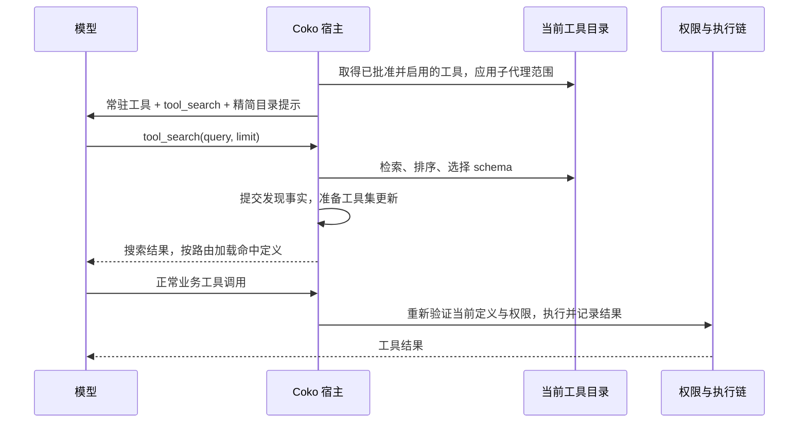

# Tool search 如何实现

调研日期：2026-11-04。状态：研究与工程建议，未批准为规格、未实施。入口：[本次研究](../README.md)。

本页是首轮接口与 Coko 接入研究。追加的真实仓库调研见[仓库实现综合对照](repository-comparison.md)，包含当前 Rukie、官方 Claude Code 的证据边界、本地社区版与四个公开项目；涉及 Rukie 现状时以该轮源码证据为准，不沿用旧 Neant 的原生能力门槛。

## 结论

Tool search 是一种工具定义按需进入模型上下文的机制：先呈现少量常驻工具与发现入口，模型搜索后，宿主将命中的完整定义加入后续请求，模型再正常调用。检索、加载、执行授权是三个不同环节。只返回工具名称或文档，并没有使该工具可调用。

对 Coko 的建议是：由应用持有工具目录和会话加载事实；第一阶段只延迟 MCP 工具，保留常用内置工具；采用精确名称匹配加 BM25 的本地检索；按实际 provider、模型、API 路由与适配器能力选择加载方式。先验证最小端到端链路，再决定启用阈值和语义检索投入。这是依据下述源码与官方接口作出的工程判断，不是已确认产品决定。

## 一、两类实现路径

| 路径 | 初始呈现 | 搜索后怎样加载 | 主要取舍 |
| --- | --- | --- | --- |
| provider 原生延迟加载 | 搜索入口及 provider 规定的目录摘要 | 原生引用或加载事件在会话中展开 schema | 缓存语义较明确，但依赖特定 API、内容块和适配器支持 |
| 应用实现普通 `tool_search` function | 常驻工具、搜索函数、精简的目录提示 | 宿主把命中的 schema 加入下一次请求的有效 tools | 可覆盖常规 function calling；变更顶层 tools 可能重建缓存前缀，效果须实测 |

两者可以共用检索与授权目录，但 wire format 不能混用。普通函数返回一段 JSON，不会自动变成原生工具加载事件；同样，API 支持 function calling 不代表支持原生搜索。

### OpenAI

Responses 提供 hosted 和 client-executed 两种搜索。后者适合由应用控制动态目录；原生发现结果可在会话后续复用。namespace 能减少初始目录暴露，单独延迟一个 function 仍暴露其名称和描述。原生搜索的加载位置有保留前缀缓存的设计。[官方指南](https://developers.openai.com/api/docs/guides/tools-tool-search)

client 模式配置 `execution: "client"` 与参数 schema；模型产生 `tool_search_call`，应用按同一 `call_id` 返回 `tool_search_output`，其 `tools` 携带可调用定义。`additional_tools` 是另一种会话中添加定义的输入项，不能当作普通文本处理。[API 类型定义](https://developers.openai.com/api/reference/resources/responses/subresources/input_items/methods/list)

当前 Sign in with ChatGPT 文档明确排除 Responses `tool_search`，client execution 也不例外；该路由列出 namespace 与 `additional_tools` 支持。必须区分标准 API、登录路由与本地源码版本，不能只按模型名称开启能力。[官方路由限制](https://developers.openai.com/siwc/token-sharing-open-source/preview-limitations)

### Anthropic 与 MCP

Anthropic 支持内置 regex/BM25 搜索，延迟定义设 `defer_loading`；也可自行检索并返回 `tool_reference`。其原生方式仍要求请求带上全部候选定义，缩减的是模型上下文。MCP 负责工具列表、调用和变更通知，模型搜索和加载策略由宿主负责。两者的请求、历史和协议版本细节见[专项资料](anthropic-mcp.md)，其中每项结论直接引用官方页面。

## 二、当前 Coko 能复用什么

本节依据当前工作区实际源码。基线 HEAD 为 `9ce6350823f3a401c3d78cbb214d160d812ed4f3`；本次只新增研究文件。CodeGraph 查询报告当前路径没有可用索引，因此使用直接源码核查。

| 已存在的接口或行为 | 证据 | 对 tool search 的意义 |
| --- | --- | --- |
| 注册表管理工具定义、实现及权限类别，`list()` 按登记顺序给出全部有效工具 | [registry.ts](../../../packages/agent/src/tools/registry.ts) | 保留执行目录；额外决定哪些定义呈现给模型 |
| MCP 按 Run 收集已连接 Server 的工具 | [mcp.ts](../../../apps/server/src/application/context/mcp.ts) 的 `runTools()` | 有现成候选源；不等于已经延迟呈现 |
| 贡献组合及 `layeredTools.allow()` 会同时过滤 `get()` 与 `list()` | [context/index.ts](../../../apps/server/src/application/context/index.ts) | 现有 allow 是可用性边界；不能直接当成可逆的延迟加载集合 |
| `SessionRunService.refreshTools()` 重取贡献、应用过滤，再通知 runtime | [session-runs.ts](../../../apps/server/src/application/session-runs.ts) | 可以接到搜索后的工具刷新链路；重取全目录时必须保留已发现状态 |
| runtime 的 `effectiveTools()` 包装超时、调度与权限观察；`prepareNextTurnWithContext` 在工具变化后更新下一轮工具 | [runtime.ts](../../../packages/agent/src/engine/runtime.ts) | 有下一轮更新位置；搜索结果必须在工具批次完成后、下一次模型请求前生效 |
| 当前子代理工具范围通过父级工具与定义交集获得 | [subagents.ts](../../../apps/server/src/application/context/subagents.ts)、[ADR 0014](../../../docs/adr/0014-subagents-as-child-sessions.md) | 延迟加载后要用父级有资格使用的目录求交，不能只用父级当前加载集 |
| Coko 明确支持三种协议并自行构造模型；`ModelSpec` 暂无 tool search 能力配置，`buildModel` 仅显式设置 adaptive thinking 兼容字段 | [models/registry.ts](../../../packages/agent/src/models/registry.ts) | 不能把参考项目的 compat 开关当作 Coko 已接入能力 |
| pi 依赖锁定 `1.4.0` | [agent/package.json](../../../packages/agent/package.json) | 文档检查时 pnpm 自动按锁文件补齐依赖；未运行真实 provider 请求，原生 wire 支持仍需核查锁定版本 |

现状结论：有动态工具组装基础，尚未发现 Coko 已有 `tool_search` 产品能力或其专用状态管理。搜索范围为 `packages/agent/src`、`apps/server/src` 与已有 `.scratch`；这不是对所有依赖内部的实现否定。

## 三、首版建议的数据流

下图是建议，并非已实现结构。目录与状态以 Session 为作用域，MCP 连接与执行仍复用现有宿主。



### 将三个集合分开

1. **当前有资格使用的目录**：通过 Server 批准、启用状态、`disabledTools`、工作目录和子代理工具范围得到。需要审批的业务工具仍可被发现；“需要审批”不等于“目录不存在”。
2. **已加载定义**：本 Session 经搜索发现并提交的工具身份与定义版本。加载不代表用户批准执行。
3. **本次请求呈现的工具**：常驻工具加已加载且仍有效的工具；原生路由还需要正确投影历史加载事件。

执行时继续走现有权限、Hook、调度、超时、秘密脱敏与恢复机制；搜索不得调用目标业务工具，不应为“发现”直接取得目标工具所需 Secret。[权限现状](../../../docs/subsystems/permissions.md)、[MCP 现状](../../../docs/subsystems/mcp.md)、[ADR 0008](../../../docs/adr/0008-project-files-only-tighten.md)

### 建议的最小接口

以下仅表达语义，不是要求新增这些类或公开 TypeScript API。

```text
search(query, limit, eligibleCatalog)
  -> matches[{toolIdentity, definitionRevision}]

load(matches, sessionHistory, currentCatalog)
  -> committedDiscovery + nextRequestToolPresentation
```

普通 function 模式下，搜索结果可展示命中名称、说明与加载状态；schema 的正式来源仍是下一轮 tools。原生模式由适配器生成 provider 所需内容块。不要把两种路径统一成“给模型返回完整 schema 文本”而遗漏真正的声明。

建议默认 limit 从 5 开始评测，设置可配置的结果数及 schema token 上限。该数值是实验起点，没有产品批准或性能证据。返回空结果时允许改写查询；目录为空时不注册无效搜索入口。

### 检索实现

首版可以内存实现，工具规模与性能证据不足以要求新增向量数据库：

- 索引 server/namespace、原始工具名、规范化调用名、描述、参数名及参数说明；避免把整份 JSON Schema 机械拼接为大量无关字段。
- 先处理完整工具名精确匹配，再对自然语言按字段加权 BM25；分词拆分 snake_case、camelCase 和连字符，保留原始名称检索。
- 排序前先筛候选资格，再截取 top-k；稳定排序以工具身份处理同分情况。
- 支持中文任务对英文目录的评测；可提示模型生成带英文关键词的查询。只有词法召回不足的实测证据出现后，再评估 embedding 或混合检索。
- 用 catalog revision 使索引缓存失效；限制描述长度与索引大小。任意用户正则不是首版必要能力。

上述算法选择是工程建议。本地 Codex 使用 BM25 的源码证据见下一节；不能由此推导 Coko 的中文召回率。

## 四、参考源码提供了哪些证据

本地源码属于具体 checkout，不代表官方托管服务行为，也不保证与公开仓库最新版本一致。

| 参考对象与核查版本 | 已核对内容 | 可复用的经验 |
| --- | --- | --- |
| Codex `48524f337a84b570f0c2453ca43ec9a1a29375c0`，本地 `Workspaces/agent/codex` | `codex-rs/core/src/tools/handlers/tool_search.rs`：从 deferred registry 构建搜索文本语料，使用 `bm25::{EmbedderBuilder,Scorer}`，命中后才物化定义并合并 namespace；缓存根据目录来源变化重建 | 搜索元数据与完整 schema 分离；索引与目录版本绑定；BM25 的 Embedder 是该库的检索表示，不等于远程神经 embedding API |
| 同一 Codex checkout | `codex-rs/tools/src/tool_search.rs`：`ToolSearchEntry` 共享定义，`to_loadable_spec` 只对选中项处理；规范化函数设置 `defer_loading` | 不必每次搜索复制整个 schema 集；规范化 wire 定义是适配责任 |
| deepseek-harness `8bd073392eef6f54e921a093b95076248eb08cbb`，本地 `Workspaces/agent/deepseek-harness` | `packages/llm/llm-pi-ai/src/models.ts` 的 `conversationUpdates()` 区分 `in-history`、`addition-only` 与无增量更新；`packages/llm/llm/README.md` 描述工具历史投影 | 把“当前有效工具”与“何时加入历史”分开；删除和重加不能只用一个 loaded boolean 处理 |
| 同一 deepseek-harness checkout | `packages/llm/llm-pi-ai/tests/conversation-updates.spec.ts` 存在把工具加入映射成 Codex `tool_search_output` 的 mock 请求断言 | 这是序列化测试，未证明当前登录路由支持；与现行官方路由限制冲突时，以真实目标路由验证为准 |

本次还参考了旧 Neant 实施记录中的恢复与子代理风险，未把旧记录当作现行源码或能力证明。该经验只用于确定下节的核查重点；其旧版阈值、API 和能力开关不直接移植。

## 五、状态、历史与权限的关键边界

### 提交与恢复

建议将已发现工具从本 Session 当前有效历史中的确定性事实派生，避免独立的全局 loaded Set 成为第二份真相。搜索成功结果需携带可恢复的工具身份和定义版本；是否复用现有 toolResult details、工具变更 system 消息，还是新增条目，需要核对 pi 1.4.0 的持久化语义后再定。

- 搜索失败、取消或提交失败不增加已加载事实；只有历史提交成功后才向下一次请求投影。
- 重启恢复能重建加载状态；压缩时保留必要的工具加载快照或明确重新发现策略，不能只在被裁掉的搜索文本中保存状态。
- Rewind 从有效上下文重建；Fork 应按 fork 的真实复制语义决定继承哪些历史事实，不能读取父会话的活动内存集合。新建子 Session 和 Handoff 的新 Session 从自身历史开始。
- 不把“已经加载”当成“已经调用”，也不把重新发现当成需要重放业务副作用。

这些是建议验证的语义，不是已确认的跨 Session 产品需求。[术语与现状](../../../GLOSSARY.md)、[上下文管理](../../../docs/subsystems/context.md)

### 工具变化

MCP 重连、`tools/list_changed`、配置停用或 schema 改变时，更新目录和索引。搜索之后、调用之前再按当前目录核对。工具已移除或同名定义已变化时，返回明确错误或重新发现，不使用旧实现悄悄执行新契约。旧 schema 为历史解释而保留，不代表仍可执行。

对增量加载，优先保持已有声明顺序并追加；撤销、替换或路由不支持增量时，显式重建当前工具呈现，接受并测量缓存失效。不能承诺普通 function 方案与原生搜索具有同等缓存收益。MCP 通知版本差异见[专项资料](anthropic-mcp.md)。

### 子代理

当前父级工具列表同时参与子代理范围计算。接入延迟加载后必须防止：父级尚未搜索某个工具，子代理因此永久失去该工具。应先从父级合格目录与子代理定义求交，再对该子 Session 应用加载策略。

受限子代理如果允许 deferred 工具，就必须有能用的发现入口；否则对其允许的工具直接呈现。父级发现状态、目录缓存及工具执行权限不能跨 Session 混为同一集合。

## 六、验证方式与实施顺序建议

先通过当前 Sidecar 装配入口完成“首次请求没有大 schema → 搜索 → 下一次请求包含命中 schema → 业务工具成功执行”的最小切片；随后补生命周期，最后再优化检索。不要先造完整搜索平台。

| 场景 | 必须观察的事实 |
| --- | --- |
| 首次加载与重复搜索 | 初始仅常驻定义；搜索后目标真正可调用；重复发现不重复加入声明 |
| 权限与目录限制 | 未批准或停用 Server 不泄漏定义；需要审批的工具可发现，但执行仍产生原有审批；子代理不能发现范围外工具 |
| 取消、失败与并行搜索 | 未提交结果不污染加载状态；并行命中按工具身份合并；下一轮不会被重取全目录覆盖 |
| 历史生命周期 | resume、压缩、rewind、fork、子 Session、handoff 分别符合其决定的状态语义 |
| 动态工具 | 删除、同名 schema 改变与重连后不会执行过期定义；索引随 revision 更新 |
| 协议与 provider | 每条目标路由单独核对 schema、内容块、调用 ID、历史投影；faux 测试与真实 API 验证分开报告 |
| 检索质量与代价 | 测 Recall@k、正确工具调用率、最终任务成功率、搜索次数、输入/缓存 token、首次业务调用延迟及总延迟 |

建议用同一批代表性任务比较 eager、词法发现、原生发现；覆盖中英文描述、近似工具名、空结果、大 schema 与多 Server。记录工具目录快照、模型、base URL 所属路由、适配器版本及温度等配置。搜索增加一次模型往返，工具少或任务本来就需多数工具时可能不划算；不预先承诺固定节省比例或按工具数量硬编码阈值。

## 七、待决问题与本次限制

进入规格前需要确认：首版是否只覆盖 MCP；延迟加载的启用方式与阈值；原生支持不足的目标路由如何呈现工具；压缩和 Fork 的状态语义；是否需要用户可见的搜索过程及其验收范围。普通 schema 列表更新是独立实现路径，不应为了兼容而自动引入未经确认的回退机制。

本次只做文档与源码调研，没有调用付费 API、运行产品测试或测量 token/延迟，没有实施、提交、推送、合并或发布。检查结果记录在研究入口；外部网页与目标 API 能力随版本变化，实施前应重新核查。
