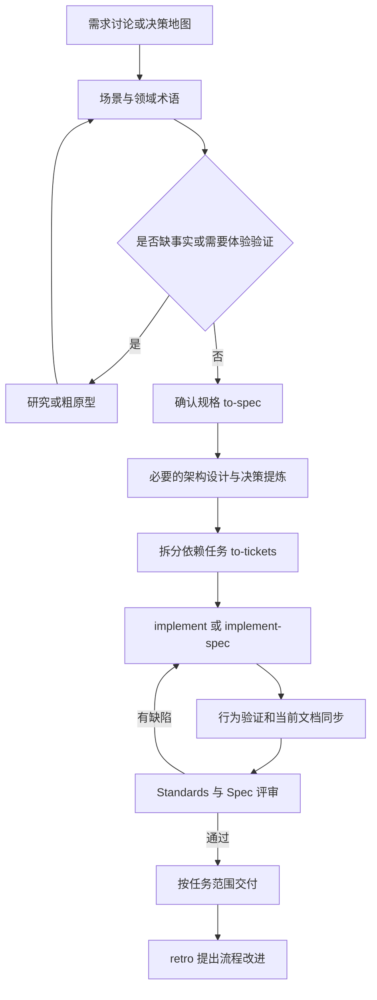

# Coko 开发与文档流程设计

采用 Matt Pocock 的现有 skills 组织需求和开发，按本项目的文档分层与证据要求维护项目知识。每个阶段留下下一阶段可直接使用的产物；产品取舍由用户决定，事实调查、文档整理和已授权实现由 Agent 推进。

本文是流程设计。上游 Matt skills 与项目补充 skills `coko-docs`、`coko-verify` 位于 `.agents/skills/`，本地文档检查为 `pnpm run check:docs`；CI 尚未建立。[文档体系](DOCUMENTATION_SYSTEM.md) 定义文档归属、模板、状态和维护规则；[技术栈](TECH_STACK.md) 拥有选型和版本，[专项技术规范](tech-stack/README.md) 拥有项目级详细技术约定，包括 UI 与测试规则；[AGENTS.md](../AGENTS.md) 只保留读取触发条件和入口。

## 从哪里开始

开始任务时按 [tracker 配置](agents/issue-tracker.md) 定位用户指定的地图、规格或票，读取其范围、依赖和讨论约定，再选择流程入口。任务的实际进度由 tracker 保存，本流程不缓存具体地图或票的状态，不自动认领或关闭决策票，也不把目标架构当作已实现架构。

| 当前情况 | 用户选择的入口 | 接下来留下什么 |
| --- | --- | --- |
| 不知道该使用哪个 skill | `ask-matt` | 对当前情况适用的流程说明 |
| 整个产品或大型功能还不明确 | `wayfinder` | 决策地图及分次解决的决策票 |
| 一个功能能在一次讨论内说清 | `grill-with-docs` | 已确认行为、术语和必要的 ADR |
| 有明确规格或实施票 | `implement` | 逐票实现、验证、评审与提交 |
| 有完整规格、依赖图和 Git 条件，希望并行实施 | `implement-spec` | 多 worktree 实施，汇入单一集成分支 |
| 现有行为出错 | `diagnosing-bugs` | 复现、定位、修复与回归证据 |
| 外部需求或缺陷报告待整理 | `triage` | 澄清后可领取的任务；不重复分拣 `to-tickets` 已产出的票 |
| 纯文档或局部机械修改 | 直接处理当前任务 | 修改及对应检查，无须强制经过完整产品设计流程 |

## 从想法到交付

流程中的箭头表示产物依赖，不表示一个 skill 可以自动调用另一个用户调用型 skill。`wayfinder`、`grill-with-docs`、`to-spec`、`to-tickets`、`implement`、`implement-spec`、`retro` 均由用户显式启动；阶段结束时保存成果并说明下一入口。

架构探索可在需求讨论期间进行；它必须能追溯到明确场景，不能反过来把尚未确认的实现选择包装成需求。实现暴露新取舍时返回相应规格或设计，不静默修改验收标准。

| 阶段 | 做什么与使用的能力 | 持久化产物 | 进入下一阶段的条件 |
| --- | --- | --- | --- |
| 1. 需求澄清 | `wayfinder` 或 `grill-with-docs`，内部使用 `grilling`、`domain-modeling` | 决策票结论、已确认术语；必要的研究或原型引用 | 目标用户、场景、结果、边界及待决问题可区分 |
| 2. 规格汇总 | 用户调用 `to-spec`，从已确认材料综合规格，讨论测试接口 | 本地 tracker 的 `spec.md` | 用户故事、适用的失败/取消/恢复行为、验收与非目标明确；阻塞决策已解决 |
| 3. 架构设计 | 使用 `codebase-design`，按下文设计步骤工作；必要时研究或原型 | `design.md`，必要的 ADR；简单局部改动可只写规格中的实现决定 | 所有权、调用方、数据流、失败保证及测试方法可解释；真实取舍有结论 |
| 4. 任务拆分 | 用户调用 `to-tickets`，确认切片与阻塞关系 | 一票一文件的实施票 | 每票可独立演示或验证，能在新的上下文内实施；架构前置工作未遗漏 |
| 5. 实施与验证 | `implement` 或 `implement-spec`，使用 `tdd`，执行 coko 的相关检查 | 代码、测试、证据记录，以及同步更新的当前文档 | 场景证据对应最终改动；必要检查无未解释缺口 |
| 6. 评审 | `code-review` 分开核对 Standards 和 Spec | 带位置与证据的发现、处理结果 | 规格、实现、测试和文档相符；变更后失效证据已更新 |
| 7. 交付与复盘 | 写 PR 时使用 `pr`；用户按需要调用 `retro` | 本地结果或 PR；必要升级说明；流程改进建议 | 准确报告本地、CI、合并与发布状态；任务和文档引用可继续访问 |

## 需求何时算确定

每个进入实施的功能至少回答：谁在什么前提下开始、做什么、看到什么结果、适用的失败和中断如何处理、哪些状态需要保留，以及本次明确不做什么。

把验收写成“前提 → 操作 → 可观察结果”，为场景分配规格内稳定编号。成功、权限拒绝、取消、断网、进程退出等只选择本功能涉及的场景，避免机械铺满所有组合。尚未决定的语义列入阻塞问题；普通实现细节可以留给开发。

`to-spec` 汇总已有结论，不替代需求访谈。原型用于验证一个问题，其运行成功不证明正式产品实现完成。原型的用户反馈、适用范围和未验证点留在所属决策票；生产实现只继承被验证的结论。

现有完整产品地图结束后再汇总其规格。若用户决定提前交付某个已确定的功能，先在地图中明确本轮交付边界，再为该功能建立独立规格和实施票；不得把未解决的全产品地图宣称为完成。

## 架构设计如何产生文档

功能架构设计以 [已选技术与项目约定](tech-stack/README.md) 为输入，为本次规格需要承担的复杂度建立解释。简单局部改动更新所属说明即可；跨进程、跨包、持久化、权限、扩展或重大生命周期变更，先用 [设计模板](templates/design.md) 形成提案。提出改变已确认选型时，单独说明原因、影响和待确认项，不将提案直接覆盖到生效规范。

1. **列约束和驱动场景。** 引用规格验收、技术栈和领域术语；说明哪些条件固定，哪些仍有选择，区分观测事实与假设。
2. **划分责任与依赖。** 列出本次涉及的 renderer、preload、main、server 和共享包，说明每项业务状态、资源和副作用由谁持有；只画与本次变化有关的关系。
3. **设计真实调用路径。** 用主要成功场景和关键失败场景画数据流或时序；说明接口的前置条件、结果、错误、取消、提交点和释放时机。复用已有接口，避免为假设中的可替换性增加层次。
4. **分析持久化与演进。** 区分运行时资源和可恢复事实，说明完整回放、checkpoint、重启及副作用处理；涉及已有格式或协议时明确旧读者、旧写者和迁移影响。
5. **比较确实考虑过的方案。** 记录收益、代价、放弃的能力与证据。不虚构备选方案；未知兼容性和性能结论通过研究或原型验证。
6. **选测试接口和验收证据。** 优先通过高层真实入口验证，列出源码、构建产物、浏览器、sidecar 或 Electron 证据；性能要求必须有测量方法。
7. **确认并落入所属文件。** 可逆的常规实现选择由 Agent 在授权范围内处理；改变产品语义、数据归属或重大承诺的未决取舍交给用户。设计结论记录在提案，满足标准的长期理由提炼到 ADR，实施后更新当前架构与模块文档。

本次功能或变更的方案写在 `.scratch/<feature>/design.md`；项目已选技术及长期约定保存在 `docs/TECH_STACK.md` 和 `docs/tech-stack/`，不因尚未实现迁入功能目录。`docs/architecture.md` 只描述已有证据支持的当前整体结构，`docs/subsystems/<domain>.md` 解释已实现的语义与接口，包 README 解释该包的使用和限制。职责、确认状态与实施状态分别判断，具体边界见 [文档体系](DOCUMENTATION_SYSTEM.md#需求已选型与实现的边界)。

## 文档生成与落库贯穿每个阶段

“落库”在这里指保存到项目中的指定文件、建立可追溯引用，并在具备 Git 后纳入版本管理；本方案不引入文档数据库或向量库。

每次文档写入遵循同一顺序：识别变更和证据 → 找到已有内容归属 → 分类 → 原地更新或按模板创建 → 同步引用、摘要和导航 → 从入口读回并检查语义、链接和证据。类型与归属见 [文档体系](DOCUMENTATION_SYSTEM.md)，更新、弃用和归档执行 [文档生命周期](DOCUMENT_LIFECYCLE.md)；同步未完成不能进入交付完成状态。

| 触发时点 | 生成或维护的内容 | 完成条件 |
| --- | --- | --- |
| 一轮需求讨论结束 | 决策票 Answer、术语、未决项 | 用户结论与 Agent 建议有区分，下一轮可直接继续 |
| 准备汇总规格 | 故事、验收、非目标、来源 | 每个重要结论可追溯，未决项没有伪装成要求 |
| 架构方案收敛 | 设计提案，必要 ADR | 选择、理由、真实替代方案、后果与确认依据齐全 |
| 每个实施切片完成 | 所属当前文档、JSDoc、证据 | 文档中的行为在当前代码或实际操作中成立 |
| 格式或外部接口改变 | 当前协议说明、格式变更记录；必要升级指南 | 区分机器兼容性证据与用户迁移步骤 |
| 交付前 | 任务的文档影响记录、有效检查结果 | 每项受影响事实都已有所属文档，或明确为何不需要新增文档 |
| 复盘或方案被替代 | 当前规则、ADR 替代关系、必要事故复盘 | 机械错误优先由自动检查防止；历史材料不再被当作当前规则 |

## 追溯与执行证据

在任务材料中使用文件和任务 ID 关联决策票、规格场景、设计/ADR、实施票、测试和当前文档。正式文档遵守 [引用方向](DOCUMENTATION_SYSTEM.md#正式文档与任务材料的引用方向)，不反向依赖任务文件；长期必要的结论和证据提炼进所属正式正文。索引只链接，事实正文保留在所属文件。

每个实施票记录覆盖的规格场景、设计或 ADR 引用、实际检查和文档影响。证据按 [模板](templates/evidence.md) 记录对象版本、精确命令或操作、环境、结果、可查看的产物及限制；代码、依赖、配置或基线改变后重新判断有效性。

没有 Git 时保存文件和内容摘要或哈希，只报告“已保存到本地”。有 Git 后区分未提交、已提交、已推送、CI 通过、已合并和已发布；同一 commit 下的脏工作区也可能使证据失效。

## 与现有 skills 的适配

下表是 coko 的接入选择，不修改全局 Matt skills。项目特有规则通过 AGENTS、文档和明确任务上下文传入；存在无法兼容的要求时，报告具体冲突，不默默宣称完整执行了原 skill。

| 接入点 | coko 的处理方式 |
| --- | --- |
| `setup-matt-pocock-skills` | 已配置 [本地 tracker](agents/issue-tracker.md)、[默认分拣角色](agents/triage-labels.md) 和 [单领域文档](agents/domain.md)；后续调整直接维护对应配置 |
| 用户调用型 skills | 提供产物和下一入口，由用户显式启动；不创建自动串联所有用户调用型 skills 的总控 skill |
| `implement` 的全量测试要求 | 接入时显式传入本仓库“最小相关集、全量须有理由”的规则，按最终改动选择；不把局部通过描述成完整执行了上游全量要求 |
| `implement` 的评审时点 | 上游 `code-review` 默认比较固定基线与 HEAD；未提交变更必须另外纳入检查。可先审实际工作区，再在授权提交后对固定提交范围补查覆盖缺口，禁止只审旧 HEAD |
| `implement-spec` 的多代理 | 只有用户选择此流程且 Git/worktree 条件具备时启动；每票固定基线和文件归属，集成顺序受依赖约束，先确认没有未提交工作再调整分支基线 |
| `code-review` | 使用其 Standards/Spec 两轴与并行评审约定；文档符合规则归 Standards，文档/行为是否满足需求归 Spec。不再创建同职能 `coko-review` |
| `retro` | 先输出改进建议；不把建议自动写成用户已接受的规则或产品决策 |
| 研究与原型资产 | 原有 skill 所需的分支或推送条件未具备时，保存本地资产并报告差异；需要跨会话或跨目录时使用 handoff，不将暂存文件视为已版本化 |

两个项目补充 skill 已创建，只承载步骤和完成条件，规则正文链接到所属文档：`coko-docs` 负责按文档体系分类、起草、同步、运行 check:docs 并读回；`coko-verify` 负责从当前改动选择并运行本仓库实际验证入口，再按测试约定报告。架构设计使用 `codebase-design` 加本流程和模板，UI、恢复及失败处理遵循所属规则，不再逐一创建重叠的主流程 skills。

## 落地顺序

1. **文档设计就绪。** 本次交付本流程、文档体系、导航和模板；既有技术栈与产品决策保持原有归属；UI/测试条款已从 AGENTS 移入对应专项页。
2. **配置现有 skills。** tracker、默认分拣角色与领域读取规则已写入 `docs/agents/`；使用实施 skills 时继续遵守上述测试与评审适配。无真实数据时不创建空 GLOSSARY、ADR 或模块说明。
3. **完成当前规格讨论。** 继续现有地图，经过研究/原型和决策提炼，使用 `to-spec` 与 `to-tickets` 形成可实施材料。
4. **首个切片建立执行能力。** 按实际 Git、脚本、构建与测试入口接入验证；文档结构由 check:docs 检查，证据和内容仍需评审，自动化成熟度单独报告。
5. **验证流程有效性。** 用需求澄清、跨进程架构变更、UI 变更、恢复缺陷和纯文档修订检查产物衔接；按实际使用中的遗漏和偏差修订两个补充 skills。
